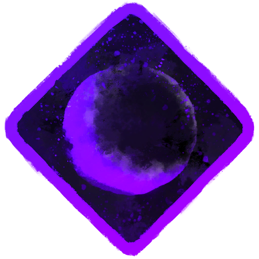
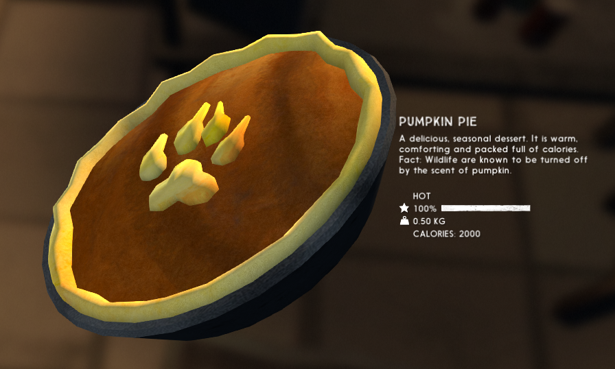

# 4 Days of Night Event

**Contents**

- [Dates](#Dates)
- [Overview](#Overview)
- [Day 1: The Quiet Dark](#Day_1%3A_The_Quiet_Dark)
- [Day 2: Howl](#Day_2%3A_Howl)
- [Day 3: A Green Fire](#Day_3%3A_A_Green_Fire)
- [Day 4: A Cold Embrace](#Day_4%3A_A_Cold_Embrace)
- [Changes from the regular mode](#Changes_from_the_regular_mode)
- [Trivia](#Trivia)
- [Gallery](#Gallery)
- [External links](#External_links)

<figure>
[Missing image: 4DON_menu_background.jpg]
<figcaption>XTHUMB The main menu background during the event</figcaption>
</figure>

<table>
<colgroup>
<col style="width: 33%" />
<col style="width: 33%" />
<col style="width: 33%" />
</colgroup>
<tbody>
<tr>
<td style="vertical-align: top; font-size: 3em; color: #5d5980; padding-right: 10px">
“
</td>
<td>
An endless night has arrived on Great Bear Island. Use your wits, and whatever you can find, to survive.

&#10;

In-game description

</td>
<td style="vertical-align: bottom; font-size: 3em; color: #5d5980; padding-left: 10px">
”
</td>
</tr>
</tbody>
</table>

**4 Days of Night**, abbreviated as **4DON**, was an annual Halloween-themed event in *<a href="./The%20Long%20Dark.md" class="wikilink" title="The Long Dark">The Long Dark</a>*.

It was discontinued in 2020 after being replaced by *<a href="./Escape%20the%20Darkwalker.md" class="wikilink" title="Escape the Darkwalker">Escape the Darkwalker</a>*, a 2 week event that was shortly turned into a standalone challenge.

## Dates

| Year | Start date          | End date            |
|------|---------------------|---------------------|
| 2016 | 28 October 10AM PST | 1 November 10AM PST |
| 2017 | 27 October 11PM PST | 31 October 11PM PST |
| 2018 | 27 October 11PM PDT | 1 November 10AM PDT |
| 2019 | 27 October 10PM PST | 1 November 10AM PDT |

## Overview

The event includes the following features:

- Perpetual darkness — the sun will not rise
- Light sources (ex. <a href="./Storm%20Lantern.md" class="wikilink" title="Storm Lantern">Storm Lantern</a>, <a href="./Flare.md" class="wikilink" title="flares">flares</a>, and <a href="./Campfire.md" class="wikilink" title="fires">fires</a>) last twice as long as usual
- <a href="./Wolf.md#%22Demon%22_Wolves" class="wikilink" title="&quot;Demon&quot; wolves">"Demon" wolves</a>
- Strategically located <a href="./Pumpkin%20Pie.md" class="wikilink" title="Pumpkin Pie">Pumpkin Pie</a> with <a href="./Warming%20Up.md" class="wikilink" title="warming">warming</a> and <a href="./Wildlife.md" class="wikilink" title="wildlife">wildlife</a> deterrent capabilities
- High-calorie value snacks in candy bowls, including 2500 calorie <a href="./Chocolate%20Bar%20%284%20Days%20of%20Night%29.md" class="wikilink" title="Candy Bars">Candy Bars</a>
- <a href="./Jack-o-Lantern.md" class="wikilink" title="Jack-o-Lanterns">Jack-o-Lanterns</a> that mark the location of rare loot and valuable loot caches
- No <a href="./Aurora.md" class="wikilink" title="Aurora">Aurora</a> (pre-2018)
- 4 unlockable <a href="./Badges.md" class="wikilink" title="Badges">Badges</a> (2018 and 2019 versions)

4 Days of Night is one of two temporary in-game events that have been hosted, along with <a href="./Winter%27s%20Embrace.md" class="wikilink" title="Winter&#39;s Embrace">Winter's Embrace</a>. In 2016, the event was introduced to the regular mode making participation was mandatory to all players as there was no way to avoid participating the event at all. As of 2016, 4 Days of Night was only available to Steam users and was not accessible on console versions of the game.

In 2017, the event was sequestered to a beta branch of the game available through the Steam client, meaning that participation is entirely optional.

Since the event is essentially a new game, all stats and settings are reset for the duration of the event. As gamma contrast have to be adjusted again, it's worth looking up the value of the setting before downloading the new content, in order to keep the darkness at the same level during the event.

4 Days of Night for 2018 has introduced new daily challenges, as well as two new badges, the Twilight Badge and Midnight Badge. Players must survive two real-time hours per day for any two days of the event to earn the Twilight Badge, and survive two real-time hours per day for all four days of the event to earn the Midnight Badge. Players could also now choose to participate in the event by selecting the mode from the main menu and was also made available for console for Playstation 4 and Xbox One.

4 Days of Night for 2019 is the same event as the previous year with updated badges.

### Day 1: The Quiet Dark

  
"*Wildlife have vanished. Use this time to explore and gather supplies for the long nights ahead. Survive at least two real-time hours to make progress towards 4DON Rewards.*"

— In-game description

### Day 2: Howl

  
"*Wolves have returned to Great Bear Island, watch out! Survive at least two real-time hours to make progress towards 4DON Rewards.*"

— In-game description

### Day 3: A Green Fire

  
"*With the Aurora in the sky, wolves are even more dangerous. Beware! Survive at least two real-time hours to make progress towards 4DON Rewards.*"

— In-game description

### Day 4: A Cold Embrace

  
"*A monster blizzard has arrived. Don't stray too far from your fire, or else! Survive at least two real-time hours to make progress towards 4DON Rewards.*"

— In-game description

## Changes from the regular mode

 During the event the player will have to explore and scavenge in the world partially submerged in darkness. The primary goals of the game are still the same but some things have been changed since the player would get stuck otherwise. This means crafting, reading and repairing are possible to do in complete darkness. The visibility limitations of fog, storms and blizzard are even more apparent in the night, but likewise a starry sky can provide almost day-like view outside. It can however be easier to sleep off a blizzard, as a regular sleeping pattern is not as important when there is same amount of light outside all day.

Only a set amount of regions are explorable during the event, with the rest being blocked off (ex, the rope to Timberwolf Mountain is missing in Pleasant Valley). Only Coastal Highway, Pleasant Valley, Mystery Lake, Winding River, Cinder Hills Coal Mine, and The Ravine are explorable, but Jack o' lanterns only spawn in the first 3 regions.

There appears to be a slight increase to the amount of <a href="./Lantern%20Fuel.md" class="wikilink" title="lantern fuel">lantern fuel</a> and <a href="./Jerry%20Can.md" class="wikilink" title="jerry cans">jerry cans</a> spawning in houses.

Outside some houses, small bowls containing a mix of 3-4 <a href="./Chocolate%20Bar.md" class="wikilink" title="candy bars">candy bars</a> and <a href="./Energy%20Bar.md" class="wikilink" title="energy bars">energy bars</a> can be found. During the event, the candy bar has its calorie value raised to 2500, although the energy bar still only provides 500 calories.

The in game clock in the top right on the HUD does not move from midnight during the event, but rather switches between early night (the moon is placed in the left side) and late night (the moon is placed in the right side).

## Trivia

- Since the sun never rises, items such as <a href="./Magnifying%20Lens.md" class="wikilink" title="magnifying lens">magnifying lens</a>, among others, are essentially useless.
- A discrepancy was created with the 2018 version, with the Pumpkin Pie being made available on Day 4 with a description that it will ward off wildlife, despite Day 4 featuring a blizzard and therefore containing no wildlife whatsoever.

## Gallery

<table class="gallery">
<colgroup>
<col style="width: 25%" />
<col style="width: 25%" />
<col style="width: 25%" />
<col style="width: 25%" />
</colgroup>
<tbody>
<tr>
<td><figure>

<figcaption>Midnight Badge.</figcaption>
</figure></td>
<td><figure>

<figcaption>Twilight Badge.</figcaption>
</figure></td>
<td><figure>

<figcaption>2019 version</figcaption>
</figure></td>
<td><figure>

<figcaption>2019 version</figcaption>
</figure></td>
</tr>
<tr>
<td><figure>

<figcaption>The_Long_Dark_--_4_Days_of_Night_2018_(Halloween_Event)</figcaption>
</figure></td>
<td><figure>

<figcaption>The_Long_Dark_-_4_Days_of_Night_(Halloween_Event)</figcaption>
</figure></td>
<td><figure>

<figcaption>Pumpkin Cache from Coastal Highway.</figcaption>
</figure></td>
<td><figure>

<figcaption>A skull in a Fishing Hut from Coastal Highway.</figcaption>
</figure></td>
</tr>
<tr>
<td><figure>
[Missing image: CandyBowl.jpg]
<figcaption>Candy bowl outside Pleasant Valley Barn.</figcaption>
</figure></td>
<td><figure>
[Missing image: Nutsnstuff.jpg]
<figcaption>The Candy Bar provides 10x the amount of calories during the event.</figcaption>
</figure></td>
<td><figure>

<figcaption>Pumpkin pie, one of the unique items available during the event</figcaption>
</figure></td>
<td><figure>
[Missing image: PVPumpkin.jpg]
<figcaption>Pumpkin Pie spawn inside Pleasant Valley Farmstead.</figcaption>
</figure></td>
</tr>
<tr>
<td><figure>
[Missing image: Wolf_demon2.jpg]
<figcaption>A 'Demon' wolf approaching.</figcaption>
</figure></td>
<td><figure>
[Missing image: 4DON_titlecard.jpg]
<figcaption>4DON_titlecard.jpg</figcaption>
</figure></td>
<td><figure>

<figcaption>Four_Days_Of_Night_2018.png</figcaption>
</figure></td>
<td></td>
</tr>
</tbody>
</table>

## External links

- [2016 4 Days of Night announcement](http://www.hinterlandforums.com/forums/topic/13145-the-long-dark-event-%E2%80%94-4-days-of-night/?tab=comments#comment-84904)
- [2017 4 Days of Night announcement](http://www.thelongdark.com/news/four-days-of-night-in-the-long-dark-a-halloween-event/)
- [2018 4 Days of Night announcement](http://www.thelongdark.com/news/4-days-of-night-2018/)

**Lua execution error in Module:Navbox function navbox**<a href="ru:4_Days_fo_Night" class="wikilink" title="ru:4 Days fo Night">ru:4 Days fo Night</a>

