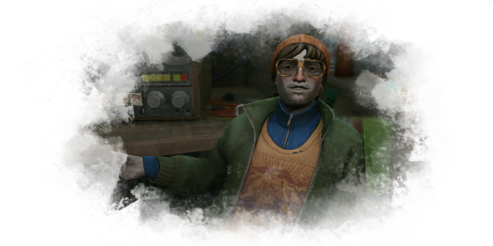

# A Cry For Help

**A Cry For Help**

| Property | Details |
| --- | --- |
|  |  / *Missions\_story\_ep5\_ACryforHelp.png* |
| Episode |  |
| **Missions** |  |
| Previous | [Perseverance](./Perseverance.md) |
| Current | A Cry For Help |
| Next | [The Cold, Broken Road](./The%20Cold%2C%20Broken%20Road.md) |
| Region | [Perseverance Mills](./Perseverance%20Mills.md) [Desperation Bay](./Desperation%20Bay.md) |
| Characters | [Astrid Greenwood](./Astrid%20Greenwood.md) / [Jane Yang](./Jane%20Yang.md) / [Terry](./Terry.md) |

> “**Investigate the strange transmission Terry intercepted.**”

**A Cry For Help** is the third mission of Part One: Perseverance in [Episode 5: The Light At The End Of All Things](./Episode%205%20-%20The%20Light%20At%20The%20End%20Of%20All%20Things.md) of the [Wintermute](./Wintermute.md) story of [*The Long Dark*](./The%20Long%20Dark.md).

## Objectives

- Go to the radio hut to look for Terry.
- Find the way to Desperation Bay.
- Investigate the ship.

## Walkthrough

## Trivia

**Lua execution error in Module:Navbox function navbox**
