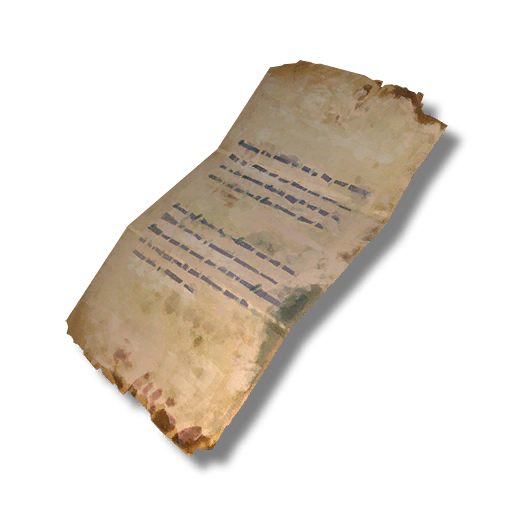

# A Handwritten Letter

<table class="infobox">
<caption>A Handwritten Letter</caption>
<colgroup>
<col style="width: 50%" />
<col style="width: 50%" />
</colgroup>
<tbody>
<tr>
<td colspan="2"><figure>

<figcaption>A_Handwritten_Letter_icon.png</figcaption>
</figure></td>
</tr>
<tr>
<td>
Release
</td>
<td>
<a href="./The%20Long%20Dark%20%E2%80%94%20Changelog.md#2.52" class="wikilink" title="31 March 2026">31 March 2026</a>
</td>
</tr>
<tr>
<td>
Wintermute
</td>
<td>
<a href="./Episode%205%20-%20The%20Light%20At%20The%20End%20Of%20All%20Things.md" class="wikilink" title="Episode 5: The Light At The End Of All Things">Episode 5: The Light At The End Of All Things</a>
</td>
</tr>
<tr>
<td colspan="2" class="section">
<strong>Properties</strong>
</td>
</tr>
<tr>
<td>
Item type
</td>
<td>
<a href="./Collectibles.md" class="wikilink" title="Collectibles">Collectibles</a>|-
</td>
</tr>
<tr>
<td>
Stackable
</td>
<td>
No
</td>
</tr>
<tr>
<td>
Examine
</td>
<td>
A letter addressed to the Constable
</td>
</tr>
<tr>
<td colspan="2" class="section">
<strong>Values</strong>
</td>
</tr>
<tr>
<td>
Weight
</td>
<td>
0.00 kg (0 lbs)
</td>
</tr>
<tr>
<td colspan="2" class="section">
<strong>Actions</strong>
</td>
</tr>
<tr>
<td>
Backpack
</td>
<td>
Examine
</td>
</tr>
<tr>
<td>
On ground
</td>
<td>
Take It, Read Text, Leave It
</td>
</tr>
</tbody>
</table>

**A Handwritten Letter** is a <a href="./Collectibles.md" class="wikilink" title="Collectibles">Collectibles</a> found in <a href="./Episode%205%20-%20The%20Light%20At%20The%20End%20Of%20All%20Things.md" class="wikilink" title="Episode 5">Episode 5</a> of the <a href="./Wintermute.md" class="wikilink" title="Wintermute">Wintermute</a> story. It is found inside the <a href="./Constable%27s%20Office.md" class="wikilink" title="Constable&#39;s Office">Constable's Office</a> during the main mission <a href="./Perseverance.md" class="wikilink" title="Perseverance">Perseverance</a>. It is on the floor to the front door, likely slipped under the door.

## Transcript

The following text is transcribed from **A Handwritten Letter**

Dear Constable Pete,\
Please find me when you can. My husband Martin has gone missing.

It happened last Friday. I woke up and he was gone. The front door was wide open, snow all over the carpet. And he didn't even take his coat! It's not like him to leave without saying anything. But he's be (sic) sleep-walking these past few weeks.

I hope you find this note very soon. Please contact me when you're back.

Jen

## Update history

\* UPDATE **31 March 2026 (<a href="./The%20Long%20Dark%20%E2%80%94%20Changelog.md#2.52" class="wikilink" title="Update">Update</a>):**

- - Added to game.

**Lua execution error in Module:Navbox function navbox**

