# A Riddle Among the Shadows

**Source:** [Fandom](https://thelongdark.fandom.com/wiki/A_Riddle_Among_the_Shadows)

**Contents**

- [Objectives](#objectives)
- [Walkthrough](#walkthrough)
- [Clue 2](#clue-2)
- [Clue 3](#clue-3)
- [Combination](#combination)
- [12-07-18](#12-07-18)
- [Notes](#notes)
- [Transcript](#transcript)

**A Riddle Among the Shadows**

| Property | Details |
| --- | --- |
|  | 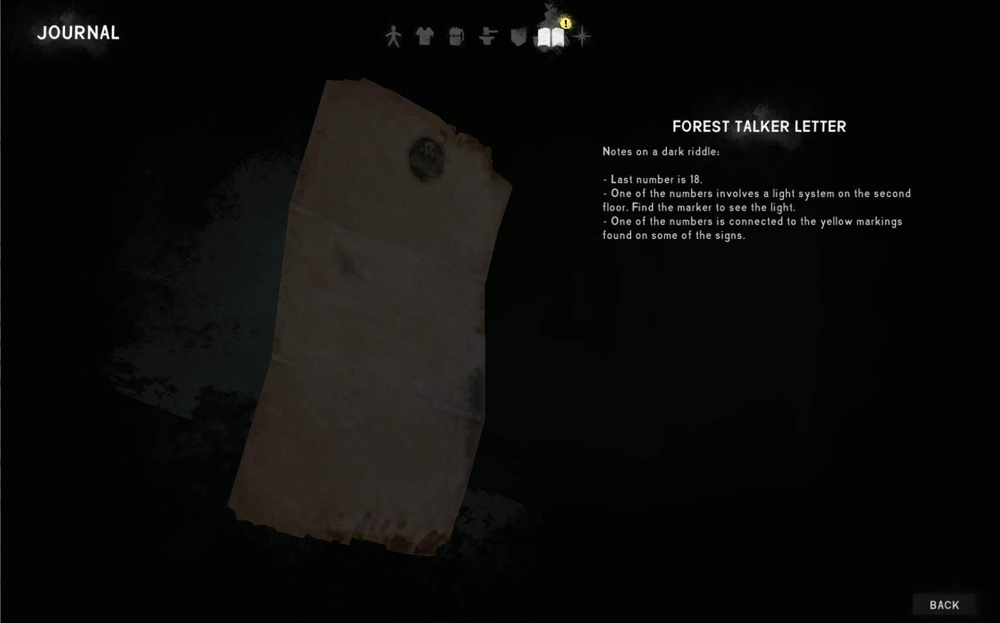 / _Forest\_Talker\_Letter.jpg_ |
| Episode |  |
| **Missions** |  |
| Current | A Riddle Among the Shadows |
| Region | [Blackrock](./Blackrock.md) |

This quest corresponds to a cache locked behind a combination lock found on Floor 1 of the [Last Prospect](./Last%20Prospect.md) mine near the entrance and near a [Receiver](./Receiver.md). The quest begins after picking up all 3 Forest Talker notes in the mine. You will get a document called "[Forest Talker Letter](./Forest%20Talker%20Letter.md)."

## Objectives

- Look for clues to open the locked cache. \[0/3\]
- Solve the riddles and unlock the cache padlock.

## Walkthrough

It has 3 clues:

- Last number is 18
- One of the numbers involves a light system on the second floor. Find the Marker to see the light
- One of the numbers is connected to the yellow markings found on some of the signs

### Clue 2

Clue two is found on floor 2, in the area where there's a bed and 3 lockers. It's up on a wooden rampart with a corpse and a marked X on the floor. By standing on the floor, you see a light flash in the distance. By counting the number flashes, you will get the second number

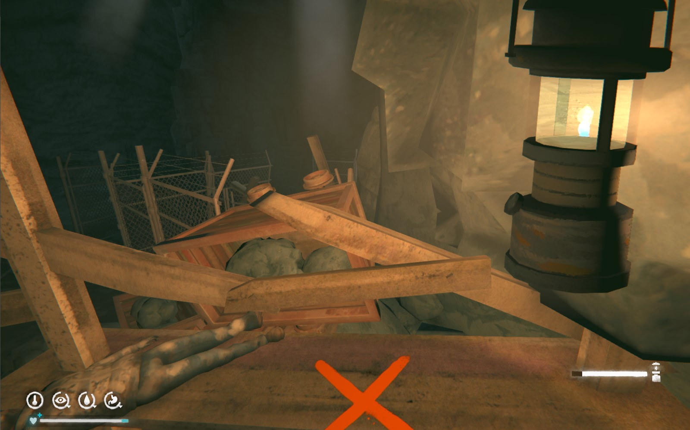

_riddle among shadows - clue 2_

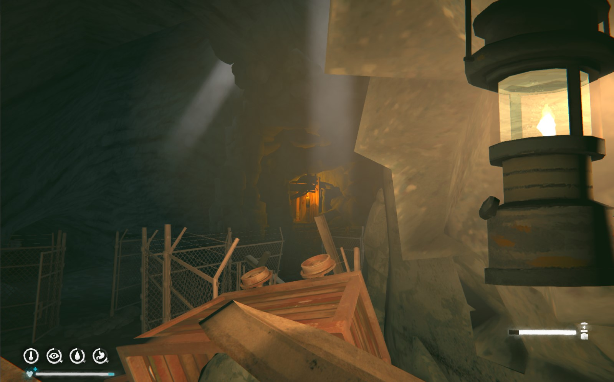

_riddle among shadows - clue 2 flash_

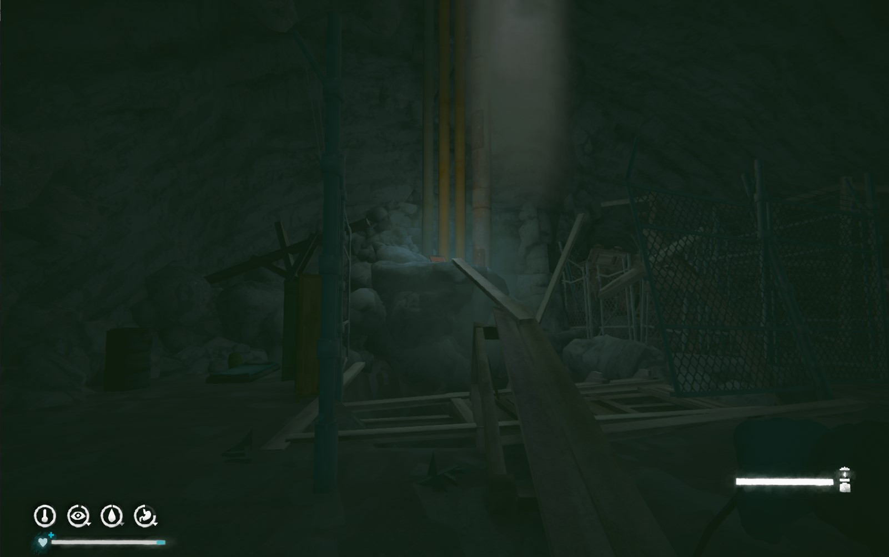

_mines floor 2 - main room_

#### Clue 3

Clue three is found on 5-6 signs on the 2nd and 1st floors. Presumably you've grabbed the detonators on floor 2 near the area with the bed and 3 lockers. Grabbing the detonators allows you to use the bolt cutters to cut the chain lock on the fence door nearby. Grab all the items you want to bring with you from the mine. Cut the chain. Then proceed towards the exit. You will find a series of signs, each with a letter marked off with an X. After noting the signs on floor two, take the elevator and go to floor 1. Continuing on you want to follow the exit signs. When you assemble the crossed out letters they spell out the first number.

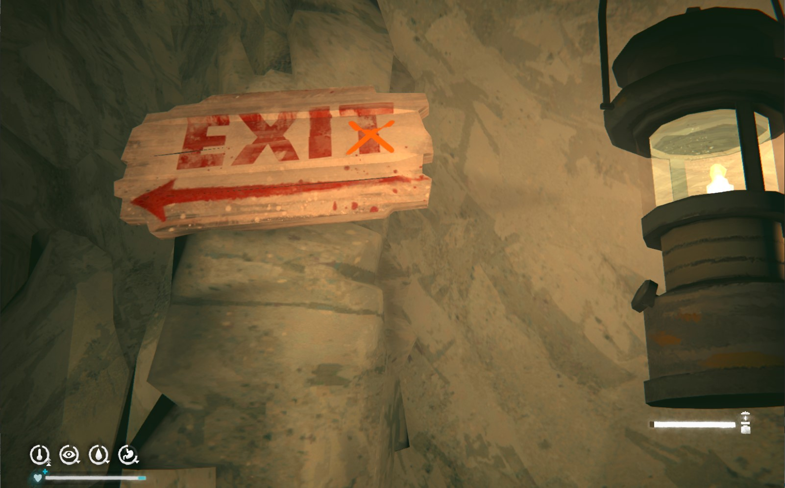

_yellow marking 1_

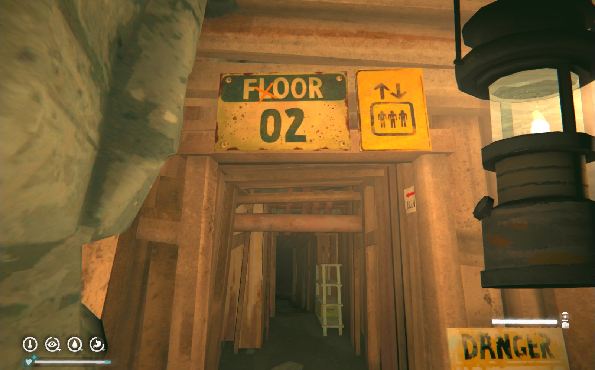

_yellow marking 2_

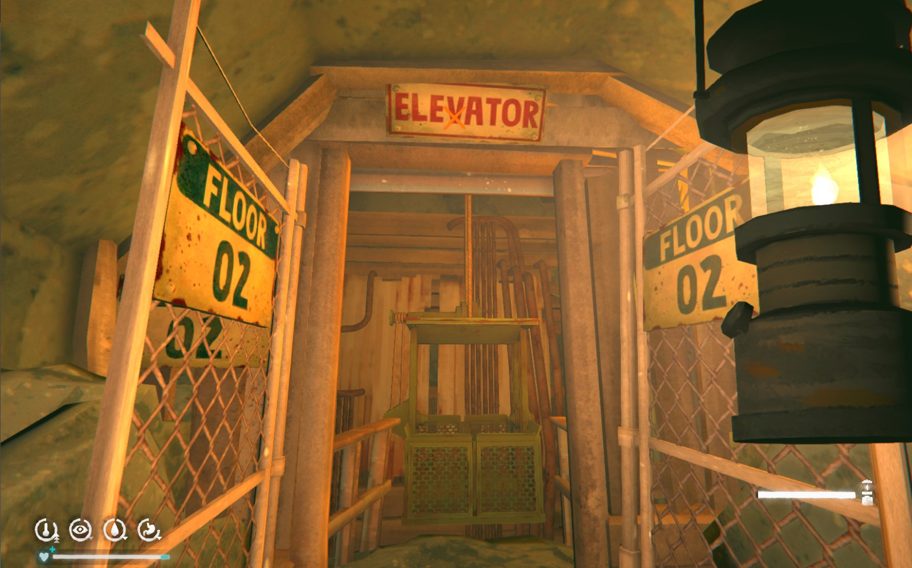

_yellow marking 3_

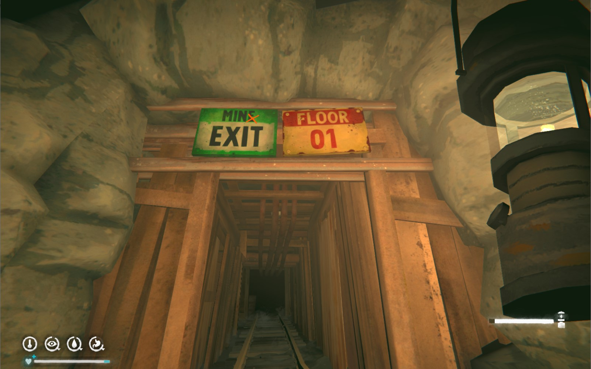

_yellow marking 4_

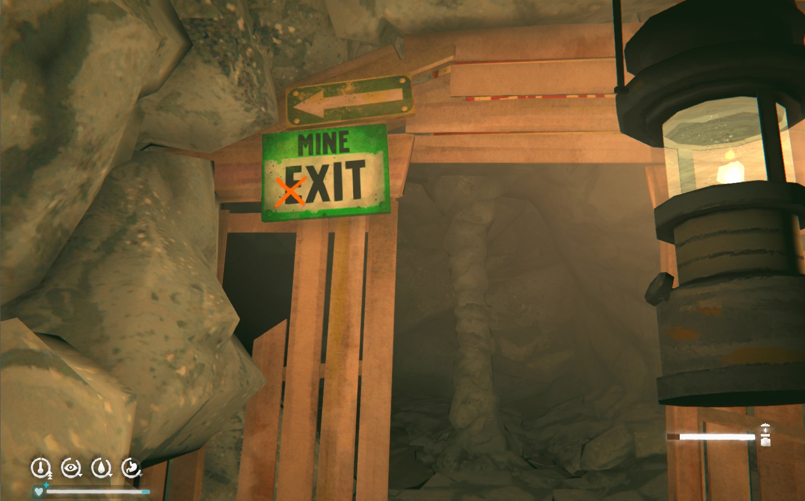

_yellow marking 5_

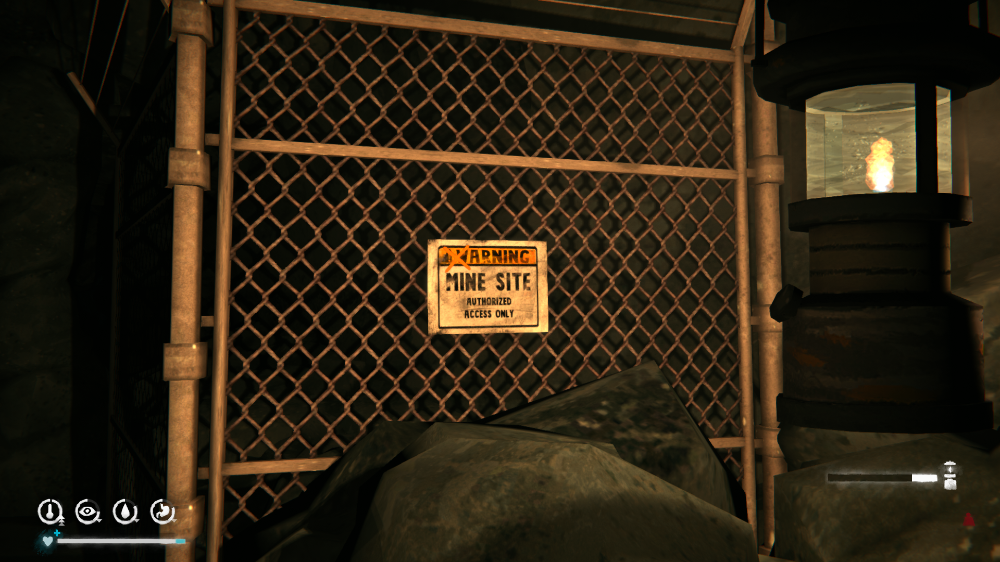

_yellow marking 6_

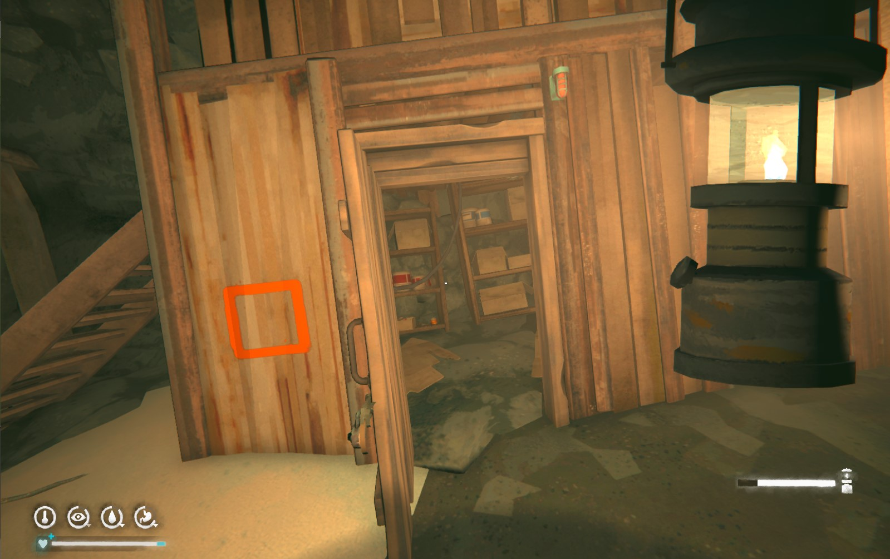

_supply cache_

#### Combination

Eventually you will reach the area with the phone and it will ring. Walking past it you will see a wooden structure with a square marked on its face. This is the door with the combination lock. Put in the combination to unlock the cache.

##### 12-07-18

## Notes

Once you find all of the notes, you can pick the lock without knowing the combination, similar to opening a [safe](./Safe.md).

## Transcript

_When Mackenzie picks up the first note_

Mackenzie: "I see..."

_When Mackenzie picks up the second note_

Mackenzie: "What next?"

_When Mackenzie picks up the third note_

Mackenzie: "Finally."

_If the player walks over to the X near the [Bolt Cutters](./Bolt%20Cutters.md), a lantern flashes in the distance giving a hint_
