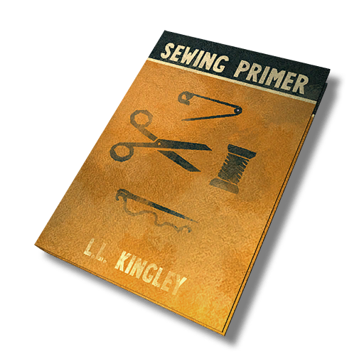

# A Sewing Primer \(The Basics of Survival\)

  
*For the version encountered in <a href="./Survival%20Mode.md" class="wikilink" title="Survival Mode">Survival Mode</a>, see <a href="./A%20Sewing%20Primer.md" class="wikilink" title="A Sewing Primer">A Sewing Primer</a>.*

<table class="infobox">
<caption>A Sewing Primer</caption>
<colgroup>
<col style="width: 50%" />
<col style="width: 50%" />
</colgroup>
<tbody>
<tr>
<td colspan="2"><figure>

<figcaption>A_Sewing_Primer_icon.png</figcaption>
</figure></td>
</tr>
<tr>
<td>
Release
</td>
<td>
<a href="./The%20Long%20Dark%20%E2%80%94%20Early%20Access%20Changelog.md#1.00" class="wikilink" title="1 August 2017">1 August 2017</a>
</td>
</tr>
<tr>
<td>
Wintermute
</td>
<td>
<a href="./Episode%201%20-%20Do%20Not%20Go%20Gentle.md" class="wikilink" title="Episode 1">Episode 1</a> - <a href="./The%20Basics%20of%20Survival.md" class="wikilink" title="The Basics of Survival">The Basics of Survival</a>
</td>
</tr>
<tr>
<td colspan="2" class="section">
<strong>Properties</strong>
</td>
</tr>
<tr>
<td>
Item type
</td>
<td>
<a href="./Collectibles.md" class="wikilink" title="Collectibles">Collectibles</a>|-
</td>
</tr>
<tr>
<td>
Stackable
</td>
<td>
No
</td>
</tr>
<tr>
<td>
Examine
</td>
<td>
Everything you ever wanted to know about maintaining your clothing.
</td>
</tr>
<tr>
<td colspan="2" class="section">
<strong>Values</strong>
</td>
</tr>
<tr>
<td>
Weight
</td>
<td>
0.00 kg (0 lbs)
</td>
</tr>
<tr>
<td colspan="2" class="section">
<strong>Actions</strong>
</td>
</tr>
<tr>
<td>
Backpack
</td>
<td>
Examine
</td>
</tr>
<tr>
<td>
On ground
</td>
<td>
Take It, Leave It
</td>
</tr>
<tr>
<td colspan="2" class="section">
<strong>Advanced data</strong>
</td>
</tr>
<tr>
<td>
Item key
</td>
<td>
GAMEPLAY_BookMending
</td>
</tr>
</tbody>
</table>

**A Sewing Primer** is a <a href="./Collectibles.md" class="wikilink" title="Collectible">Collectible</a> item found in <a href="./Episode%201%20-%20Do%20Not%20Go%20Gentle.md" class="wikilink" title="Episode 1">Episode 1</a> of the <a href="./Wintermute.md" class="wikilink" title="Wintermute">Wintermute</a> story mode to start the <a href="./The%20Basics%20of%20Survival.md" class="wikilink" title="The Basics of Survival">The Basics of Survival</a> side mission.

During the course of the mission, the surivor finds the book *A Sewing Primer* from the second floor of <a href="./Milton%20House%20%28Grey%20Mother%27s%29.md" class="wikilink" title="Milton House (Grey Mother&#39;s)">Milton House (Grey Mother's)</a> in <a href="./Milton.md" class="wikilink" title="Milton">Milton</a>, and are tasked to repair clothing items.

## Update history

- UPDATE **17 December 2018 (<a href="./The%20Long%20Dark%20%E2%80%94%20Changelog.md#1.41" class="wikilink" title="Update">Update</a>):**
  - Added to game.

**Lua execution error in Module:Navbox function navbox**

