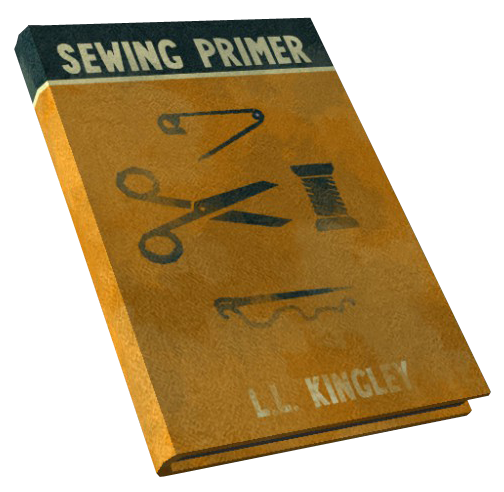

# A Sewing Primer

**Categories:** Fire Starting, Pages with update history, Tools · **Source:** [Fandom](https://thelongdark.fandom.com/wiki/A_Sewing_Primer)

**Contents**

- [Research](#research)
- [Fire Starting](#fire-starting)
- [Location](#location)
- [Coastal Highway](#coastal-highway)
- [Desolation Point](#desolation-point)
- [Forlorn Muskeg](#forlorn-muskeg)
- [Hushed River Valley](#hushed-river-valley)
- [Mountain Town](#mountain-town)
- [Mystery Lake](#mystery-lake)
- [Pleasant Valley](#pleasant-valley)
- [Trivia](#trivia)
- [Gallery](#gallery)
- [Update history](#update-history)

**A Sewing Primer**

[A Sewing Primer icon](../assets/A_Sewing_Primer_icon.png)

**Release:** [23 September 2016](./The%20Long%20Dark%20%E2%80%94%20Early%20Access%20Changelog.md#0.364)

**Wintermute:** No

**Properties**

**Item type:** [Fire Starting](./Fire%20Starting.md)[Tools](./Tools.md)

**Stackable:** No

**Examine:** Everything you ever wanted to know about maintaining your clothing. Researching it will improve your Mending Skill.

**Values**

**Weight:** 0.50 kg (1.1 lbs)

**Actions**

**Backpack:** Research, Drop

_For the version encountered in [Wintermute](./Wintermute.md), see [A Sewing Primer (The Basics of Survival)](./A%20Sewing%20Primer%20%28The%20Basics%20of%20Survival%29.md)._

**A Sewing Primer** is a [Research Book](./Research%20Book.md) used to improve the [Mending](./Mending.md) skill. It can also be used as Fuel when starting a [Fire](./Fire.md).

## Research

_A Sewing Primer_ can be researched for 5 hours that can be broken into multiple 1-hour minimum research sessions. 10 [Mending skill points](./Mending.md#Skill_levels) are awarded on completing the research. By selecting the Settled Mind [Feat](./Feats.md), research time will be reduced by 20%, putting it at 4 hours.

Research can only be performed under the following conditions:

- There is light present to read
- [Warmth](./Warmth.md), [Fatigue](./Fatigue.md), [Thirst](./Thirst.md), and [Hunger](./Hunger.md) exceed 0%
- No negative [Afflictions](./Afflictions.md)

If the player's fatigue, thirst or hunger meters go down to zero or if the environment becomes dark during a research session, the session will be terminated instantly. The hour of research that was in progress will not be completed and any time that had already been spent will be wasted. For a multiple-hour research session, only the incomplete hour will be lost, all the previous hours will still count towards completion of the book.

## Fire Starting

**A Sewing Primer**

**Type:** Fuel

**Statistics**

**Duration:** [Fire Starting](../assets/Fire_Starting.png) 18 minutes

**Start Chance:** [Firestart mod icon](../assets/Firestart_mod_icon.png) +35%

**Heat:** [Fire heat icon](../assets/Fire_heat_icon.png) +2°C (+3.6°F)

**Burn Density:** 0.6 hr/kg (0.27 hr/lb)

## Location

#### Coastal Highway

- Car parked in front of the house north west of [Coastal Townsite](./Coastal%20Townsite.md)

#### Desolation Point

- [Stone Church](./Stone%20Church.md)
- [The Riken](./The%20Riken.md)
- [Lonely Lighthouse](./Lonely%20Lighthouse.md)

#### Forlorn Muskeg

- Beside a backpack under the small, open overhang hay barn east of the [Forge](./Forge.md) at the [Old Spence Family Homestead](./Old%20Spence%20Family%20Homestead.md)

#### Hushed River Valley

- Inside the cave at [Monolith Lake](./Monolith%20Lake.md)

#### Mountain Town

- [Milton Post Office](./Milton%20Post%20Office.md)

#### Mystery Lake

- [Lookout](./Lookout%20%28Mystery%20Lake%20location%29.md)

#### Pleasant Valley

- [Rural Store](./Rural%20Store.md)
- [Skeeter's Ridge](./Skeeter%27s%20Ridge.md)
- Inside the car on [Heartbreak Bridge](./Heartbreak%20Bridge.md)

_A Sewing Primer_ is also a possible loot item of the [Cargo Containers](./Cargo%20Container.md) in [Timberwolf Mountain](./Timberwolf%20Mountain.md)

## Trivia

- Attempting to burn a copy of _A Sewing Primer_ when it has not been fully read will give a confirmation warning before it can be burned.
- Once a copy of _A Sewing Primer_ (or any research book) is fully researched, it will no longer appear in the Tools section of the Backpack.

## Gallery

## Update history

- UPDATE **23 September 2016 ([Update](./The%20Long%20Dark%20%E2%80%94%20Early%20Access%20Changelog.md#0.364)):**
  - Added to game.
