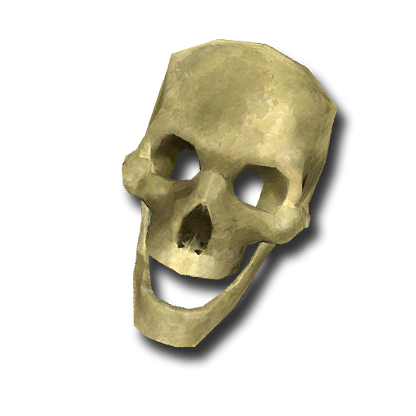

# A Skeleton And Note

<table>
<colgroup>
<col style="width: 33%" />
<col style="width: 33%" />
<col style="width: 33%" />
</colgroup>
<tbody>
<tr>
<td width="40px"><figure>
[Missing image: Ptarmigan_icon.png]
<figcaption>Ptarmigan_icon.png</figcaption>
</figure></td>
<td>
<strong>DLC-Exclusive content.</strong> 

This content requires the <a href="./Tales%20from%20the%20Far%20Territory.md" class="wikilink" title="Tales from the Far Territory">Tales from the Far Territory</a> addon to be installed before it can be seen or used in regular gameplay.

</td>
<td>
|}

<table class="infobox">
<caption>A Skeleton And Note</caption>
<colgroup>
<col style="width: 50%" />
<col style="width: 50%" />
</colgroup>
<tbody>
<tr>
<td colspan="2"><figure>

<figcaption>A_Skeleton_And_Note_icon.png</figcaption>
</figure></td>
</tr>
<tr>
<td>
Release
</td>
<td>
<a href="./The%20Long%20Dark%20%E2%80%94%20Changelog.md#2.33" class="wikilink" title="2 December 2024">2 December 2024</a>
</td>
</tr>
<tr>
<td>
Wintermute
</td>
<td>
No
</td>
</tr>
<tr>
<td colspan="2" class="section">
<strong>Properties</strong>
</td>
</tr>
<tr>
<td>
Item type
</td>
<td>
<a href="./Tools.md" class="wikilink" title="Tools">Tools</a>|-
</td>
</tr>
<tr>
<td>
Stackable
</td>
<td>
No
</td>
</tr>
<tr>
<td>
Examine
</td>
<td>
Human remains resting on a scrap of paper. Some of the bones appear burnt.
</td>
</tr>
<tr>
<td colspan="2" class="section">
<strong>Values</strong>
</td>
</tr>
<tr>
<td>
Weight
</td>
<td>
0.00 kg (0 lbs)
</td>
</tr>
</tbody>
</table>

<strong>A Skeleton And Note</strong> is an item found during <a href="./Sutherland%27s%20Tale.md" class="wikilink" title="Sutherland&#39;s Tale">Sutherland's Tale</a>.

<h2 id="Overview">Overview</h2>

It is found in a walled up room in the <a href="./Prepper%27s%20Abandoned%20Cache.md" class="wikilink" title="Prepper&#39;s Abandoned Cache">Prepper's Abandoned Cache</a> and comes with <a href="./Sutherland%27s%20Note.md" class="wikilink" title="Sutherland&#39;s Note">Sutherland's Note</a>. It must be placed in the <a href="./Trade%20Drop%20Box.md" class="wikilink" title="Trade Drop Box">Trade Drop Box</a> as the 4th Special Request to Sutherland to advance his questline.

It cannot be dropped or placed in a container, so it cannot be lost.

<h2 id="Update_History">Update History</h2>

<strong>Template:update historyLua execution error in Module:Navbox function navbox</strong>

<a href="ru:%D0%A1%D0%BA%D0%B5%D0%BB%D0%B5%D1%82_%D0%B8_%D0%B7%D0%B0%D0%BF%D0%B8%D1%81%D0%BA%D0%B0" class="wikilink" title="ru:Скелет и записка">ru:Скелет и записка</a>
</td>
</tr>
</tbody>
</table>

