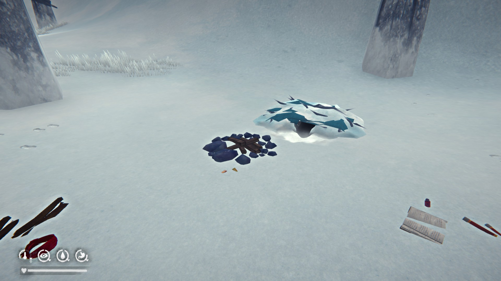
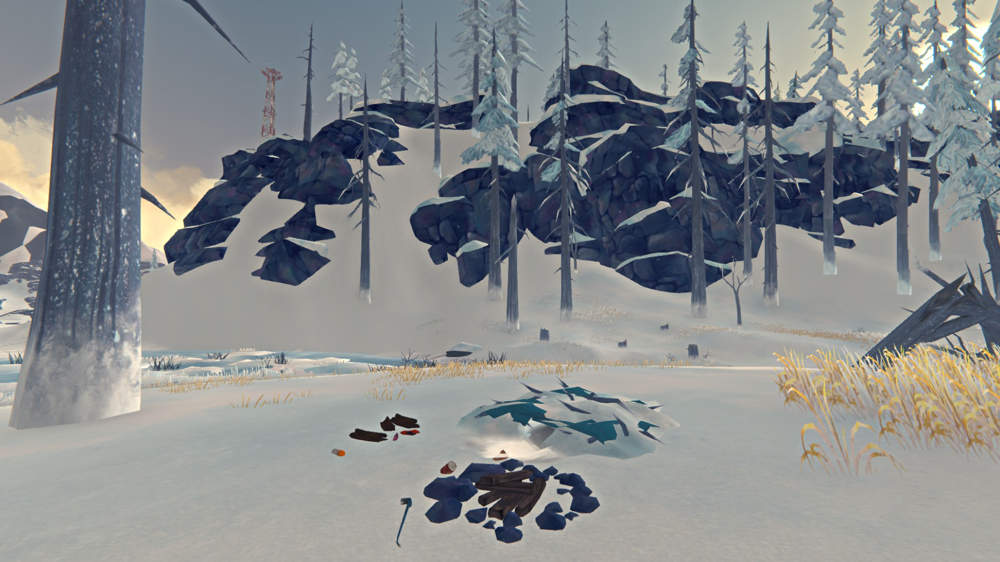
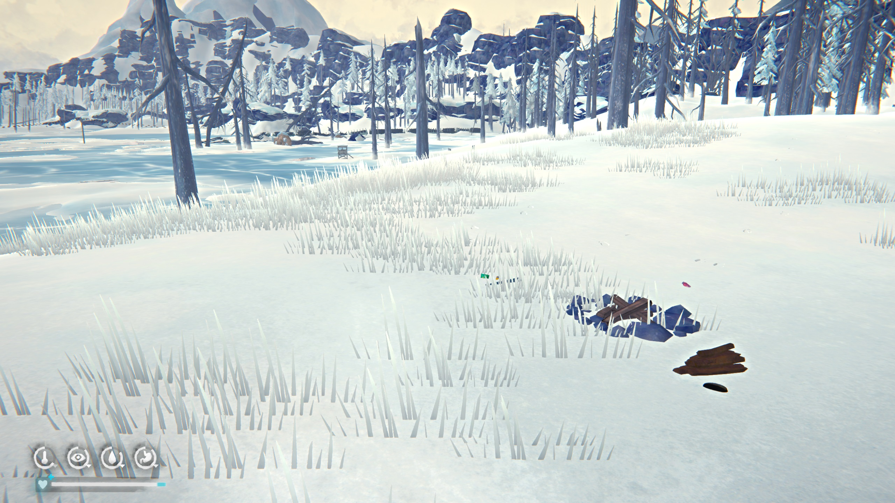

# Abandoned Camp

**Categories:** Locations, Locations in Forlorn Muskeg, Outdoor locations, Sheltered locations · **Source:** [Fandom](https://thelongdark.fandom.com/wiki/Abandoned_Camp)

**Abandoned Camp**

[Abandoned camp](../assets/Abandoned_camp.jpg)

**Location**

[Abandoned Camp Location](../assets/Abandoned_Camp_Location.png)

**Region:** [Forlorn Muskeg](./Forlorn%20Muskeg.md)

**Type:** Outdoors

## Overview

The camp consists of a [Snow Shelter](./Snow%20Shelter.md) and some loot. This location has more 4 potential spawn locations and will only spawn once in the region.

### Spawn

The four possible spawn locations for the snow shelter are:

- North-west of [Low Blind](./Low%20Blind.md) , Go straight down the stairs of the Low Blind.
- North-east of [Low Blind](./Low%20Blind.md) , West of the [Hat Creek](./Hat%20Creek.md).
- North-east of [High Blind](./High%20Blind.md) , Below the cliff on the north side of the hill where the [Muskeg Overlook](./Muskeg%20Overlook.md) is located.
- South-east of [High Blind](./High%20Blind.md) , North side from the cave connected to the [Bleak Inlet](./Bleak%20Inlet.md) .

North-east of [Low Blind](./Low%20Blind.md)

