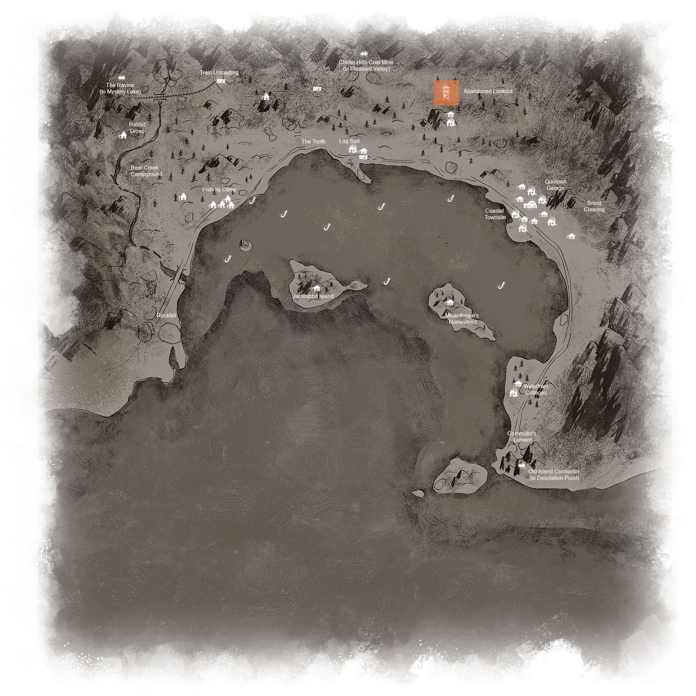

# Abandoned Lookout

**Categories:** Locations, Locations in Coastal Highway, Lookout towers, Military/Sporting locations, Sheltered locations · **Source:** [Fandom](https://thelongdark.fandom.com/wiki/Abandoned_Lookout)

**Contents**

- [Overview](#overview)
- [Furnishings](#furnishings)
- [Possible Loot](#possible-loot)
- [Safehouse](#safehouse)
- [Notes](#notes)
- [Gallery](#gallery)

**Abandoned Lookout**

_new\_forestry\_lookout.jpg_

**Location**

_Abandoned\_Lookout\_map.png_

**Region:** [Coastal Highway](./Coastal%20Highway.md)

**Description:** A fire lookout tower

**General**

**Type:** Military/Sporting

_bed\_icon.png_

Has a bed
