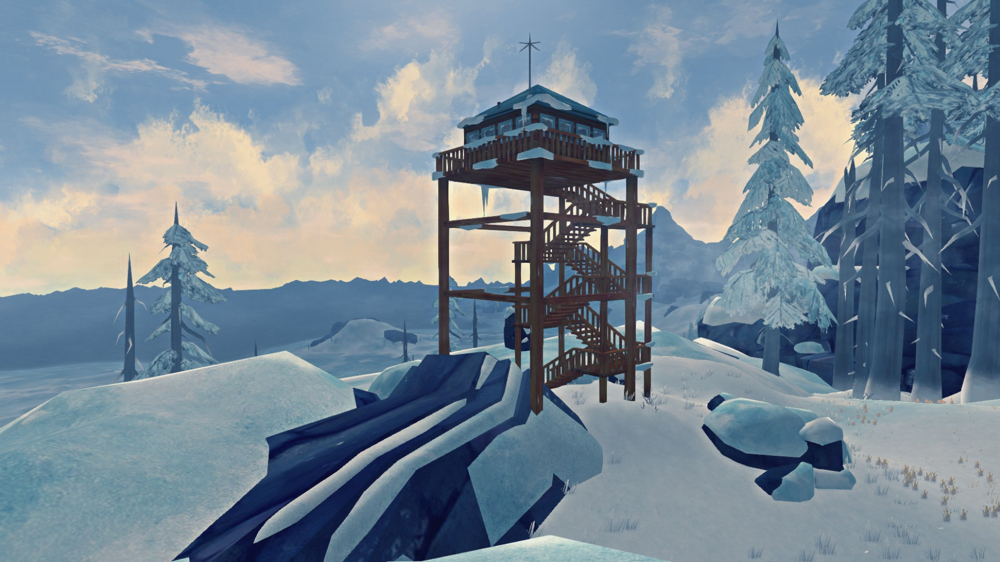
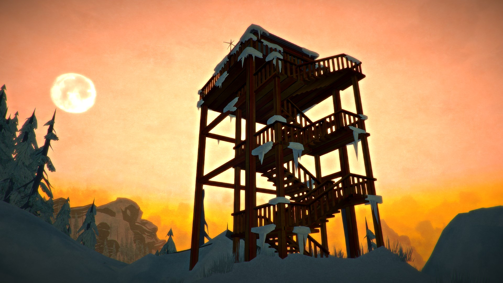
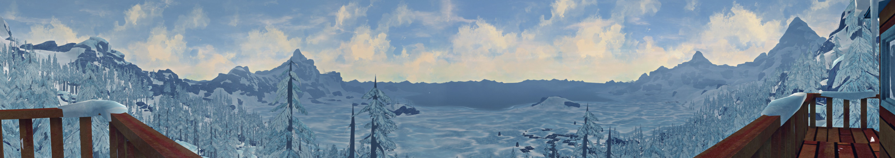
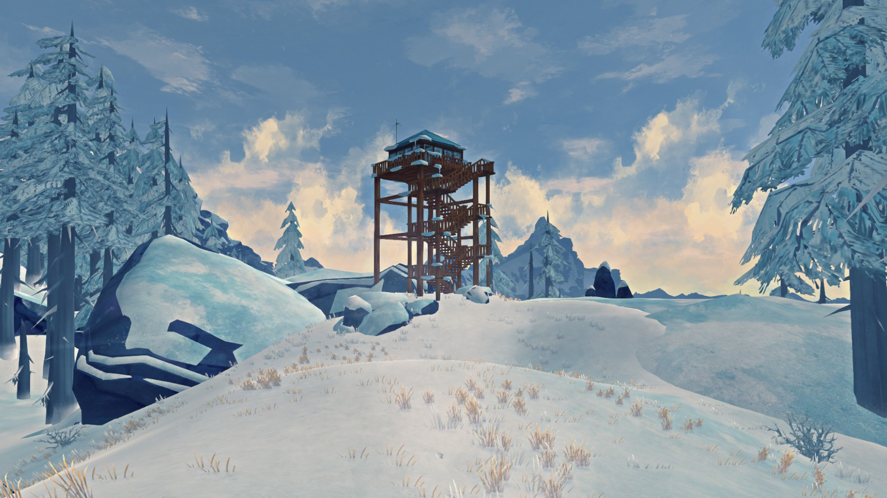
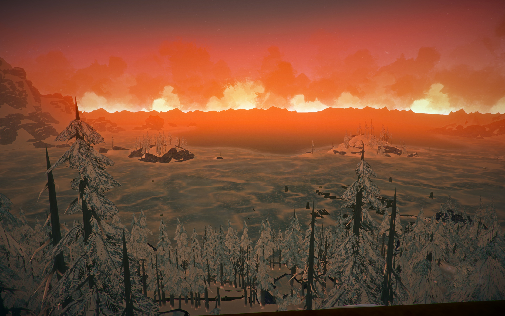

# Abandoned Lookout

**Categories:** Locations, Locations in Coastal Highway, Lookout towers, Military/Sporting locations, Sheltered locations · **Source:** [Fandom](https://thelongdark.fandom.com/wiki/Abandoned_Lookout)

**Contents**

- [Overview](#overview)
- [Furnishings](#furnishings)
- [Possible Loot](#possible-loot)
- [Safehouse](#safehouse)
- [Notes](#notes)
- [Gallery](#gallery)

**Abandoned Lookout**

**Location**

**Region:** [Coastal Highway](./Coastal%20Highway.md)

**Description:** A fire lookout tower

**General**

**Type:** Military/Sporting

Has a bed

Provides some shelter **Abandoned Lookout** is small, abandoned lookout tower located to the north in [Coastal Highway](./Coastal%20Highway.md).

## Overview

Abandoned Lookout is a tower that sits on a hill to the far north-west of the [Coastal Townsite](./Coastal%20Townsite.md) and north-east of [Log Sort](./Log%20Sort.md). The Abandoned Lookout is situated very close to the [Cinder Hills Coal Mine](./Cinder%20Hills%20Coal%20Mine.md) transition area for [Pleasant Valley](./Pleasant%20Valley.md). This makes it a stop for almost anyone heading to Pleasant Valley. The lookout is much more sparsely decorated compared to the [Forestry Lookout](./Forestry%20Lookout.md) in [Mystery Lake](./Mystery%20Lake%20%28region%29.md).

It's possible to deploy a [Mountaineering Rope](./Mountaineering%20Rope.md) from the embankment on the south side of the lookout.

## Furnishings

Abandoned Lookout contains the following:

- [Pot Belly Stove](./Pot%20Belly%20Stove.md)
- Bed
- Cabinet
- Shelf

## Possible Loot

Abandoned Lookout has less loot than many of the other buildings.

- [Hunting Rifle](./Hunting%20Rifle.md)
- [Hunting Knife](./Hunting%20Knife.md)
- [Mountaineering Rope](./Mountaineering%20Rope.md)
- [Reclaimed Wood](./Reclaimed%20Wood.md)
- Various [food and drink](./Food%20And%20Drink.md) items
- [Firearm Cleaning Kit](./Firearm%20Cleaning%20Kit.md)
- [Magnifying Lens](./Magnifying%20Lens.md)
- [Whetstone](./Whetstone.md)

## Safehouse

While it can be a useful camp, Abandoned Lookout generally makes a poor base. It lacks the luxury of having many storage containers, which is a problem for anyone looking to survive for a long period of time. It also lacks a [Work Bench](./Work%20Bench.md), and is very far from any buildings to scavenge from. It also does not have many renewable sources of food (i.e., game or fish), fuel, or medicinal flora close by.

The [Quonset Garage](./Quonset%20Garage.md) and [Jackrabbit Island](./Jackrabbit%20Island.md) make for much more suitable safehouses.

## Notes

- Unlike other houses and non-destroyed structures, entering Abandoned Lookout does not cause a loading screen to appear. Instead, the when the door is opened, the player may walk inside, with no change of scene. This allows the player to see through the windows outside, as well as a quick way to enter and exit the safety of a home.
- Because of the many flights of stairs you need to climb to reach the main section of Abandoned Lookout, it is not an ideal place to go when you are evading hostile wildlife.
- The height of the lookout does provide protection for the player from attackers below.
- The height of the lookout also allows the player to get a view of their surroundings without having to do much exploration.
- The top of the Lookout serves as a [Vista](./Polaroids.md) location.

## Gallery

