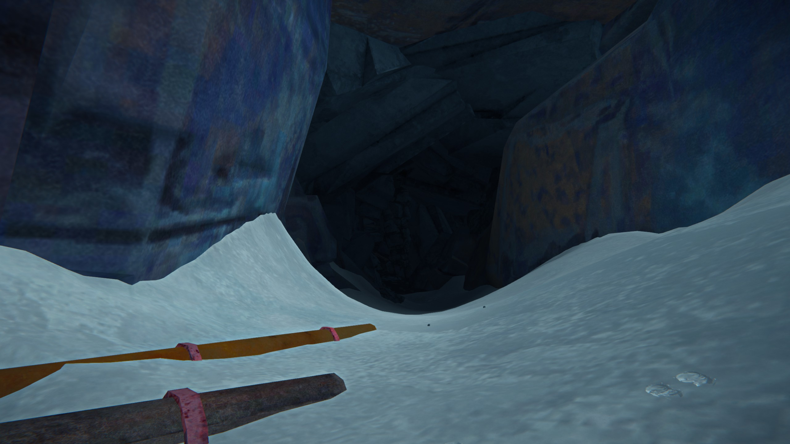
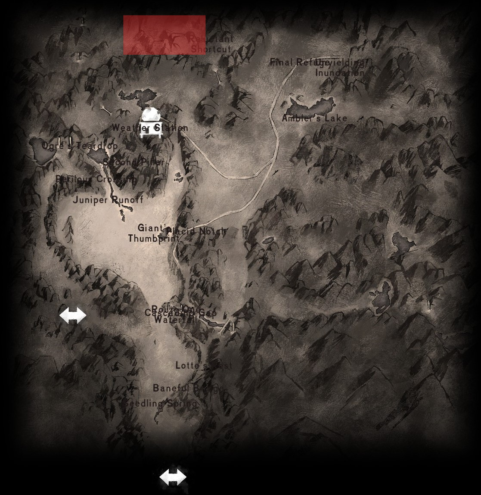
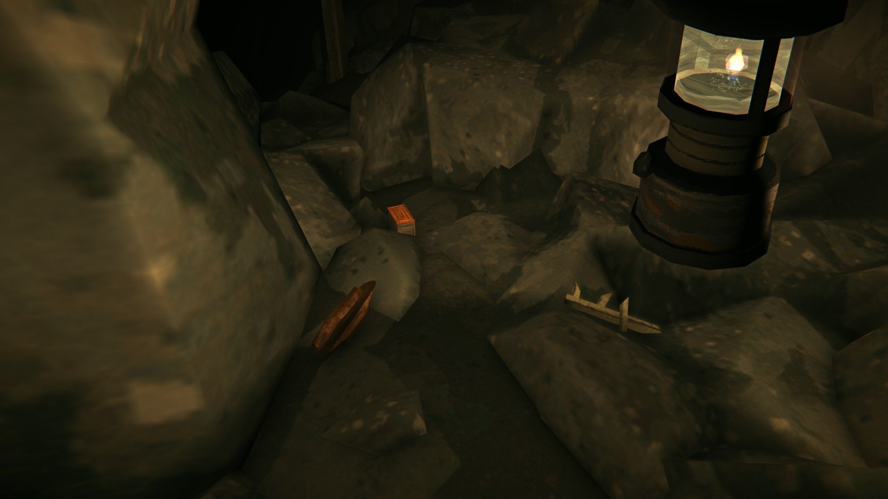
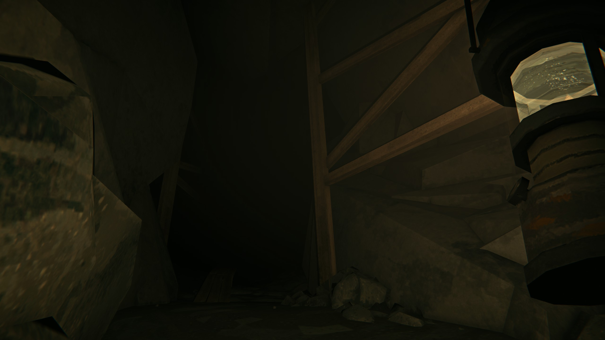

# Abandoned Mine

**Categories:** Caves, Indoor locations, Locations, Locations in Sundered Pass · **Source:** [Fandom](https://thelongdark.fandom.com/wiki/Abandoned_Mine)

**Abandoned Mine**

\[\[File: /  / _Entrance_ /  / _Exit_

250px\]\]

_Entrance_

_Exit_

**Location**

_Abandoned\_Mine\_Location.png_

Region

[Sundered Pass](./Sundered%20Pass.md)

Description

**General**

Type

Cave

Firebox

_The hidden cache_

_The inside of the entrance_
