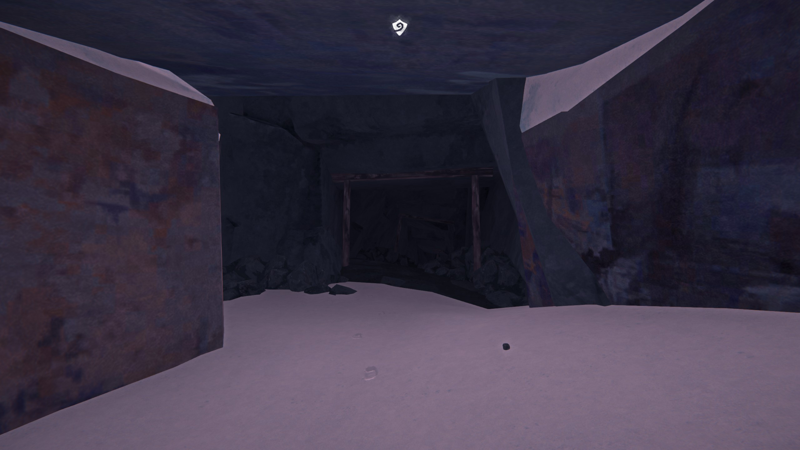

# Abandoned Mine

**Categories:** Caves, Indoor locations, Locations, Locations in Sundered Pass · **Source:** [Fandom](https://thelongdark.fandom.com/wiki/Abandoned_Mine)

**Abandoned Mine**

|

**Location**

Region

[Sundered Pass](./Sundered%20Pass.md)

Description

A large cavern cutting through the northern mountain, with various abandoned mine equipment.

**General**

Type

Cave

Firebox

[Fire Barrel](./Fire%20Barrel.md)

Has an interior

**Abandoned Mine** is a mine located in [Sundered Pass](./Sundered%20Pass.md), close to [Reluctant Shortcut](./Reluctant%20Shortcut.md).

## Overview

It is located a short walk down the hill from the cabin at [Final Refuge](./Final%20Refuge.md), and then up a small plateau and across a tree bridge (past [Bolt Chopper's Haven](./Bolt%20Chopper%27s%20Haven.md)) into the mountains, then past Reluctant Shortcut. The mine, being an interior space, is a naturally large indoor cavern, converted into a mine long since abandoned. It is quite linear in its layout, with [Coal](./Coal.md) and [Stones](./Stone.md) occasionally found on the cavern floors along with [Barrels](./Barrel.md) and [Crates](./Crate.md). The coal may be useful to survivors who are trying to survive at [Unyielding Inundation](./Unyielding%20Inundation.md) or [Placid Notch](./Placid%20Notch.md), in order to help make up for the lack of firewood on the alpine plateau.

A [Hidden Cache](./Hidden%20Cache.md) can be found near the middle of the mine, next to a large pillar. A small path diverging from the exit can be found after this point, with the path to the right leading to a break area with a table, a [Fire Barrel](./Fire%20Barrel.md), and several [Lockers](./Locker.md).

Near the exit, another table with more Lockers can be found.

The exit leads to a large field on the other side of the mountain, later branching into 3 paths with several [Wolves](./Wolf.md):

- A path to the left down a [Rope Climbing](./Rope%20Climbing.md) ([Mountaineering Rope](./Mountaineering%20Rope.md) needed) section to the marsh behind the [Weather Station](./Weather%20Station.md).
- A path to [Second Pillar](./Second%20Pillar.md), across a pond with [Cat Tails](./Cat%20Tail.md) and down a one way drop, then across a tree bridge.
- To a [Crashed Plane](./Plane%20Crashes.md) near [Ogre's Teardrop](./Ogre%27s%20Teardrop.md).

