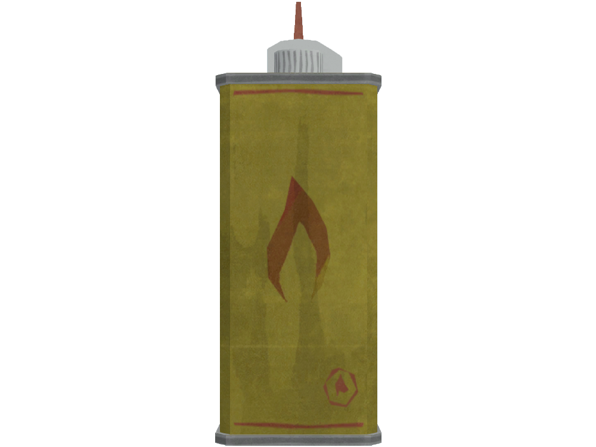

# Accelerant

**Accelerant**

| Property | Details |
| --- | --- |
|  |  / *accelerant\_icon.png* |
| **General** |  |
| Item Type | Fire Starting\|- |
| Renewable | Yes (rare [Beachcombing](./Beachcombing.md)) |
| Firestarting Slot | Accelerant |
| **Statistics** |  |
| Weight | 0.10 kg(0.22 lbs) |
| Bonus chance | +40% |

> “**Low-volume fuel source designed to help start fires; ex. lighter fluid.**”
>
> — In-game description

**Accelerant** is a tool that aids in lighting fires. It comes in a container labeled *Quickflame* and stacks in the inventory.

## Usage

One entire bottle of accelerant or 0.3 liters of [Kerosene](./Kerosene.md) when starting a fire to increase the probability of the fire igniting by 40%.

As accelerant is non-renewable beside from the rare spawn chance from [Beachcombing](./Beachcombing.md), [Lantern Fuel](./Lantern%20Fuel.md) can be acquired from cooking fish. Accelerant is lighter than 0.30 L of kerosene (0.24 kg plus the 0.10 kg container). In other words, it is best to use kerosene to start fires and keep accelerant on the player for emergencies, such as when starting a fire to hold wolves at bay, or when in imminent danger of freezing to death.

## Gallery

| Column 1 |
| --- |
|  / *old model* |

**Lua execution error in Module:Navbox function navbox**

[ru:Горючее](ru:%D0%93%D0%BE%D1%80%D1%8E%D1%87%D0%B5%D0%B5) [es:Acelerante](es:Acelerante)
