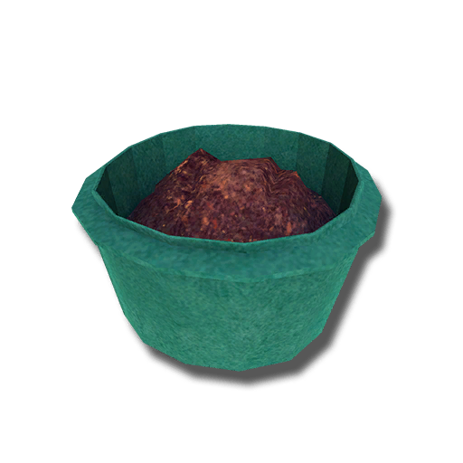

# Acorn Grounds

**Contents**

- [Overview](#Overview)
- [Recipe](#Recipe)
- [Products](#Products)
- [Update history](#Update_history)

<table class="infobox">
<caption>Acorn Grounds</caption>
<colgroup>
<col style="width: 50%" />
<col style="width: 50%" />
</colgroup>
<tbody>
<tr>
<td colspan="2"><figure>

<figcaption>Acorn_Grounds_icon.png</figcaption>
</figure></td>
</tr>
<tr>
<td>
Release
</td>
<td>
<a href="./The%20Long%20Dark%20%E2%80%94%20Changelog.md#2.10" class="wikilink" title="30 March 2023">30 March 2023</a>
</td>
</tr>
<tr>
<td>
Wintermute
</td>
<td>
No
</td>
</tr>
<tr>
<td>
Renewable
</td>
<td>
No
</td>
</tr>
<tr>
<td colspan="2" class="section">
<strong>Properties</strong>
</td>
</tr>
<tr>
<td>
Item type
</td>
<td>
<a href="./Materials.md" class="wikilink" title="Materials">Materials</a>|-
</td>
</tr>
<tr>
<td>
Stackable
</td>
<td>
Yes
</td>
</tr>
<tr>
<td>
Examine
</td>
<td>
Ground Acorns. Makes for a wholesome, but very weak, cup of coffee.
</td>
</tr>
<tr>
<td colspan="2" class="section">
<strong>Values</strong>
</td>
</tr>
<tr>
<td>
Weight
</td>
<td>
0.20 kg (0.44 lbs)
</td>
</tr>
<tr>
<td colspan="2" class="section">
<strong>Advanced data</strong>
</td>
</tr>
<tr>
<td>
Item key
</td>
<td>
GAMEPLAY_AcornGrounds
</td>
</tr>
</tbody>
</table>

## Overview

**Acorn Grounds** are produced from grinding Cooked Acorns with a <a href="./Heavy%20Hammer.md" class="wikilink" title="Heavy Hammer">Heavy Hammer</a>.

<a href="./Acorns.md" class="wikilink" title="Acorns">Acorns</a> can be found in the wilderness beneath <a href="./Oak%20Tree.md" class="wikilink" title="Oak Trees">Oak Trees</a> by searching patches of discolored snow beneath the trees. Acorns can be shelled into <a href="./Prepared%20Acorns.md" class="wikilink" title="Prepared Acorns">Prepared Acorns</a> and either cooked to make <a href="./Acorns%20%28Cooked%29.md" class="wikilink" title="Acorns (Cooked)">Acorns (Cooked)</a>, or bundled into <a href="./Prepared%20Acorns%20%28Large%20Portion%29.md" class="wikilink" title="Prepared Acorns (Large Portion)">Prepared Acorns (Large Portion)</a> and cooked into <a href="./Acorns%20%28Cooked%20-%20Large%20Portion%29.md" class="wikilink" title="Acorns (Cooked - Large Portion)">Acorns (Cooked - Large Portion)</a>. At this point they can be consumed as a food item, but they may also be hammered with a <a href="./Heavy%20Hammer.md" class="wikilink" title="Heavy Hammer">Heavy Hammer</a> into Acorn Grounds.

Acorn Grounds can be used to make <a href="./Cup%20of%20Acorn%20Coffee.md" class="wikilink" title="Cup of Acorn Coffee">Cup of Acorn Coffee</a>, or can be used as an ingredient to make several Recipes.

## Recipe

<table class="infobox">
<caption>Acorn Grounds</caption>
<tbody>
<tr>
<td colspan="2">
-
</td>
</tr>
<tr>
<td colspan="2">
-
</td>
</tr>
<tr>
<td colspan="2">
10 minutes
</td>
</tr>
<tr>
<td colspan="2" class="section">
<strong>Requirements</strong>
</td>
</tr>
<tr>
<td>
Facility
</td>
<td>
[[File:Anywhere icon.png
</td>
</tr>
<tr>
<td>
Tool
</td>
<td>
<strong>Template:iconlink</strong>
</td>
</tr>
<tr>
<td colspan="2" class="section">
<strong>Materials</strong>
</td>
</tr>
<tr>
<td colspan="2" class="section">
<strong>Template:iconlink plain</strong>
</td>
</tr>
<tr>
<td>
Item
</td>
<td>
<a href="./Acorns%20%28Cooked%29.md" class="wikilink" title="Acorns (Cooked)">Acorns (Cooked)</a>
</td>
</tr>
<tr>
<td>
Quantity
</td>
<td>
4
</td>
</tr>
</tbody>
</table>

<table class="infobox">
<caption>Acorn Grounds</caption>
<tbody>
<tr>
<td colspan="2">
-
</td>
</tr>
<tr>
<td colspan="2">
-
</td>
</tr>
<tr>
<td colspan="2">
10 minutes
</td>
</tr>
<tr>
<td colspan="2" class="section">
<strong>Requirements</strong>
</td>
</tr>
<tr>
<td>
Facility
</td>
<td>
[[File:Anywhere icon.png
</td>
</tr>
<tr>
<td>
Tool
</td>
<td>
<strong>Template:iconlink</strong>
</td>
</tr>
<tr>
<td colspan="2" class="section">
<strong>Materials</strong>
</td>
</tr>
<tr>
<td colspan="2" class="section">
<strong>Template:iconlink plain</strong>
</td>
</tr>
<tr>
<td>
Item
</td>
<td>
<a href="./Acorns%20%28Cooked%20-%20Large%20Portion%29.md" class="wikilink" title="Acorns (Cooked - Large Portion)">Acorns (Cooked - Large Portion)</a>
</td>
</tr>
<tr>
<td>
Quantity
</td>
<td>
1
</td>
</tr>
</tbody>
</table>

## Products

## Update history

- UPDATE **30 March 2023 (<a href="./The%20Long%20Dark%20%E2%80%94%20Changelog.md#2.10" class="wikilink" title="Update">Update</a>):**
  - Added to game.

**Lua execution error in Module:Navbox function navbox** <a href="ru:%D0%98%D0%B7%D0%BC%D0%B5%D0%BB%D1%8C%D1%87%D0%B5%D0%BD%D0%BD%D1%8B%D0%B5_%D0%B6%D0%B5%D0%BB%D1%83%D0%B4%D0%B8" class="wikilink" title="ru:Измельченные желуди">ru:Измельченные желуди</a>

