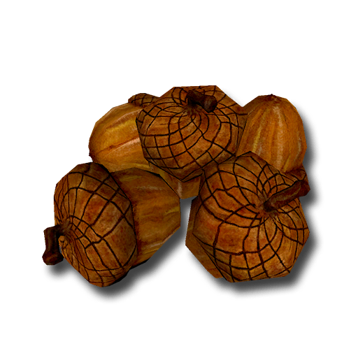

# Acorns

**Contents**

- [Overview](#Overview)
- [Products](#Products)
- [Locations](#Locations)
- [Broken Railroad](#Broken_Railroad)
- [Coastal Highway](#Coastal_Highway)
- [Hushed River Valley](#Hushed_River_Valley)
- [Mountain Town](#Mountain_Town)
- [Timberwolf Mountain](#Timberwolf_Mountain)
- [Transfer Pass](#Transfer_Pass)
- [Update history](#Update_history)

<table class="infobox">
<caption>Acorns</caption>
<colgroup>
<col style="width: 50%" />
<col style="width: 50%" />
</colgroup>
<tbody>
<tr>
<td colspan="2"><figure>

<figcaption>Acorns_icon.png</figcaption>
</figure></td>
</tr>
<tr>
<td>
Release
</td>
<td>
<a href="./The%20Long%20Dark%20%E2%80%94%20Changelog.md#2.10" class="wikilink" title="30 March 2023">30 March 2023</a>
</td>
</tr>
<tr>
<td>
Wintermute
</td>
<td>
No
</td>
</tr>
<tr>
<td>
Renewable
</td>
<td>
No
</td>
</tr>
<tr>
<td colspan="2" class="section">
<strong>Properties</strong>
</td>
</tr>
<tr>
<td>
Item type
</td>
<td>
<a href="./Materials.md" class="wikilink" title="Materials">Materials</a>|-
</td>
</tr>
<tr>
<td>
Stackable
</td>
<td>
Yes
</td>
</tr>
<tr>
<td>
Examine
</td>
<td>
Nuts from an Oak Tree. Prepare the Acorns to remove their leathery shell prior to Cooking.
</td>
</tr>
<tr>
<td colspan="2" class="section">
<strong>Values</strong>
</td>
</tr>
<tr>
<td>
Weight
</td>
<td>
0.05 kg (0.11 lbs)
</td>
</tr>
<tr>
<td colspan="2" class="section">
<strong>Advanced data</strong>
</td>
</tr>
<tr>
<td>
Item key
</td>
<td>
GAMEPLAY_Acorn
</td>
</tr>
</tbody>
</table>

**Acorns** are a material in **<a href="./The%20Long%20Dark.md" class="wikilink" title="The Long Dark">The Long Dark</a>**.

## Overview

Hardy seeds of <a href="./Oak%20Tree.md" class="wikilink" title="Oak Trees">Oak Trees</a>, **Acorns** can be found at the base of any dormant oak tree, buried underneath patches of snow. The trees themselves are distinguished by their stout stature and sprawling, bare branches compared to the surrounding conifers.

Each Oak Tree contains 1-3 buried Acorn patches at their base. These patches can be distinguished as brownish speckles in the surrounding white snow. Harvesting a patch always generates 1 "Acorns" material for the player.

Some patches may have already been harvested, consisting of a dug up patch of bare ground. Whether this implies that other animals/survivors may have eaten or collected them is unknown. Some unharvested patches appear as black spots of disturbed earth, others as brown dots upon the snow.

Acorns must be shelled into <a href="./Prepared%20Acorns.md" class="wikilink" title="Prepared Acorns">Prepared Acorns</a> before they can be cooked into the aptly named <a href="./Acorns%20%28Cooked%29.md" class="wikilink" title="Acorns (Cooked)">Acorns (Cooked)</a>, which can either be eaten or turned into <a href="./Acorn%20Grounds.md" class="wikilink" title="Acorn Grounds.">Acorn Grounds.</a> Once prepared, four acorns can be combined into one large batch of acorns.

As with most non-fuel resources in the game, Acorns do not respawn once harvested.

## Products

## Locations

### Broken Railroad

<a href="./Broken%20Railroad.md" class="wikilink" title="Broken Railroad">Broken Railroad</a> contains few Oak trees. There are at least:

- 1 tree = ~2 patches along the route from <a href="./Forlorn%20Muskeg.md" class="wikilink" title="Forlorn Muskeg">Forlorn Muskeg</a> entry point overlooking a pond near a fallen tree bridge.
- 4 Trees in the vicinity of the <a href="./Hunting%20Lodge.md" class="wikilink" title="Hunting Lodge">Hunting Lodge</a>
- 6 trees on top of the cliff between the <a href="./Rickety%20Foot%20Bridge.md" class="wikilink" title="Rickety Foot Bridge">Rickety Foot Bridge</a> and the climbing spot.

### <a href="./Coastal%20Highway.md" class="wikilink" title="Coastal Highway">Coastal Highway</a>

- 2 Trees in the vicinity of the Abandoned Lookout
- 3 Trees north / northeast of Coastal Town
- 3 Trees on the path to the tracks near a trailer

### <a href="./Hushed%20River%20Valley.md" class="wikilink" title="Hushed River Valley">Hushed River Valley</a>

- Several (5) trees near/behind the arch southwards (straight) from the <a href="./Many%20Falls%20Vista.md" class="wikilink" title="Many Falls Vista">Many Falls Vista</a> climbing spot. This area is patrolled by a wolf most of the time.
- 1 tree = ~3 patches directly in front of the middle entrance to the northern ice cave. Reachable by going north from the rope climb or <a href="./Hushed%20River.md" class="wikilink" title="Hushed River">Hushed River</a>, passing a small pond and then continuing along the rock.
- 4 trees = ~10 patches in front of <a href="./Peak%20Cave.md" class="wikilink" title="Peak Cave">Peak Cave</a>

### <a href="./Mountain%20Town.md" class="wikilink" title="Mountain Town">Mountain Town</a>

Mountain town contains several Oak trees in close proximity. There are at least:

- 2 trees = ~5 patches underneath the climb on the route to <a href="./Mystery%20Lake%20%28region%29.md" class="wikilink" title="Mystery Lake">Mystery Lake</a> transition cave.
- 10 trees = ~22 patches scattered around the <a href="./Picnic%20Area.md" class="wikilink" title="Picnic Area">Picnic Area</a> and <a href="./Milton%20Park.md" class="wikilink" title="Milton Park">Milton Park</a>.

<a href="./Mystery%20Lake%20%28disambiguation%29.md" class="wikilink" title="Mystery Lake">Mystery Lake</a>

At least:

- 4 trees = ~10 patches between the <a href="./Derailment.md" class="wikilink" title="Derailment">Derailment</a> and <a href="./Camp%20Office.md" class="wikilink" title="Camp Office">Camp Office</a> (1 tree on one side of the tracks, 2 on the other, one located around the bend heading towards <a href="./Forestry%20Lookout.md" class="wikilink" title="Forestry Lookout">Forestry Lookout</a>).
- 1 tree = ~2 patches located near the bridge leading to <a href="./Carter%20Hydro%20Dam.md" class="wikilink" title="Carter Hydro Dam">Carter Hydro Dam</a>
- 3 trees = ~8 patches located north of the <a href="./Frozen%20Creek.md" class="wikilink" title="Frozen Creek">Frozen Creek</a> and west of the <a href="./Forestry%20Lookout.md" class="wikilink" title="Forestry Lookout">Forestry Lookout</a>

### Timberwolf Mountain

Timberwolf Mountain contains several loose groupings of Oak trees. There are at least:

- 7 trees = ~17 patches above the ropeclimb from <a href="./Crystal%20Lake.md" class="wikilink" title="Crystal Lake">Crystal Lake</a>, around the two <a href="./Cargo%20Container.md" class="wikilink" title="Cargo Containers">Cargo Containers</a>. Visible from <a href="./Mountaineer%27s%20Hut.md" class="wikilink" title="Mountaineer&#39;s Hut">Mountaineer's Hut</a>, beware a pack of 2-3 <a href="./Wolf.md" class="wikilink" title="Wolves">Wolves</a> in the area.

### Transfer Pass

The <a href="./Transfer%20Pass.md" class="wikilink" title="Transfer Pass">Transfer Pass</a> is densely populated by Oak trees, as the region itself is rather small. There are at least:

- 14 trees = ~32 patches along the short section of rails between <a href="./Distempered%20Flatcars.md" class="wikilink" title="Distempered Flatcars">Distempered Flatcars</a> and <a href="./Loitering%20Marsh.md" class="wikilink" title="Loitering Marsh">Loitering Marsh</a>.
- 2 trees = ~6 patches near the <a href="./Forsaken%20Airfield.md" class="wikilink" title="Forsaken Airfield">Forsaken Airfield</a> transition spot.

## Update history

- UPDATE **30 March 2023 (<a href="./The%20Long%20Dark%20%E2%80%94%20Changelog.md#2.10" class="wikilink" title="Update">Update</a>):**
  - Added to game.

**Lua execution error in Module:Navbox function navbox**

<a href="ru:%D0%96%D1%91%D0%BB%D1%83%D0%B4%D0%B8" class="wikilink" title="ru:Жёлуди">ru:Жёлуди</a>

