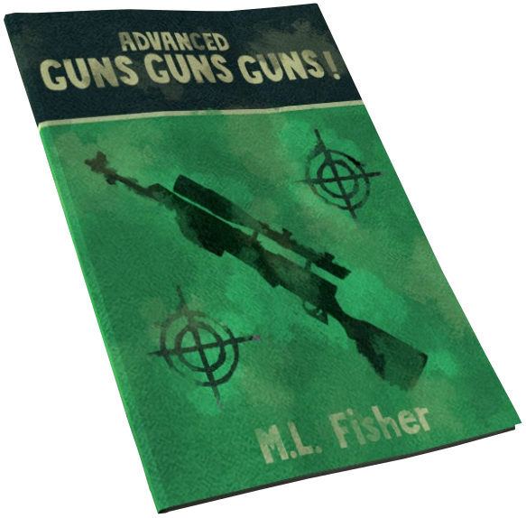
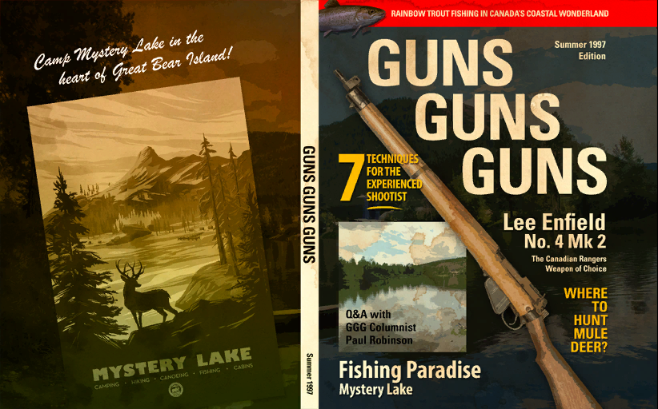

# Advanced Guns Guns Guns\!

**Contents**

- [Research info](#research-info)
- [Fire Starting info](#fire-starting-info)
- [Trivia](#trivia)
- [Gallery](#gallery)
- [Update history](#update-history)

**Advanced Guns Guns Guns!**

| Property | Details |
| --- | --- |
|  |  / *Advanced\_Guns\_Guns\_Guns!\_icon.png* |
| Release | [23 June 2016](./The%20Long%20Dark%20%E2%80%94%20Changelog.md#0.346) |
| Wintermute | No |
| **Properties** |  |
| Item type | [Fire Starting](./Fire%20Starting.md)[Tools](./Tools.md)\|- |
| Stackable | No |
| Examine | Packed full of advice and technical details about how to be a better shooter. Researching this will improve your Rifle Firearm Skill. |
| **Values** |  |
| Weight | 0.50 kg (1.1 lbs) |
| **Actions** |  |
| Backpack | Research, Drop |

*For the version encountered in [Wintermute](./Wintermute.md), see [Advanced Guns Guns Guns! (Survival School)](./Advanced%20Guns%20Guns%20Guns!%20%28Survival%20School%29.md).*

**Advanced Guns Guns Guns!** is a [Research Book](./Research%20Book.md) used to improve the [Rifle Firearm](./Rifle%20Firearm.md) skill. It can also be used as Fuel when starting a [Fire](./Fire.md).

## Research info

*Advanced Guns Guns Guns!* can be researched for 25 hours, which can be broken into multiple research sessions. 10 [Rifle Firearm skill points](./Rifle%20Firearm.md#Skill_levels) are awarded on completing the research.

Research can only be performed under the following conditions:

- There is light present to read
- [Warmth](./Warmth.md), [Fatigue](./Fatigue.md), [Thirst](./Thirst.md), and [Hunger](./Hunger.md) exceed 0%
- No negative [Afflictions](./Afflictions.md)

## Fire Starting info

**Advanced Guns Guns Guns!**

| Property | Details |
| --- | --- |
| Type | Fuel |
| **Statistics** |  |
| Duration |  18 minutes |
| Start Chance |  +35% |
| Heat |  +2°C (+3.6°F) |
| Burn Density | 0.6 hr/kg (0.27 hr/lb) |

## Trivia

- Reaching 0% in any Needs while researching will immediately end the research session and negate any progress for that research attempt.
- Attempting to burn a copy of *Advanced Guns Guns Guns!* when it has not been fully read will give a confirmation warning before it can be burned.
- Once a copy of *Advanced Guns Guns Guns!* is fully researched, it will no longer appear in the Tools section of the Backpack.

## Gallery

| Column 1 | Column 2 |
| --- | --- |
|  / *3D Model* |  / *Old model* |

## Update history

- UPDATE **23 June 2016 ([Update](./The%20Long%20Dark%20%E2%80%94%20Early%20Access%20Changelog.md#.346)):**
  - Added to game.

**Lua execution error in Module:Navbox function navbox** **Lua execution error in Module:Navbox function navbox**
