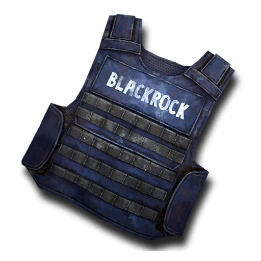
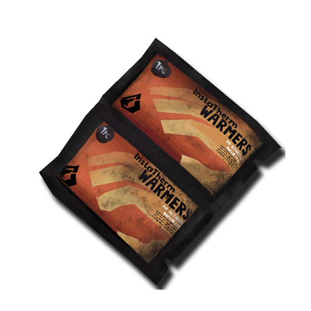
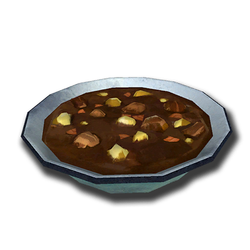
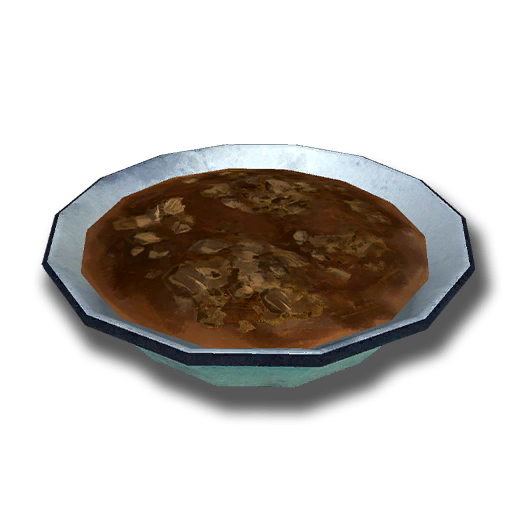
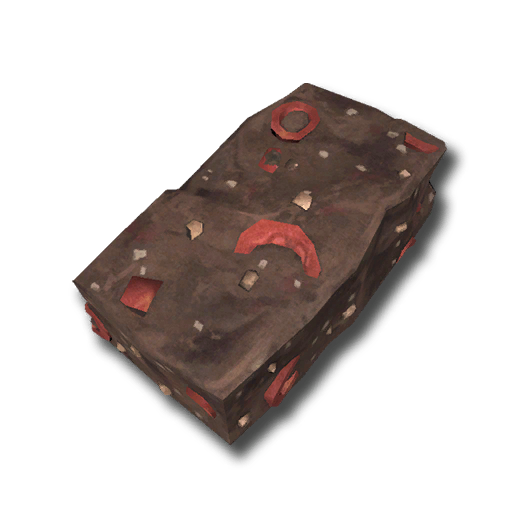
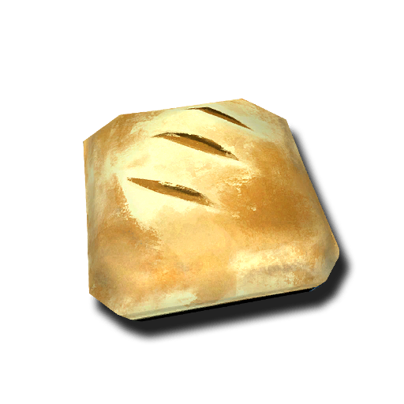
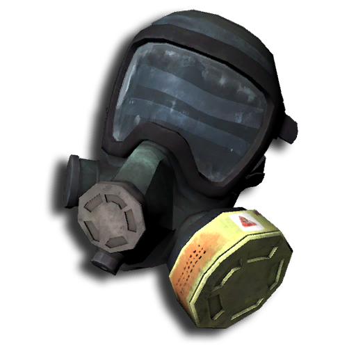
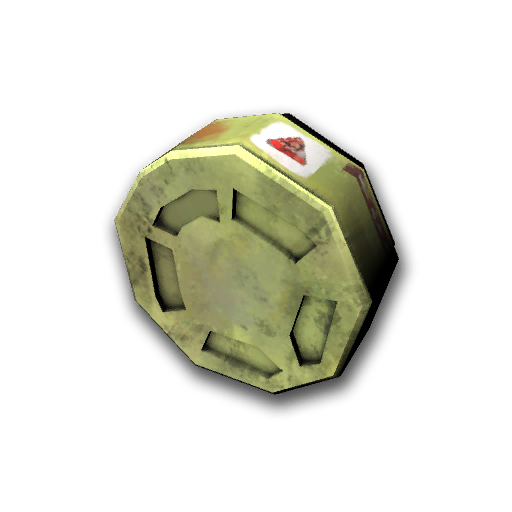

# Afflictions

**Contents**

- [Overview](#Overview)
- [Benefits](#Benefits)
- [Benefit-Like Causing Items](#Benefit-Like_Causing_Items)
- [Afflictions](#Afflictions)
- [Injuries](#Injuries)
- [Diseases](#Diseases)
- [Darkwalker Afflictions](#Darkwalker_Afflictions)
- [Misery Mode Afflictions](#Misery_Mode_Afflictions)
- [Cheat Death Afflictions](#Cheat_Death_Afflictions)
- [Wintermute Afflictions](#Wintermute_Afflictions)
- [Removed Afflictions](#Removed_Afflictions)

 **Afflictions** are mostly temporary medical conditions that affect the player's ability to survive.

## Overview

Afflictions can be acquired by the player through gameplay, and any current active Afflictions can be viewed in the menu.

There are two types of afflictions:

- Positive afflictions: Referred to in-game as **Benefits**, confer favorable effects and are identifiable by a green status icon
- Negative afflictions: Referred to simply as **Afflictions**, inflict harmful effects and are represented by a yellow risk or red afflicted status icon.

## Benefits

Benefits are temporary status effects that provide positive effects to the player. They are gained by consuming certain foods, drinks, or recipes, wearing specific accessories, using First Aid items, or by avoiding starvation.

There are currently 11 different Benefits.

<table>
<colgroup>
<col style="width: 20%" />
<col style="width: 20%" />
<col style="width: 20%" />
<col style="width: 20%" />
<col style="width: 20%" />
</colgroup>
<thead>
<tr>
<th>
Image
</th>
<th>
Affliction
</th>
<th>
Cause
</th>
<th>
Effect
</th>
<th>
Duration
</th>
</tr>
</thead>
<tbody>
<tr>
<td><figure>
[Missing image: Armoured_icon.png]
<figcaption>Armoured_icon.png</figcaption>
</figure></td>
<td>
<a href="./Armoured.md" class="wikilink" title="Armoured">Armoured</a>
</td>
<td>
Equipped

<ul>
<li> <a href="./Ballistic%20Vest.md" class="wikilink" title="Ballistic Vest">Ballistic Vest</a></li>
</ul></td>
<td><ul>
<li>+50% <a href="./Clothing.md#Protection" class="wikilink" title="Protection">Protection</a></li>
</ul></td>
<td>
While wearing the Ballistic Vest
</td>
</tr>
<tr>
<td><figure>
[Missing image: Energy_Boost_icon.png]
<figcaption>Energy_Boost_icon.png</figcaption>
</figure></td>
<td>
<a href="./Energy%20Boost.md" class="wikilink" title="Energy Boost">Energy Boost</a>
</td>
<td>
Consume

<ul>
<li> <a href="./Go!%20Energy%20Drink.md" class="wikilink" title="Go! Energy Drink">Go! Energy Drink</a></li>
<li> <a href="./Emergency%20Stim.md" class="wikilink" title="Emergency Stim">Emergency Stim</a></li>
</ul></td>
<td><ul>
<li>Go! Energy Drink
<ul>
<li>50% <a href="./Fatigue.md" class="wikilink" title="Fatigue">Fatigue</a> and <a href="./Stamina.md" class="wikilink" title="Stamina">Stamina</a> replenished immediately.</li>
<li>50% Fatigue is lost when effect ends.</li>
</ul></li>
</ul>
<ul>
<li>Emergency Stim
<ul>
<li>+100% Fatigue and Stamina</li>
<li>Fatigue and Stamina do not decay (meaning you can sprint for as long as this effect lasts)</li>
<li>-100% Fatigue (0% "Exhausted") when duration ends.</li>
</ul></li>
</ul></td>
<td>
30 minutes (Go! Energy Drink)

15 minutes (Emergency Stim)
</td>
</tr>
<tr>
<td><figure>
[Missing image: Fatigue_Reduced_icon.png]
<figcaption>Fatigue_Reduced_icon.png</figcaption>
</figure></td>
<td>
<a href="./Fatigue%20Reduced.md" class="wikilink" title="Fatigue Reduced">Fatigue Reduced</a>
</td>
<td>
Consume:

<ul>
<li> <a href="./Cup%20of%20Acorn%20Coffee.md" class="wikilink" title="Cup of Acorn Coffee">Cup of Acorn Coffee</a></li>
<li> <a href="./Cup%20of%20Coffee.md" class="wikilink" title="Cup of Coffee">Cup of Coffee</a></li>
<li> <a href="./Go!%20Energy%20Drink.md" class="wikilink" title="Go! Energy Drink">Go! Energy Drink</a></li>
<li> <a href="./Emergency%20Stim.md" class="wikilink" title="Emergency Stim">Emergency Stim</a></li>
<li> <a href="./Caffeine%20Pills.md" class="wikilink" title="Caffeine Pills">Caffeine Pills</a></li>
</ul></td>
<td><ul>
<li>+10% <a href="./Fatigue.md" class="wikilink" title="Fatigue">Fatigue</a>.</li>
<li>Fatigue decay is slowed.</li>
<li>-50% Calorie Burn from <a href="./Stamina.md" class="wikilink" title="Sprinting">Sprinting</a>.</li>
</ul></td>
<td><ul>
<li>30 minutes (Acorn Coffee)</li>
<li>1 hour (Coffee)</li>
<li>45 minutes (Go! Energy Drink)</li>
<li>15 minutes (Emergency Stim)</li>
<li>4 hours (Caffeine Pills)</li>
</ul></td>
</tr>
<tr>
<td><figure>
[Missing image: Heat_Pack_(Affliction)_icon.png]
<figcaption>Heat_Pack_(Affliction)_icon.png</figcaption>
</figure></td>
<td>
<a href="./Heat%20Pack%20%28Affliction%29.md" class="wikilink" title="Heat Pack (Affliction)">Heat Pack (Affliction)</a>
</td>
<td><ul>
<li> <a href="./Heat%20Pack.md" class="wikilink" title="Heat Pack">Heat Pack</a></li>
</ul></td>
<td><ul>
<li>+5.0C of <a href="./Warmth.md" class="wikilink" title="Warmth">Warmth</a> as long as Heat Pack is carried once activated.</li>
</ul></td>
<td>
6 hours
</td>
</tr>
<tr>
<td><figure>
[Missing image: Improved_rest_icon.png]
<figcaption>Improved_rest_icon.png</figcaption>
</figure></td>
<td>
<a href="./Improved%20Rest.md" class="wikilink" title="Improved Rest">Improved Rest</a>
</td>
<td>
Consume

<ul>
<li> <a href="./Cup%20of%20Herbal%20Tea.md" class="wikilink" title="Cup of Herbal Tea">Cup of Herbal Tea</a></li>
<li> <a href="./Ptarmigan%20Stew.md" class="wikilink" title="Ptarmigan Stew">Ptarmigan Stew</a></li>
<li> <a href="./Rabbit%20Stew.md" class="wikilink" title="Rabbit Stew">Rabbit Stew</a></li>
<li> <a href="./Ranger%20Stew.md" class="wikilink" title="Ranger Stew">Ranger Stew</a></li>
<li> <a href="./Stalker%27s%20Pie.md" class="wikilink" title="Stalker&#39;s Pie">Stalker's Pie</a></li>
<li> <a href="./Thomson%20Family%20Stew.md" class="wikilink" title="Thomson Family Stew">Thomson Family Stew</a></li>
<li> <a href="./Trout%20Stew.md" class="wikilink" title="Trout Stew">Trout Stew</a></li>
<li> <a href="./Venison%20Stew.md" class="wikilink" title="Venison Stew">Venison Stew</a></li>
</ul></td>
<td><ul>
<li>Additional +2% Condition restored per hour while <a href="./Sleep.md" class="wikilink" title="sleeping">sleeping</a> (1% for Interloper) per hour.</li>
</ul></td>
<td><ul>
<li>3 hours (Any Stew)</li>
<li>or</li>
<li>6 hours (Herbal Tea, Stalker's Pie)</li>
</ul></td>
</tr>
<tr>
<td rowspan="2"><figure>
[Missing image: Nourished_icon.png]
<figcaption>Nourished_icon.png</figcaption>
</figure></td>
<td rowspan="2">
<a href="./Nourished.md" class="wikilink" title="Nourished">Nourished</a>
</td>
<td>
Consume

<ul>
<li> <a href="./Camber%20Flight%20Porridge.md" class="wikilink" title="Camber Flight Porridge">Camber Flight Porridge</a></li>
<li> <a href="./Breyerhouse%20Pie.md" class="wikilink" title="Breyerhouse Pie">Breyerhouse Pie</a></li>
<li> <a href="./Dockworker%27s%20Pie.md" class="wikilink" title="Dockworker&#39;s Pie">Dockworker's Pie</a></li>
<li> <a href="./Lily%27s%20Pancakes.md" class="wikilink" title="Lily&#39;s Pancakes">Lily's Pancakes</a></li>
<li> <a href="./Ranger%20Stew.md" class="wikilink" title="Ranger Stew">Ranger Stew</a></li>
<li> <a href="./Last%20Resort%20Soup.md" class="wikilink" title="Last Resort Soup">Last Resort Soup</a></li>
<li> <a href="./Porter%27s%20Soup.md" class="wikilink" title="Porter&#39;s Soup">Porter's Soup</a></li>
<li> <a href="./Vagabond%20Soup.md" class="wikilink" title="Vagabond Soup">Vagabond Soup</a></li>
</ul></td>
<td><ul>
<li>+10% maximum Condition (for 110 total maximum)</li>
</ul></td>
<td rowspan="2">
3 hours
</td>
</tr>
<tr>
<td>
Consume

<ul>
<li> <a href="./Pemmican%20Bar.md" class="wikilink" title="Pemmican Bar">Pemmican Bar</a></li>
<li> <a href="./Prepper%27s%20Pie.md" class="wikilink" title="Prepper&#39;s Pie">Prepper's Pie</a></li>
<li> <a href="./Stalker%27s%20Pie.md" class="wikilink" title="Stalker&#39;s Pie">Stalker's Pie</a></li>
</ul></td>
<td><ul>
<li>+15% maximum Stamina</li>
</ul></td>
</tr>
<tr>
<td><figure>
[Missing image: Restore_Condition_icon.png]
<figcaption>Restore_Condition_icon.png</figcaption>
</figure></td>
<td>
<a href="./Restore%20Condition.md" class="wikilink" title="Restore Condition">Restore Condition</a>
</td>
<td>
Consume

<ul>
<li> <a href="./Birch%20Bark%20Tea.md" class="wikilink" title="Birch Bark Tea">Birch Bark Tea</a></li>
</ul></td>
<td><ul>
<li>+2.5% <a href="./Condition.md" class="wikilink" title="Condition">Condition</a> per hour.</li>
<li>Note: Effect continues in addition/despite other Condition altering effects (0% <a href="./Needs.md" class="wikilink" title="Needs">Needs</a>, <a href="./Blood%20Loss.md" class="wikilink" title="Blood Loss">Blood Loss</a>, passive Condition restoration, etc).</li>
</ul></td>
<td>
2 hours
</td>
</tr>
<tr>
<td><figure>
[Missing image: Sure_Footing.png]
<figcaption>Sure_Footing.png</figcaption>
</figure></td>
<td>
<a href="./Sure%20Footing.md" class="wikilink" title="Sure Footing">Sure Footing</a>
</td>
<td>
Wearing

<ul>
<li> <a href="./Crampons.md" class="wikilink" title="Crampons">Crampons</a></li>
<li> <a href="./Improvised%20Crampons.md" class="wikilink" title="Improvised Crampons">Improvised Crampons</a></li>
</ul></td>
<td><ul>
<li>Less frequent sprains</li>
<li><a href="./Rope%20Climbing.md" class="wikilink" title="Rope Climbing">Rope Climbing</a> is faster</li>
<li><a href="./Weak%20Ice.md" class="wikilink" title="Weak Ice">Weak Ice</a> is more forgiving</li>
</ul></td>
<td>
While wearing Crampons/Improvised Crampons
</td>
</tr>
<tr>
<td><figure>
[Missing image: Unburdened_icon.png]
<figcaption>Unburdened_icon.png</figcaption>
</figure></td>
<td>
<a href="./Unburdened.md" class="wikilink" title="Unburdened">Unburdened</a>
</td>
<td>
Consume

<ul>
<li> <a href="./Coastal%20Fishcakes.md" class="wikilink" title="Coastal Fishcakes">Coastal Fishcakes</a></li>
<li> <a href="./Rabbit%20Pie.md" class="wikilink" title="Rabbit Pie">Rabbit Pie</a></li>
<li> <a href="./Venison%20Pie.md" class="wikilink" title="Venison Pie">Venison Pie</a></li>
<li> <a href="./Pemmican%20Bar.md" class="wikilink" title="Pemmican Bar">Pemmican Bar</a></li>
<li> <a href="./Porter%27s%20Soup.md" class="wikilink" title="Porter&#39;s Soup">Porter's Soup</a></li>
</ul></td>
<td><ul>
<li>Increase carrying capacity by 3kg (6.6bs)</li>
</ul></td>
<td>
3 hours
</td>
</tr>
<tr>
<td><figure>
[Missing image: Warming_up_icon.png]
<figcaption>Warming_up_icon.png</figcaption>
</figure></td>
<td>
<a href="./Warming%20Up.md" class="wikilink" title="Warming Up">Warming Up</a>
</td>
<td>
Consume HOT food/drinks
</td>
<td><ul>
<li>Significantly slows Warmth loss when 'feels like' is negative.</li>
</ul></td>
<td>
1 hour
</td>
</tr>
<tr>
<td><figure>

<figcaption>Well_fed_icon.png</figcaption>
</figure></td>
<td>
<a href="./Well%20Fed.md" class="wikilink" title="Well Fed">Well Fed</a>
</td>
<td>
Calorie Store must not hit 0 for at least 72 hours
</td>
<td><ul>
<li>+5% maximum Condition (for 105% total maximum)</li>
<li>Increases carrying capacity by 5kg (11lbs).</li>
</ul></td>
<td>
Until starving (Calorie Store becomes 0)
</td>
</tr>
</tbody>
</table>

## Benefit-Like Causing Items

The following items have positive secondary effects associated with them that give Benefit-like effects when equipped/used, despite no Affliction being present in the Stats menu. These Benefits are not immediately obvious, but gameplay altering effects do occur once these items are used/worn.

<table>
<colgroup>
<col style="width: 25%" />
<col style="width: 25%" />
<col style="width: 25%" />
<col style="width: 25%" />
</colgroup>
<thead>
<tr>
<th>
Affliction
</th>
<th>
Cause
</th>
<th>
Effect
</th>
<th>
Duration
</th>
</tr>
</thead>
<tbody>
<tr>
<td>
Reduced Rifle Weight
</td>
<td>
Equipped <a href="./Security%20Chief%27s%20Rifle%20Holster.md" class="wikilink" title="Security Chief&#39;s Rifle Holster">Security Chief's Rifle Holster</a>
</td>
<td><ul>
<li>Halves the weight of 1 Hunting Rifle in the player's inventory</li>
</ul></td>
<td>
While wearing the Security Chief's Rifle Holster
</td>
</tr>
<tr>
<td>
Reduced Tool Weight
</td>
<td>
Equipped <a href="./Foreman%27s%20Tool%20Belt.md" class="wikilink" title="Foreman&#39;s Tool Belt">Foreman's Tool Belt</a>
</td>
<td><ul>
<li>Halves the weight of up to 3 specific tools in the player's inventory</li>
</ul></td>
<td>
While wearing the Foreman's Tool Belt
</td>
</tr>
<tr>
<td>
Wildlife Deterring Effect
</td>
<td>
Equipped <a href="./Wolfskin%20Coat.md" class="wikilink" title="Wolfskin Coat">Wolfskin Coat</a>
</td>
<td><ul>
<li><a href="./Wolf.md" class="wikilink" title="Wolves">Wolves</a> have a chance to flee upon seeing the player.</li>
</ul></td>
<td>
While wearing the Wolfskin Coat
</td>
</tr>
<tr>
<td>
Wildlife Deterring Effect
</td>
<td>
Equipped <a href="./Bearskin%20Coat.md" class="wikilink" title="Bearskin Coat">Bearskin Coat</a>
</td>
<td><ul>
<li><a href="./Wolf.md" class="wikilink" title="Wolves">Wolves</a> have a chance to flee upon seeing the player.</li>
</ul></td>
<td>
While wearing the Bearskin Coat
</td>
</tr>
<tr>
<td>
Wildlife Deterring Effect
</td>
<td>
Carry <a href="./Bear%20Skin%20Bedroll.md" class="wikilink" title="Bear Skin Bedroll">Bear Skin Bedroll</a>
</td>
<td><ul>
<li><a href="./Wolf.md" class="wikilink" title="Wolves">Wolves</a> have a chance to flee upon seeing the player.</li>
</ul></td>
<td>
When deploying/carrying a Bear Skin Bedroll
</td>
</tr>
<tr>
<td>
<a href="./Pumpkin%20Pie.md#Wildlife_deterring_effect" class="wikilink" title="Wildlife Deterring Effect">Wildlife Deterring Effect</a>
</td>
<td>
Consume <a href="./Pumpkin%20Pie.md" class="wikilink" title="Pumpkin Pie">Pumpkin Pie</a>
</td>
<td><ul>
<li><a href="./Wolf.md" class="wikilink" title="Wolves">Wolves</a> always run away from the player. (only present during the <a href="./4%20Days%20of%20Night%20Event.md" class="wikilink" title="4 Days of Night">4 Days of Night</a> event).</li>
</ul></td>
<td>
6 hours
</td>
</tr>
</tbody>
</table>

## Afflictions

Afflictions are temporary or permanent status effects that cause Condition loss or detrimental effects to the player. Most afflictions are treatable, however treatments may require multiple doses (and time between each dose) to cure. Treatments are mostly affliction-specific, and when taken must be selected to treat affliction for their effect.

Acquiring an Affliction will always list the origin. A list of Affliction sources include:

- Fall
- Wolf Attack
- Bear Attack
- Moose Attack
- Cougar Attack
- Plane Crash Injuries (Wintermute Only)
- <a href="./Water%20%28Unsafe%29.md" class="wikilink" title="Tainted Water">Tainted Water</a>
- Spoiled Food
- <a href="./Glimmer%20Fog.md" class="wikilink" title="Glimmer Fog">Glimmer Fog</a>
- and many more

There are 39 different Afflictions, which can be sorted into two categories: injuries and diseases.

### Injuries

Injuries are Afflictions that cause instantaneous damage to the player, and can be caused by falling, animal struggles, exposure to the elements, and steep terrain. Frostbite is a notable exception, being a permanent injury that occurs after the "Frostbite Risk" reaches 100%.

<table style="width:100%;">
<colgroup>
<col style="width: 16%" />
<col style="width: 16%" />
<col style="width: 16%" />
<col style="width: 16%" />
<col style="width: 16%" />
<col style="width: 16%" />
</colgroup>
<thead>
<tr>
<th>
Image
</th>
<th>
Affliction
</th>
<th>
<strong>Cause</strong>
</th>
<th>
Effect
</th>
<th>
Duration
</th>
<th>
Treatment
</th>
</tr>
</thead>
<tbody>
<tr>
<td><figure>
[Missing image: Blood_Loss_icon.png]
<figcaption>Blood_Loss_icon.png</figcaption>
</figure></td>
<td>
<a href="./Blood%20Loss.md" class="wikilink" title="Blood Loss">Blood Loss</a>
</td>
<td>
<a href="./Struggle.md" class="wikilink" title="Struggle">Struggles</a> with <a href="./Wolf.md" class="wikilink" title="Wolf">Wolf</a>, <a href="./Bear.md" class="wikilink" title="Bear">Bear</a>, <a href="./Poisoned%20Wolf.md" class="wikilink" title="Poisoned Wolf">Poisoned Wolf</a>, or <a href="./Timberwolf.md" class="wikilink" title="Timberwolf">Timberwolf</a> attacks, and falling
</td>
<td><ul>
<li>-30% <a href="./Condition.md" class="wikilink" title="Condition">Condition</a> per hour</li>
</ul></td>
<td>
Until treatment
</td>
<td>
1 <a href="./Bandage.md" class="wikilink" title="Bandage">Bandage</a>
</td>
</tr>
<tr>
<td><figure>
[Missing image: Broken_Ribs_icon.png]
<figcaption>Broken_Ribs_icon.png</figcaption>
</figure></td>
<td>
<a href="./Broken%20Ribs.md" class="wikilink" title="Broken Ribs">Broken Ribs</a>
</td>
<td>
<a href="./Struggle.md#Moose" class="wikilink" title="Struggle">Struggle</a> with <a href="./Moose.md" class="wikilink" title="Moose">Moose</a>
</td>
<td><ul>
<li>-50% Maximum <a href="./Stamina.md" class="wikilink" title="Stamina">Stamina</a></li>
<li>-25% Carrying capacity</li>
<li>Note: Additional applications of Broken Ribs do not stack effect, but last longer (120 hours, 168, 216, etc).</li>
</ul></td>
<td>
120 hours
</td>
<td>
2 <a href="./Bandage.md" class="wikilink" title="Bandage">Bandage</a> + 4 <a href="./Painkillers.md" class="wikilink" title="Painkillers">Painkillers</a> (or 2 <a href="./Rose%20Hip%20Tea.md" class="wikilink" title="Rose Hip Tea">Rose Hip Tea</a>) and waiting 5 days (120 hours)
</td>
</tr>
<tr>
<td><figure>
[Missing image: Burdened_icon.png]
<figcaption>Burdened_icon.png</figcaption>
</figure></td>
<td>
<a href="./Burdened.md" class="wikilink" title="Burdened">Burdened</a>
</td>
<td>
Consume

<ul>
<li> <a href="./Prepper%27s%20Pie.md" class="wikilink" title="Prepper&#39;s Pie">Prepper's Pie</a></li>
<li> <a href="./Stalker%27s%20Pie.md" class="wikilink" title="Stalker&#39;s Pie">Stalker's Pie</a></li>
</ul></td>
<td><ul>
<li>Decrease carrying capacity by 3kg (6.6bs)</li>
</ul></td>
<td>
1 hour
</td>
<td>
Wait until Affliction passes.
</td>
</tr>
<tr>
<td><figure>
[Missing image: Burns_icon.png]
<figcaption>Burns_icon.png</figcaption>
</figure></td>
<td rowspan="2">
<a href="./Burns.md" class="wikilink" title="Burns">Burns</a>
</td>
<td rowspan="2">
Walking over a lit <a href="./Campfire.md" class="wikilink" title="Campfire">Campfire</a> or into any open fire Walking into electrified wires/water during an <a href="./Aurora.md" class="wikilink" title="Aurora">Aurora</a>

Not throwing a lit <a href="./Noisemaker.md" class="wikilink" title="Noisemaker">Noisemaker</a>
</td>
<td rowspan="2"><ul>
<li>Maximum <a href="./Condition.md" class="wikilink" title="Condition">Condition</a> set to 75%.</li>
<li>When Burned, all Condition above 75% is lost immediately</li>
<li>In addition to burns, contact with fires/electrified wires causes constant and rapid Condition loss</li>
</ul></td>
<td rowspan="2">
30 hours or until treatment
</td>
<td rowspan="2">
1 <a href="./Bandage.md" class="wikilink" title="Bandage">Bandage</a> + 2 <a href="./Painkillers.md" class="wikilink" title="Painkillers">Painkillers</a> (or 1 <a href="./Rose%20Hip%20Tea.md" class="wikilink" title="Rose Hip Tea">Rose Hip Tea</a>)
</td>
</tr>
<tr>
<td><figure>
[Missing image: Burns_(electric)_icon.png]
<figcaption>Burns_(electric)_icon.png</figcaption>
</figure></td>
</tr>
<tr>
<td><figure>
[Missing image: Frostbite_icon.png]
<figcaption>Frostbite_icon.png</figcaption>
</figure></td>
<td>
<a href="./Frostbite.md" class="wikilink" title="Frostbite">Frostbite</a>
</td>
<td>
Frostbite Risk reaches 100%. (body part exposed to sustained 0<strong>°</strong>C or colder temperatures (head, hands, feet etc), or body part is wearing frozen clothing
</td>
<td><ul>
<li>-10% Maximum <a href="./Condition.md" class="wikilink" title="Condition">Condition</a></li>
</ul></td>
<td>
Permanent
</td>
<td>
No Treatment
</td>
</tr>
<tr>
<td><figure>
[Missing image: Gorged_icon.png]
<figcaption>Gorged_icon.png</figcaption>
</figure></td>
<td>
<a href="./Gorged.md" class="wikilink" title="Gorged">Gorged</a>
</td>
<td>
Consume

<ul>
<li> <a href="./Breyerhouse%20Pie.md" class="wikilink" title="Breyerhouse Pie">Breyerhouse Pie</a></li>
<li> <a href="./Dockworker%27s%20Pie.md" class="wikilink" title="Dockworker&#39;s Pie">Dockworker's Pie</a></li>
</ul></td>
<td><ul>
<li>-15% Maximum <a href="./Stamina.md" class="wikilink" title="Stamina">Stamina</a></li>
</ul></td>
<td>
1 hour
</td>
<td>
Wait until Affliction passes.
</td>
</tr>
<tr>
<td><figure>
[Missing image: Headache_icon.png]
<figcaption>Headache_icon.png</figcaption>
</figure></td>
<td>
<a href="./Headache.md" class="wikilink" title="Headache">Headache</a>
</td>
<td>
Drinking <a href="./Go!%20Energy%20Drink.md" class="wikilink" title="Go! Energy Drink">Go! Energy Drink</a>, consuming certain <a href="./Cooking.md" class="wikilink" title="recipes">recipes</a>
</td>
<td><ul>
<li>Vision is blurred</li>
<li>All <a href="./Stamina.md" class="wikilink" title="Stamina">Stamina</a> is instantly lost</li>
</ul></td>
<td>
20 minutes
</td>
<td>
Wait until Affliction passes.
</td>
</tr>
<tr>
<td><figure>
[Missing image: Laceration_icon.png]
<figcaption>Laceration_icon.png</figcaption>
</figure></td>
<td>
<a href="./Laceration.md" class="wikilink" title="Laceration">Laceration</a>
</td>
<td>
<a href="./Struggle.md" class="wikilink" title="Struggles">Struggles</a> with <a href="./Wildlife.md" class="wikilink" title="Wildlife">Wildlife</a>
</td>
<td><ul>
<li>-20% <a href="./Condition.md" class="wikilink" title="Condition">Condition</a></li>
</ul></td>
<td>
Immediate effect
</td>
<td>
Status effect disappears shortly after injury
</td>
</tr>
<tr>
<td><figure>
[Missing image: Major_Bruising_icon.png]
<figcaption>Major_Bruising_icon.png</figcaption>
</figure></td>
<td>
<a href="./Major%20Bruising.md" class="wikilink" title="Major Bruising">Major Bruising</a>
</td>
<td>
<a href="./Struggle.md" class="wikilink" title="Struggle">Struggles</a> with wildlife, falling
</td>
<td><ul>
<li>-10% <a href="./Condition.md" class="wikilink" title="Condition">Condition</a></li>
</ul></td>
<td>
Immediate effect
</td>
<td>
Status effect disappears shortly after injury
</td>
</tr>
<tr>
<td><figure>
[Missing image: Minor_Bruising_icon.png]
<figcaption>Minor_Bruising_icon.png</figcaption>
</figure></td>
<td>
<a href="./Minor%20Bruising.md" class="wikilink" title="Minor Bruising">Minor Bruising</a>
</td>
<td>
<a href="./Struggle.md" class="wikilink" title="Struggle">Struggles</a> with wildlife, falling
</td>
<td><ul>
<li>-5% <a href="./Condition.md" class="wikilink" title="Condition">Condition</a></li>
</ul></td>
<td>
Immediate effect
</td>
<td>
Status effect disappears shortly after injury
</td>
</tr>
<tr>
<td><figure>
[Missing image: Pain_icon.png]
<figcaption>Pain_icon.png</figcaption>
</figure></td>
<td>
<a href="./Pain.md" class="wikilink" title="Pain">Pain</a>
</td>
<td>
<a href="./Struggle.md" class="wikilink" title="Struggle">Struggles</a> with <a href="./Wildlife.md" class="wikilink" title="Wildlife">Wildlife</a>, falling, sprains
</td>
<td><ul>
<li>Blurred vision, distorted sounds</li>
</ul></td>
<td>
Four hours or until treatment
</td>
<td>
1 <a href="./Bandage.md" class="wikilink" title="Bandage">Bandage</a> + 2 <a href="./Painkillers.md" class="wikilink" title="Painkillers">Painkillers</a> (or 1 <a href="./Rose%20Hip%20Tea.md" class="wikilink" title="Rose Hip Tea">Rose Hip Tea</a>) Wait 4 hours
</td>
</tr>
<tr>
<td><figure>
[Missing image: Severe_Lacerations_icon.png]
<figcaption>Severe_Lacerations_icon.png</figcaption>
</figure></td>
<td>
<a href="./Severe%20Lacerations.md" class="wikilink" title="Severe Lacerations">Severe Lacerations</a>
</td>
<td>
<a href="./Cougar.md" class="wikilink" title="Cougar">Cougar</a> <a href="./Struggle.md" class="wikilink" title="Struggle">Struggle</a>
</td>
<td><ul>
<li>Maximum <a href="./Condition.md" class="wikilink" title="Condition">Condition</a> is reduced to 50%.</li>
<li>Maximum <a href="./Stamina.md" class="wikilink" title="Stamina">Stamina</a> is reduced by 50%.</li>
<li>Generates 2-3 <a href="./Blood%20Loss.md" class="wikilink" title="Blood Loss">Blood Loss</a> and <a href="./Infection%20Risk.md" class="wikilink" title="Infection Risk">Infection Risk</a> along with the Affliction.</li>
<li>New instances of <a href="./Blood%20Loss.md" class="wikilink" title="Blood Loss">Blood Loss</a> and <a href="./Infection%20Risk.md" class="wikilink" title="Infection Risk">Infection Risk</a> occur every 12 hours.</li>
</ul></td>
<td>
72 Hours
</td>
<td>
Wait until Affliction passes.
</td>
</tr>
<tr>
<td><figure>
[Missing image: Sprained_Ankle_icon.png]
<figcaption>Sprained_Ankle_icon.png</figcaption>
</figure></td>
<td>
<a href="./Sprained%20Ankle.md" class="wikilink" title="Sprained Ankle">Sprained Ankle</a>
</td>
<td>
<a href="./Struggle.md" class="wikilink" title="Struggle">Struggles</a> with <a href="./Wildlife.md" class="wikilink" title="wildlife">wildlife</a>, falling, walking on uneven or steep terrain (increased chance below 50% <a href="./Fatigue.md" class="wikilink" title="Fatigue">Fatigue</a>, or when <a href="./Encumbrance.md" class="wikilink" title="encumbered">encumbered</a>)
</td>
<td><ul>
<li><a href="./Stamina.md" class="wikilink" title="Sprinting">Sprinting</a> is disabled</li>
<li><a href="./Rope%20Climbing.md" class="wikilink" title="Rope Climbing">Rope Climbing</a> and <a href="./Rock%20Climb.md" class="wikilink" title="Rock Climbing">Rock Climbing</a> is disabled</li>
</ul></td>
<td>
Four hours of rest or until treatment
</td>
<td>
1 <a href="./Bandage.md" class="wikilink" title="Bandage">Bandage</a> or 4 hours of <a href="./Sleep.md" class="wikilink" title="Sleep">Sleep</a>
</td>
</tr>
<tr>
<td><figure>
[Missing image: Sprained_Wrist_icon.png]
<figcaption>Sprained_Wrist_icon.png</figcaption>
</figure></td>
<td>
<a href="./Sprained%20Wrist.md" class="wikilink" title="Sprained Wrist">Sprained Wrist</a>
</td>
<td>
<a href="./Struggle.md" class="wikilink" title="Struggle">Struggles</a> with <a href="./Wildlife.md" class="wikilink" title="Wildlife">Wildlife</a>, falling, walking on uneven or steep terrain (increased chance below 50% <a href="./Fatigue.md" class="wikilink" title="Fatigue">Fatigue</a>, or when <a href="./Encumbrance.md" class="wikilink" title="Encumbered">Encumbered</a>)
</td>
<td><ul>
<li><a href="./Rope%20Climbing.md" class="wikilink" title="Rope Climbing">Rope Climbing</a> and <a href="./Rock%20Climb.md" class="wikilink" title="Rock Climbing">Rock Climbing</a> is disabled</li>
<li>Use of <a href="./Hunting%20Rifle.md" class="wikilink" title="Hunting Rifles">Hunting Rifles</a> and <a href="./Survival%20Bow.md" class="wikilink" title="Survival Bows">Survival Bows</a> use is disabled</li>
<li>With both wrists sprained <a href="./Revolver.md" class="wikilink" title="Revolvers">Revolvers</a>, <a href="./Distress%20Pistol.md" class="wikilink" title="Distress Pistols">Distress Pistols</a>, and <a href="./Stone.md" class="wikilink" title="Stone">Stones</a> use is disabled</li>
</ul></td>
<td>
Two hours of rest or until treatment
</td>
<td>
1 <a href="./Bandage.md" class="wikilink" title="Bandage">Bandage</a> or 2 hours of <a href="./Sleep.md" class="wikilink" title="Sleep">Sleep</a>
</td>
</tr>
<tr>
<td><figure>
[Missing image: Suffocation_icon.png]
<figcaption>Suffocation_icon.png</figcaption>
</figure></td>
<td>
<a href="./Suffocation.md" class="wikilink" title="Suffocation">Suffocation</a>
</td>
<td>
Being inside polluted air found in <a href="./Last%20Prospect.md" class="wikilink" title="Last Prospect">Last Prospect</a> and <a href="./Langston%20Mine.md" class="wikilink" title="Langston Mine">Langston Mine</a>.
</td>
<td><ul>
<li>Deteriorating vision, loss of hearing.</li>
</ul>
<ul>
<li><u><strong>Instant Death</strong></u> after the timer reaches 0</li>
</ul></td>
<td>
Length of the timer (30-60 real life seconds)
</td>
<td>
Exit the polluted air Wear a <a href="./Respirator.md" class="wikilink" title="Respirator">Respirator</a> with <a href="./Canister.md" class="wikilink" title="Canister">Canister</a>
</td>
</tr>
<tr>
<td><figure>
[Missing image: Torn_Clothing_icon.png]
<figcaption>Torn_Clothing_icon.png</figcaption>
</figure></td>
<td>
<a href="./Torn%20Clothing.md" class="wikilink" title="Torn Clothing">Torn Clothing</a>
</td>
<td>
<a href="./Struggle.md" class="wikilink" title="Struggle">Struggles</a> with wildlife, falling
</td>
<td><ul>
<li>Small amount of condition loss for outermost layer of clothing</li>
</ul></td>
<td>
Immediate effect
</td>
<td>
Status effect disappears shortly after injury
</td>
</tr>
</tbody>
</table>

### Diseases

Diseases are Afflictions that build up as a visible yellow "Affliction Risk" and then physically deteriorate the body once the meter is full, with most diseases requiring some form of treatment in order to heal the player (though some will pass over time.) Though rare, some diseases are purely psychological in nature, but can be just as detrimental to a player's survival as a physical disease.

Players are able to view the percentage of any existing risk of disease in the Status Menu. This risk may cause disease either by reaching 100% or through a dice roll based on the current risk percentage at a certain point in time (Ex. <a href="./Dysentery.md" class="wikilink" title="Dysentery">Dysentery</a>, <a href="./Intestinal%20Parasites.md" class="wikilink" title="Intestinal Parasites">Intestinal Parasites</a>, <a href="./Scurvy.md" class="wikilink" title="Scurvy">Scurvy</a>)

Actions that increase risk of disease include drinking unsafe water, consuming raw, spoiled, or predator-based food, and spending too much time indoors or in freezing cold. Players must be aware of these risks and how to manage them in order to avoid the Afflictions they may cause. 

<table style="width:100%;">
<colgroup>
<col style="width: 16%" />
<col style="width: 16%" />
<col style="width: 16%" />
<col style="width: 16%" />
<col style="width: 16%" />
<col style="width: 16%" />
</colgroup>
<thead>
<tr>
<th>
Image
</th>
<th>
Affliction
</th>
<th>
Cause
</th>
<th>
Effect
</th>
<th>
Duration
</th>
<th>
Treatment
</th>
</tr>
</thead>
<tbody>
<tr>
<td><figure>
[Missing image: Cabin_Fever_icon.png]
<figcaption>Cabin_Fever_icon.png</figcaption>
</figure></td>
<td>
<a href="./Cabin%20Fever.md" class="wikilink" title="Cabin Fever">Cabin Fever</a>
</td>
<td>
Spending more than 113 hours indoors over the last 6 days (daily average of 18.83 hours). (Immediately on Stalker or Interloper, after 50 Days on Voyageur)
</td>
<td><ul>
<li>Cannot <a href="./Sleep.md" class="wikilink" title="Sleep">Sleep</a> indoors for 24 hours</li>
</ul></td>
<td>
Until treated
</td>
<td>
Spending time outside
</td>
</tr>
<tr>
<td><figure>
[Missing image: Chemical_Poisoning_icon.png]
<figcaption>Chemical_Poisoning_icon.png</figcaption>
</figure></td>
<td>
<a href="./Chemical%20Poisoning.md" class="wikilink" title="Chemical Poisoning">Chemical Poisoning</a>
</td>
<td>
Walking through <a href="./Chemical%20Hazard.md" class="wikilink" title="Chemical Hazard">Chemical Hazard</a> Patches without a <a href="./Respirator.md" class="wikilink" title="Respirator">Respirator</a> or footwear

Struggles with <a href="./Poisoned%20Wolf.md" class="wikilink" title="Poisoned Wolf">Poisoned Wolf</a>
</td>
<td><ul>
<li>Maximum <a href="./Condition.md" class="wikilink" title="Condition">Condition</a> reduced by 20% per affliction.</li>
<li>Note: When Poisoned, all Condition above the lowered max threshold, and the <a href="./Well%20Fed.md" class="wikilink" title="Well Fed">Well Fed</a> buff is lost.</li>
</ul></td>
<td>
72 hours or until treatment
</td>
<td>
1 <a href="./Emergency%20Stim.md" class="wikilink" title="Emergency Stim">Emergency Stim</a>
</td>
</tr>
<tr>
<td><figure>
[Missing image: Dysentery_icon.png]
<figcaption>Dysentery_icon.png</figcaption>
</figure></td>
<td>
<a href="./Dysentery.md" class="wikilink" title="Dysentery">Dysentery</a>
</td>
<td>
Drinking <a href="./Water%20%28Unsafe%29.md" class="wikilink" title="Water (Unsafe)">Water (Unsafe)</a>  
</td>
<td><ul>
<li><a href="./Condition.md" class="wikilink" title="Condition">Condition</a> cannot be restored by <a href="./Sleep.md" class="wikilink" title="Sleep">Sleep</a></li>
<li>-4% Condition per hour.</li>
<li><a href="./Thirst.md" class="wikilink" title="Thirst">Thirst</a> Need rapidly depletes.</li>
</ul></td>
<td>
Until treated
</td>
<td>
2 <a href="./Antibiotics.md" class="wikilink" title="Antibiotics">Antibiotics</a> (or 1 <a href="./Reishi%20Tea.md" class="wikilink" title="Reishi Tea">Reishi Tea</a>/1 <a href="./Burdock%20Tea.md" class="wikilink" title="Burdock Tea">Burdock Tea</a>) and 2.0 L <a href="./Water%20%28Potable%29.md" class="wikilink" title="Water (Potable)">Water (Potable)</a> and 10 hours of <a href="./Sleep.md" class="wikilink" title="Sleep">Sleep</a>.
</td>
</tr>
<tr>
<td><figure>
[Missing image: Food_Poisoning_icon.png]
<figcaption>Food_Poisoning_icon.png</figcaption>
</figure></td>
<td>
<a href="./Food%20Poisoning.md" class="wikilink" title="Food Poisoning">Food Poisoning</a>
</td>
<td>
Eating <a href="./Food%20Poisoning.md#Risk_by_item" class="wikilink" title="raw meat or spoiled food">raw meat or spoiled food</a>.
</td>
<td><ul>
<li><a href="./Condition.md" class="wikilink" title="Condition">Condition</a> above 15% of maximum cannot be restored.</li>
<li>-85% Condition over 12-24 hours (will not reduce Condition below 15% maximum).</li>
<li>Note: most food poisoning sources become safe at <a href="./Skills.md" class="wikilink" title="5 Cooking Skill">5 Cooking Skill</a>.</li>
</ul></td>
<td>
12 - 24 hours or until treated
</td>
<td>
2 <a href="./Antibiotics.md" class="wikilink" title="Antibiotics">Antibiotics</a> (or 1 <a href="./Reishi%20Tea.md" class="wikilink" title="Reishi Tea">Reishi Tea</a>/1 <a href="./Burdock%20Tea.md" class="wikilink" title="Burdock Tea">Burdock Tea</a>) and 10 hours of <a href="./Sleep.md" class="wikilink" title="Sleep">Sleep</a>

Waiting 12-24 hours.
</td>
</tr>
<tr>
<td><figure>
[Missing image: Hypothermia_icon.png]
<figcaption>Hypothermia_icon.png</figcaption>
</figure></td>
<td>
<a href="./Hypothermia.md" class="wikilink" title="Hypothermia">Hypothermia</a>
</td>
<td>
<a href="./Needs.md" class="wikilink" title="Freezing">Freezing</a> for an extended period of time
</td>
<td><ul>
<li><a href="./Condition.md" class="wikilink" title="Condition">Condition</a> loss from Freezing is doubled (-20% Condition per hour, increased to -40% per hour).</li>
<li><a href="./Fatigue.md" class="wikilink" title="Fatigue">Fatigue</a> is lost at 200% rate.</li>
</ul></td>
<td>
Until treated
</td>
<td>
Affliction heals while Warmth is above 0% (not "Freezing") until cured (6 hours on Pilgrim, 12 on Voyageur, 18 on Stalker, and 24 on Interloper)

<ul>
<li>Note: While Hypothermic, Freezing again (0% Warmth) will fully reset the timer to maximum.</li>
</ul></td>
</tr>
<tr>
<td><figure>
[Missing image: Infection_icon.png]
<figcaption>Infection_icon.png</figcaption>
</figure></td>
<td>
<a href="./Infection.md" class="wikilink" title="Infection">Infection</a>
</td>
<td>
<a href="./Blood%20Loss.md" class="wikilink" title="Blood Loss">Blood Loss</a> from a <a href="./Struggle.md" class="wikilink" title="Struggle">Struggle</a> with wildlife
</td>
<td><ul>
<li>-5% <a href="./Condition.md" class="wikilink" title="Condition">Condition</a> per hour</li>
<li><a href="./Fatigue.md" class="wikilink" title="Fatigue">Fatigue</a> is lost at an increased rate</li>
</ul></td>
<td>
Until treated
</td>
<td>
2 <a href="./Antibiotics.md" class="wikilink" title="Antibiotics">Antibiotics</a> (or 1 <a href="./Reishi%20Tea.md" class="wikilink" title="Reishi Tea">Reishi Tea</a>/1 <a href="./Burdock%20Tea.md" class="wikilink" title="Burdock Tea">Burdock Tea</a>) and 8 hours of <a href="./Sleep.md" class="wikilink" title="Sleep">Sleep</a>.
</td>
</tr>
<tr>
<td><figure>
[Missing image: Insomnia_icon.png]
<figcaption>Insomnia_icon.png</figcaption>
</figure></td>
<td>
<a href="./Insomnia.md" class="wikilink" title="Insomnia">Insomnia</a>
</td>
<td>
Exposure to <a href="./Glimmer%20Fog.md" class="wikilink" title="Glimmer Fog">Glimmer Fog</a> for too long
</td>
<td><ul>
<li><a href="./Sleep.md" class="wikilink" title="Rest">Rest</a> is frequently interrupted, denying the player the full benefits of sleeping for long periods of time</li>
</ul></td>
<td>
18 - 36 hours
</td>
<td>
Wait until Affliction passes. Affliction can be mitigated by drinking  <a href="./Cup%20of%20Herbal%20Tea.md" class="wikilink" title="Cup of Herbal Tea">Cup of Herbal Tea</a> before Resting.
</td>
</tr>
<tr>
<td><figure>
[Missing image: Intestinal_Parasites_icon.png]
<figcaption>Intestinal_Parasites_icon.png</figcaption>
</figure></td>
<td>
<a href="./Intestinal%20Parasites.md" class="wikilink" title="Intestinal Parasites">Intestinal Parasites</a>
</td>
<td>
Consuming <a href="./Bear%20Meat%20%28Raw%29.md" class="wikilink" title="Bear">Bear</a>, <a href="./Cougar%20Meat%20%28Raw%29.md" class="wikilink" title="Cougar Meat">Cougar Meat</a>, or <a href="./Wolf%20Meat%20%28Raw%29.md" class="wikilink" title="Wolf Meat">Wolf Meat</a> (on Stalker or Interloper mode)
</td>
<td><ul>
<li>-2% Maximum <a href="./Condition.md" class="wikilink" title="Condition">Condition</a> per day</li>
<li>-2% Maximum <a href="./Fatigue.md" class="wikilink" title="Fatigue">Fatigue</a> per day</li>
</ul></td>
<td>
Until treated
</td>
<td>
2 <a href="./Antibiotics.md" class="wikilink" title="Antibiotics">Antibiotics</a> (or 1 <a href="./Reishi%20Tea.md" class="wikilink" title="Reishi Tea">Reishi Tea</a>/1 <a href="./Burdock%20Tea.md" class="wikilink" title="Burdock Tea">Burdock Tea</a>) once a day for 10 days (240 hours) on Stalker; 20 days (480 hours) on Interloper
</td>
</tr>
<tr>
<td><figure>
[Missing image: Scurvy_icon.png]
<figcaption>Scurvy_icon.png</figcaption>
</figure></td>
<td>
<a href="./Scurvy.md" class="wikilink" title="Scurvy">Scurvy</a>
</td>
<td>
Not eating enough foods rich in Vitamin-C
</td>
<td><ul>
<li>Carry Capacity debuff of 5 Kg</li>
<li>Stamina drain multiplier of 1.5</li>
<li>Fatigue multiplier of 1.5</li>
<li>Lose 1 point of <a href="./Condition.md" class="wikilink" title="Condition">Condition</a> per hour until the affliction is cured or until death</li>
</ul></td>
<td>
Until treated
</td>
<td>
Eat foods high in Vitamin-C
</td>
</tr>
<tr>
<td></td>
<td></td>
<td></td>
<td></td>
<td></td>
<td></td>
</tr>
</tbody>
</table>

## Darkwalker Afflictions

The following Afflictions can only be encountered in the Challenge <a href="./Escape%20the%20Darkwalker.md" class="wikilink" title="Escape the Darkwalker">Escape the Darkwalker</a>.

<table style="width:100%;">
<colgroup>
<col style="width: 16%" />
<col style="width: 16%" />
<col style="width: 16%" />
<col style="width: 16%" />
<col style="width: 16%" />
<col style="width: 16%" />
</colgroup>
<thead>
<tr>
<th>
Image
</th>
<th>
Affliction
</th>
<th>
<strong>Cause</strong>
</th>
<th>
Effect
</th>
<th>
Duration
</th>
<th>
Treatment
</th>
</tr>
</thead>
<tbody>
<tr>
<td><figure>
[Missing image: Anxiety_icon.png]
<figcaption>Anxiety_icon.png</figcaption>
</figure></td>
<td>
<a href="./Anxiety.md" class="wikilink" title="Anxiety">Anxiety</a>
</td>
<td>
Being within 200m (~656 feet) of the Darkwalker
</td>
<td><ul>
<li>Sleep and Pass Time is disabled, unless also in an active ward glyph's area of effect</li>
<li>Increasingly bloodied screen the closer one becomes to the Darkwalker</li>
</ul></td>
<td>
Immediate effect
</td>
<td>
Moving further than 200m from The Darkwalker
</td>
</tr>
<tr>
<td><figure>
[Missing image: Fear_icon.png]
<figcaption>Fear_icon.png</figcaption>
</figure></td>
<td>
<a href="./Fear.md" class="wikilink" title="Fear">Fear</a>
</td>
<td>
Being less than 50m (~164 feet) from The Darkwalker
</td>
<td><ul>
<li>-50% <a href="./Condition.md" class="wikilink" title="Condition">Condition</a> per minute (real-time)</li>
</ul></td>
<td>
Immediate effect
</td>
<td>
Moving further than 50m from The Darkwalker
</td>
</tr>
<tr>
<td><figure>
[Missing image: Toxic_Fog_icon_(severe).png]
<figcaption>Toxic_Fog_icon_(severe).png</figcaption>
</figure></td>
<td>
<a href="./Toxic%20Fog.md" class="wikilink" title="Toxic Fog">Toxic Fog</a>
</td>
<td>
Staying within a Region after Toxic Fog reaches Level 3 (timer reaches 2 minutes or less)
</td>
<td><ul>
<li>All food and drink is instantly RUINED and provides 0 calories</li>
<li>Rapid loss of Condition</li>
<li>All Wildlife dies within the Region</li>
</ul></td>
<td>
Infinite
</td>
<td>
Leave Region with Level 3 Toxic Fog
</td>
</tr>
</tbody>
</table>

## Misery Mode Afflictions

All Afflictions unique to <a href="./Misery.md" class="wikilink" title="Misery Mode">Misery Mode</a> are permanent. Some Afflictions appear when at different stages.

<table>
<colgroup>
<col style="width: 20%" />
<col style="width: 20%" />
<col style="width: 20%" />
<col style="width: 20%" />
<col style="width: 20%" />
</colgroup>
<thead>
<tr>
<th>
Image
</th>
<th>
Affliction
</th>
<th>
<strong>Cause</strong>
</th>
<th>
Effect
</th>
<th>
Duration
</th>
</tr>
</thead>
<tbody>
<tr>
<td><figure>
[Missing image: Diminished_Form_icon.png]
<figcaption>Diminished_Form_icon.png</figcaption>
</figure></td>
<td>
<a href="./Diminished%20Form.md" class="wikilink" title="Diminished Form">Diminished Form</a>
</td>
<td>
Stage 1: Hardship
</td>
<td><ul>
<li>-5kg <a href="./Encumbrance.md" class="wikilink" title="Carry Weight">Carry Weight</a></li>
<li>33% <a href="./Clothing.md" class="wikilink" title="Mobility Penalty">Mobility Penalty</a> (Maximum <a href="./Stamina.md" class="wikilink" title="Stamina">Stamina</a> is 66%)</li>
<li>Reduced chance of hostile wildlife fleeing during struggle (<a href="./Wolf.md" class="wikilink" title="Wolf">Wolf</a>, <a href="./Timberwolf.md" class="wikilink" title="Timberwolf">Timberwolf</a> and <a href="./Poisoned%20Wolf.md" class="wikilink" title="Poisoned Wolf">Poisoned Wolf</a>)</li>
</ul></td>
<td>
Permanent
</td>
</tr>
<tr>
<td><figure>
[Missing image: Sour_Stomach_icon.png]
<figcaption>Sour_Stomach_icon.png</figcaption>
</figure></td>
<td>
<a href="./Sour%20Stomach.md" class="wikilink" title="Sour Stomach">Sour Stomach</a>
</td>
<td>
Stage 2: Sorrow

Stage 3: Despair

Stage 4: Torment
</td>
<td><ul>
<li>Maximum <a href="./Hunger.md" class="wikilink" title="Calories Stored">Calories Stored</a> reduced by 1000 (1500 maximum)</li>
<li>Disables <a href="./Cooking.md" class="wikilink" title="Cooking Skill">Cooking Skill</a> level 5 "immunity to <a href="./Food%20Poisoning.md" class="wikilink" title="Food Poisoning">Food Poisoning</a>" perk when eating cooked low Condition food</li>
<li>Disables Cooking Skill level 5 "immunity to <a href="./Intestinal%20Parasites.md" class="wikilink" title="Intestinal Parasites">Intestinal Parasites</a>" perk when eating cooked predator meat</li>
<li>All Food Poisoning chances of all food items are doubled. Safe food items with 0% Food Poisoning risk are still safe, though.</li>
<li>The rate at which the <a href="./Risk%20of%20Intestinal%20Parasites.md" class="wikilink" title="Risk of Intestinal Parasites">Risk of Intestinal Parasites</a> meter is filled after consuming predator meat is increased by 1.5. One piece gives 1% risk, two pieces 6%, three pieces 13% etc.</li>
</ul></td>
<td>
Permanent
</td>
</tr>
<tr>
<td><figure>
[Missing image: Frigid_Bones_icon.png]
<figcaption>Frigid_Bones_icon.png</figcaption>
</figure></td>
<td>
<a href="./Frigid%20Bones.md" class="wikilink" title="Frigid Bones">Frigid Bones</a>
</td>
<td>
Stage 2: Sorrow

Stage 3: Despair

Stage 4: Torment
</td>
<td><ul>
<li>-5°C <a href="./Feels%20Like.md" class="wikilink" title="Feels Like">Feels Like</a> temperature penalty (Outdoors and Indoors)</li>
<li><a href="./Warmth.md" class="wikilink" title="Warmth">Warmth</a> meter recovers 50% slower</li>
</ul></td>
<td>
Permanent
</td>
</tr>
<tr>
<td><figure>
[Missing image: Rheumatic_Joints_icon.png]
<figcaption>Rheumatic_Joints_icon.png</figcaption>
</figure></td>
<td>
<a href="./Rheumatic%20Joints.md" class="wikilink" title="Rheumatic Joints">Rheumatic Joints</a>
</td>
<td>
Stage 2: Sorrow

Stage 3: Despair

Stage 4: Torment
</td>
<td><ul>
<li>-40% <a href="./Stamina.md" class="wikilink" title="Sprint">Sprint</a> speed</li>
<li>-1s <a href="./Survival%20Bow.md" class="wikilink" title="Aiming">Aiming</a> time</li>
<li>Chance to get sprains increased from 15% (base chance) to 40%</li>
<li>2% <a href="./Condition.md" class="wikilink" title="Condition">Condition</a> damage upon receiving a <a href="./Sprained%20Wrist.md" class="wikilink" title="Sprained Wrist">Sprained Wrist</a> or <a href="./Sprained%20Ankle.md" class="wikilink" title="Sprained Ankle">Sprained Ankle</a></li>
</ul></td>
<td>
Permanent
</td>
</tr>
<tr>
<td><figure>
[Missing image: Haunted_Mind_icon.png]
<figcaption>Haunted_Mind_icon.png</figcaption>
</figure></td>
<td>
<a href="./Haunted%20Mind.md" class="wikilink" title="Haunted Mind">Haunted Mind</a>
</td>
<td>
Stage 2: Sorrow

Stage 3: Despair

Stage 4: Torment
</td>
<td><ul>
<li>Maximum consecutive <a href="./Sleep.md" class="wikilink" title="Sleep">Sleep</a> hours capped at 7 (normally 12)</li>
<li>-50% Condition recovered by Sleep</li>
</ul></td>
<td>
Permanent
</td>
</tr>
<tr>
<td><figure>
[Missing image: Broken_Body_icon.png]
<figcaption>Broken_Body_icon.png</figcaption>
</figure></td>
<td>
<a href="./Broken%20Body.md" class="wikilink" title="Broken Body">Broken Body</a>
</td>
<td>
Stage 5: Ruin
</td>
<td><ul>
<li>All forms of <a href="./Condition.md" class="wikilink" title="Condition">Condition</a> recovery are disabled (Passive from met <a href="./Needs.md" class="wikilink" title="Needs">Needs</a>, <a href="./Sleep.md" class="wikilink" title="Sleep">Sleep</a> and all <a href="./Emergency%20Stim.md" class="wikilink" title="Items">Items</a>)</li>
<li>+100% Condition damage taken (double damage taken)(all sources)</li>
</ul></td>
<td>
Permanent
</td>
</tr>
</tbody>
</table>

## Cheat Death Afflictions

If the player chooses to <a href="./Cheat%20Death.md" class="wikilink" title="Cheat Death">Cheat Death</a>, they will be given 2 Afflictions.

<table style="width:100%;">
<colgroup>
<col style="width: 16%" />
<col style="width: 16%" />
<col style="width: 16%" />
<col style="width: 16%" />
<col style="width: 16%" />
<col style="width: 16%" />
</colgroup>
<thead>
<tr>
<th>
Image
</th>
<th>
Affliction
</th>
<th>
<strong>Cause</strong>
</th>
<th>
Effect
</th>
<th>
Duration
</th>
<th>
Treatment
</th>
</tr>
</thead>
<tbody>
<tr>
<td><figure>
[Missing image: Cheated_Death_Penalty_icon.png]
<figcaption>Cheated_Death_Penalty_icon.png</figcaption>
</figure></td>
<td>
<a href="./Cheated%20Death%20Penalty.md" class="wikilink" title="Cheated Death Penalty">Cheated Death Penalty</a>
</td>
<td>
Cheated Death
</td>
<td><ul>
<li>Long Term Penalty (permanent)
<ul>
<li>-25%, -35%, -50% Condition (per death)</li>
</ul></li>
<li>Short Term Penalty (temporary)
<ul>
<li>-50%, -60%, -75% Condition (per death)</li>
</ul></li>
</ul></td>
<td><ul>
<li>Short Term Penalty: Recovery Hours dependent on Experience and number of Deaths</li>
<li>Long Term Penalty: Permanent Affliction</li>
</ul></td>
<td>
None
</td>
</tr>
<tr>
<td><figure>
[Missing image: Weakened_State_icon.png]
<figcaption>Weakened_State_icon.png</figcaption>
</figure></td>
<td>
<a href="./Weakened%20State.md" class="wikilink" title="Weakened State">Weakened State</a>
</td>
<td>
Cheated Death
</td>
<td><ul>
<li><a href="./Condition.md" class="wikilink" title="Condition">Condition</a> and <a href="./Stamina.md" class="wikilink" title="Stamina">Stamina</a> recovery are halved</li>
<li>A Black and White filter is placed over the world</li>
</ul></td>
<td>
Recovery Hours dependent on Experience and number of Deaths.
</td>
<td>
None
</td>
</tr>
</tbody>
</table>

## Wintermute Afflictions

The following Afflictions can only be encountered in <a href="./Wintermute.md" class="wikilink" title="Wintermute">Wintermute</a>. These Afflictions do not affect the player character, but rather a <a href="./Crash%20Survivor.md" class="wikilink" title="Crash Survivor">Crash Survivor</a>.

<table style="width:100%;">
<colgroup>
<col style="width: 16%" />
<col style="width: 16%" />
<col style="width: 16%" />
<col style="width: 16%" />
<col style="width: 16%" />
<col style="width: 16%" />
</colgroup>
<thead>
<tr>
<th>
Image
</th>
<th>
Affliction
</th>
<th>
<strong>Cause</strong>
</th>
<th>
Effect
</th>
<th>
Duration
</th>
<th>
Treatment
</th>
</tr>
</thead>
<tbody>
<tr>
<td><figure>
[Missing image: Concussion_icon.png]
<figcaption>Concussion_icon.png</figcaption>
</figure></td>
<td>
<a href="./Concussion.md" class="wikilink" title="Concussion">Concussion</a>
</td>
<td>
Plane crash has given this to a Crash Survivor
</td>
<td>
None
</td>
<td>
Scripted
</td>
<td>
None
</td>
</tr>
<tr>
<td><figure>
[Missing image: Dehydration_Risk_icon.png]
<figcaption>Dehydration_Risk_icon.png</figcaption>
</figure></td>
<td>
<a href="./Dehydration%20Risk.md" class="wikilink" title="Dehydration Risk">Dehydration Risk</a>
</td>
<td>
Affects a Crash Survivor, Lack of water
</td>
<td>
None
</td>
<td>
Until Healed
</td>
<td>
Drink <a href="./Water%20%28Potable%29.md" class="wikilink" title="Water (Potable)">Water (Potable)</a>
</td>
</tr>
<tr>
<td><figure>
[Missing image: Dehydrated_icon.png]
<figcaption>Dehydrated_icon.png</figcaption>
</figure></td>
<td>
<a href="./Dehydrated.md" class="wikilink" title="Dehydrated">Dehydrated</a>
</td>
<td>
Affects a Crash Survivor, Lack of water
</td>
<td>
Loss of Condition
</td>
<td>
Until Healed or Death
</td>
<td>
Drink <a href="./Water%20%28Potable%29.md" class="wikilink" title="Water (Potable)">Water (Potable)</a>
</td>
</tr>
<tr>
<td><figure>
[Missing image: Hyperglycemic_Risk_icon.png]
<figcaption>Hyperglycemic_Risk_icon.png</figcaption>
</figure></td>
<td>
<a href="./Hyperglycemic%20Risk.md" class="wikilink" title="Hyperglycemic Risk">Hyperglycemic Risk</a>
</td>
<td>
Dimitri has Type-1 Diabetes and has high blood sugar
</td>
<td>
None
</td>
<td>
Scripted
</td>
<td>
<a href="./Insulin.md" class="wikilink" title="Insulin">Insulin</a>
</td>
</tr>
</tbody>
</table>

## Removed Afflictions

The following Affliction has been removed from the game:

<table style="width:100%;">
<colgroup>
<col style="width: 16%" />
<col style="width: 16%" />
<col style="width: 16%" />
<col style="width: 16%" />
<col style="width: 16%" />
<col style="width: 16%" />
</colgroup>
<thead>
<tr>
<th>
Image
</th>
<th>
Affliction
</th>
<th>
<strong>Cause</strong>
</th>
<th>
Effect
</th>
<th>
Duration
</th>
<th>
Treatment
</th>
</tr>
</thead>
<tbody>
<tr>
<td><figure>
[Missing image: Plane_Crash_Injuries_icon.png]
<figcaption>Plane_Crash_Injuries_icon.png</figcaption>
</figure></td>
<td>
<a href="./Plane%20Crash%20Injuries.md" class="wikilink" title="Plane Crash Injuries">Plane Crash Injuries</a>
</td>
<td>
Plane crash has given this to <a href="./Will%20Mackenzie.md" class="wikilink" title="Will Mackenzie">Will Mackenzie</a>
</td>
<td>
Cannot Sprint, hold Weapons, climb <a href="./Rock%20Climb.md" class="wikilink" title="Rock Climbs">Rock Climbs</a>
</td>
<td>
Scripted
</td>
<td>
Scripted
</td>
</tr>
</tbody>
</table>

**Lua execution error in Module:Navbox function navbox**<a href="ru:%D0%A1%D0%BE%D1%81%D1%82%D0%BE%D1%8F%D0%BD%D0%B8%D1%8F" class="wikilink" title="ru:Состояния">ru:Состояния</a> <a href="es:Aflicciones" class="wikilink" title="es:Aflicciones">es:Aflicciones</a> <a href="fr:Afflictions" class="wikilink" title="fr:Afflictions">fr:Afflictions</a>

