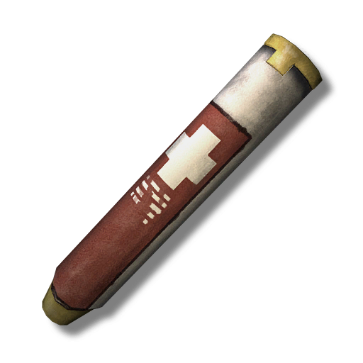
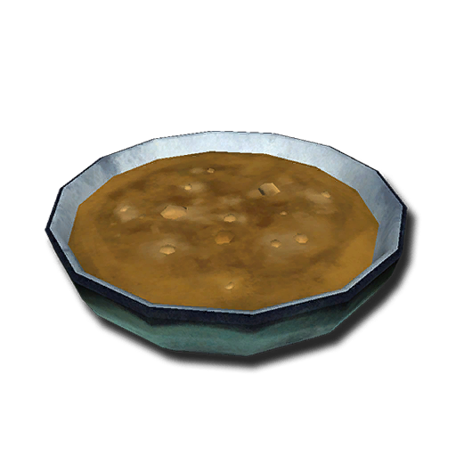

# Afflictions

**Categories:** Afflictions, Gameplay · **Source:** [Fandom](https://thelongdark.fandom.com/wiki/Afflictions)

**Contents**

- [Overview](#overview)
- [Benefits](#benefits)
- [Benefit-Like Causing Items](#benefit-like-causing-items)
- [Afflictions](#afflictions)
- [Injuries](#injuries)
- [Diseases](#diseases)
- [Darkwalker Afflictions](#darkwalker-afflictions)
- [Misery Mode Afflictions](#misery-mode-afflictions)
- [Cheat Death Afflictions](#cheat-death-afflictions)
- [Wintermute Afflictions](#wintermute-afflictions)
- [Removed Afflictions](#removed-afflictions)

 **Afflictions** are mostly temporary medical conditions that affect the player's ability to survive.

## Overview

Afflictions can be acquired by the player through gameplay, and any current active Afflictions can be viewed in the menu.

There are two types of afflictions:

- Positive afflictions: Referred to in-game as **Benefits**, confer favorable effects and are identifiable by a green status icon
- Negative afflictions: Referred to simply as **Afflictions**, inflict harmful effects and are represented by a yellow risk or red afflicted status icon.

## Benefits

Benefits are temporary status effects that provide positive effects to the player. They are gained by consuming certain foods, drinks, or recipes, wearing specific accessories, using First Aid items, or by avoiding starvation.

There are currently 11 different Benefits.

| Image | Affliction | Cause | Effect | Duration |
| --- | --- | --- | --- | --- |
|  _Armoured\_icon.png_ | [Armoured](./Armoured.md) | Equipped -  [Ballistic Vest](./Ballistic%20Vest.md) | - +50% [Protection](./Clothing.md#Protection) | While wearing the Ballistic Vest |
|  _Energy\_Boost\_icon.png_ | [Energy Boost](./Energy%20Boost.md) | Consume -  [Go! Energy Drink](./Go!%20Energy%20Drink.md) -  [Emergency Stim](./Emergency%20Stim.md) | - Go! Energy Drink - 50% [Fatigue](./Fatigue.md) and [Stamina](./Stamina.md) replenished immediately. - 50% Fatigue is lost when effect ends. - Emergency Stim - +100% Fatigue and Stamina - Fatigue and Stamina do not decay (meaning you can sprint for as long as this effect lasts) - -100% Fatigue (0% "Exhausted") when duration ends. | 30 minutes (Go! Energy Drink) 15 minutes (Emergency Stim) |
|  _Fatigue\_Reduced\_icon.png_ | [Fatigue Reduced](./Fatigue%20Reduced.md) | Consume: -  [Cup of Acorn Coffee](./Cup%20of%20Acorn%20Coffee.md) -  [Cup of Coffee](./Cup%20of%20Coffee.md) -  [Go! Energy Drink](./Go!%20Energy%20Drink.md) -  [Emergency Stim](./Emergency%20Stim.md) -  [Caffeine Pills](./Caffeine%20Pills.md) | - +10% [Fatigue](./Fatigue.md). - Fatigue decay is slowed. - -50% Calorie Burn from [Sprinting](./Stamina.md). | - 30 minutes (Acorn Coffee) - 1 hour (Coffee) - 45 minutes (Go! Energy Drink) - 15 minutes (Emergency Stim) - 4 hours (Caffeine Pills) |
|  _Heat\_Pack\_(Affliction)\_icon.png_ | [Heat Pack (Affliction)](./Heat%20Pack%20%28Affliction%29.md) | -  [Heat Pack](./Heat%20Pack.md) | - +5.0C of [Warmth](./Warmth.md) as long as Heat Pack is carried once activated. | 6 hours |
|  _Improved\_rest\_icon.png_ | [Improved Rest](./Improved%20Rest.md) | Consume -  [Cup of Herbal Tea](./Cup%20of%20Herbal%20Tea.md) -  [Ptarmigan Stew](./Ptarmigan%20Stew.md) -  [Rabbit Stew](./Rabbit%20Stew.md) -  [Ranger Stew](./Ranger%20Stew.md) -  [Stalker's Pie](./Stalker%27s%20Pie.md) -  [Thomson Family Stew](./Thomson%20Family%20Stew.md) -  [Trout Stew](./Trout%20Stew.md) -  [Venison Stew](./Venison%20Stew.md) | - Additional +2% Condition restored per hour while [sleeping](./Sleep.md) (1% for Interloper) per hour. | - 3 hours (Any Stew) - or - 6 hours (Herbal Tea, Stalker's Pie) |
|  _Nourished\_icon.png_ | [Nourished](./Nourished.md) | Consume -  [Camber Flight Porridge](./Camber%20Flight%20Porridge.md) -  [Breyerhouse Pie](./Breyerhouse%20Pie.md) -  [Dockworker's Pie](./Dockworker%27s%20Pie.md) -  [Lily's Pancakes](./Lily%27s%20Pancakes.md) -  [Ranger Stew](./Ranger%20Stew.md) -  [Last Resort Soup](./Last%20Resort%20Soup.md) -  [Porter's Soup](./Porter%27s%20Soup.md) -  [Vagabond Soup](./Vagabond%20Soup.md) | - +10% maximum Condition (for 110 total maximum) | 3 hours |
| Consume -  [Pemmican Bar](./Pemmican%20Bar.md) -  [Prepper's Pie](./Prepper%27s%20Pie.md) -  [Stalker's Pie](./Stalker%27s%20Pie.md) | - +15% maximum Stamina |  |  |  |
|  _Restore\_Condition\_icon.png_ | [Restore Condition](./Restore%20Condition.md) | Consume -  [Birch Bark Tea](./Birch%20Bark%20Tea.md) | - +2.5% [Condition](./Condition.md) per hour. - Note: Effect continues in addition/despite other Condition altering effects (0% [Needs](./Needs.md), [Blood Loss](./Blood%20Loss.md), passive Condition restoration, etc). | 2 hours |
| \[Missing image: Sure\_Footing.png\] _Sure\_Footing.png_ | [Sure Footing](./Sure%20Footing.md) | Wearing -  [Crampons](./Crampons.md) -  [Improvised Crampons](./Improvised%20Crampons.md) | - Less frequent sprains - [Rope Climbing](./Rope%20Climbing.md) is faster - [Weak Ice](./Weak%20Ice.md) is more forgiving | While wearing Crampons/Improvised Crampons |
|  _Unburdened\_icon.png_ | [Unburdened](./Unburdened.md) | Consume -  [Coastal Fishcakes](./Coastal%20Fishcakes.md) -  [Rabbit Pie](./Rabbit%20Pie.md) -  [Venison Pie](./Venison%20Pie.md) -  [Pemmican Bar](./Pemmican%20Bar.md) -  [Porter's Soup](./Porter%27s%20Soup.md) | - Increase carrying capacity by 3kg (6.6bs) | 3 hours |
|  _Warming\_up\_icon.png_ | [Warming Up](./Warming%20Up.md) | Consume HOT food/drinks | - Significantly slows Warmth loss when 'feels like' is negative. | 1 hour |
|  _Well\_fed\_icon.png_ | [Well Fed](./Well%20Fed.md) | Calorie Store must not hit 0 for at least 72 hours | - +5% maximum Condition (for 105% total maximum) - Increases carrying capacity by 5kg (11lbs). | Until starving (Calorie Store becomes 0) |

## Benefit-Like Causing Items

The following items have positive secondary effects associated with them that give Benefit-like effects when equipped/used, despite no Affliction being present in the Stats menu. These Benefits are not immediately obvious, but gameplay altering effects do occur once these items are used/worn.

| Affliction | Cause | Effect | Duration |
| --- | --- | --- | --- |
| Reduced Rifle Weight | Equipped [Security Chief's Rifle Holster](./Security%20Chief%27s%20Rifle%20Holster.md) | - Halves the weight of 1 Hunting Rifle in the player's inventory | While wearing the Security Chief's Rifle Holster |
| Reduced Tool Weight | Equipped [Foreman's Tool Belt](./Foreman%27s%20Tool%20Belt.md) | - Halves the weight of up to 3 specific tools in the player's inventory | While wearing the Foreman's Tool Belt |
| Wildlife Deterring Effect | Equipped [Wolfskin Coat](./Wolfskin%20Coat.md) | - [Wolves](./Wolf.md) have a chance to flee upon seeing the player. | While wearing the Wolfskin Coat |
| Wildlife Deterring Effect | Equipped [Bearskin Coat](./Bearskin%20Coat.md) | - [Wolves](./Wolf.md) have a chance to flee upon seeing the player. | While wearing the Bearskin Coat |
| Wildlife Deterring Effect | Carry [Bear Skin Bedroll](./Bear%20Skin%20Bedroll.md) | - [Wolves](./Wolf.md) have a chance to flee upon seeing the player. | When deploying/carrying a Bear Skin Bedroll |
| [Wildlife Deterring Effect](./Pumpkin%20Pie.md#Wildlife_deterring_effect) | Consume [Pumpkin Pie](./Pumpkin%20Pie.md) | - [Wolves](./Wolf.md) always run away from the player. (only present during the [4 Days of Night](./4%20Days%20of%20Night%20Event.md) event). | 6 hours |

## Afflictions

Afflictions are temporary or permanent status effects that cause Condition loss or detrimental effects to the player. Most afflictions are treatable, however treatments may require multiple doses (and time between each dose) to cure. Treatments are mostly affliction-specific, and when taken must be selected to treat affliction for their effect.

Acquiring an Affliction will always list the origin. A list of Affliction sources include:

- Fall
- Wolf Attack
- Bear Attack
- Moose Attack
- Cougar Attack
- Plane Crash Injuries (Wintermute Only)
- [Tainted Water](./Water%20%28Unsafe%29.md)
- Spoiled Food
- [Glimmer Fog](./Glimmer%20Fog.md)
- and many more

There are 39 different Afflictions, which can be sorted into two categories: injuries and diseases.

### Injuries

Injuries are Afflictions that cause instantaneous damage to the player, and can be caused by falling, animal struggles, exposure to the elements, and steep terrain. Frostbite is a notable exception, being a permanent injury that occurs after the "Frostbite Risk" reaches 100%.

| Image | Affliction | **Cause** | Effect | Duration | Treatment |
| --- | --- | --- | --- | --- | --- |
|  _Blood\_Loss\_icon.png_ | [Blood Loss](./Blood%20Loss.md) | [Struggles](./Struggle.md) with [Wolf](./Wolf.md), [Bear](./Bear.md), [Poisoned Wolf](./Poisoned%20Wolf.md), or [Timberwolf](./Timberwolf.md) attacks, and falling | - -30% [Condition](./Condition.md) per hour | Until treatment | 1 [Bandage](./Bandage.md) |
|  _Broken\_Ribs\_icon.png_ | [Broken Ribs](./Broken%20Ribs.md) | [Struggle](./Struggle.md#Moose) with [Moose](./Moose.md) | - -50% Maximum [Stamina](./Stamina.md) - -25% Carrying capacity - Note: Additional applications of Broken Ribs do not stack effect, but last longer (120 hours, 168, 216, etc). | 120 hours | 2 [Bandage](./Bandage.md) + 4 [Painkillers](./Painkillers.md) (or 2 [Rose Hip Tea](./Rose%20Hip%20Tea.md)) and waiting 5 days (120 hours) |
|  _Burdened\_icon.png_ | [Burdened](./Burdened.md) | Consume -  [Prepper's Pie](./Prepper%27s%20Pie.md) -  [Stalker's Pie](./Stalker%27s%20Pie.md) | - Decrease carrying capacity by 3kg (6.6bs) | 1 hour | Wait until Affliction passes. |
|  _Burns\_icon.png_ | [Burns](./Burns.md) | Walking over a lit [Campfire](./Campfire.md) or into any open fire Walking into electrified wires/water during an [Aurora](./Aurora.md) Not throwing a lit [Noisemaker](./Noisemaker.md) | - Maximum [Condition](./Condition.md) set to 75%. - When Burned, all Condition above 75% is lost immediately - In addition to burns, contact with fires/electrified wires causes constant and rapid Condition loss | 30 hours or until treatment | 1 [Bandage](./Bandage.md) + 2 [Painkillers](./Painkillers.md) (or 1 [Rose Hip Tea](./Rose%20Hip%20Tea.md)) |
|  _Burns\_(electric)\_icon.png_ |  |  |  |  |  |
|  _Frostbite\_icon.png_ | [Frostbite](./Frostbite.md) | Frostbite Risk reaches 100%. (body part exposed to sustained 0**°**C or colder temperatures (head, hands, feet etc), or body part is wearing frozen clothing | - -10% Maximum [Condition](./Condition.md) | Permanent | No Treatment |
|  _Gorged\_icon.png_ | [Gorged](./Gorged.md) | Consume -  [Breyerhouse Pie](./Breyerhouse%20Pie.md) -  [Dockworker's Pie](./Dockworker%27s%20Pie.md) | - -15% Maximum [Stamina](./Stamina.md) | 1 hour | Wait until Affliction passes. |
|  _Headache\_icon.png_ | [Headache](./Headache.md) | Drinking [Go! Energy Drink](./Go!%20Energy%20Drink.md), consuming certain [recipes](./Cooking.md) | - Vision is blurred - All [Stamina](./Stamina.md) is instantly lost | 20 minutes | Wait until Affliction passes. |
|  _Laceration\_icon.png_ | [Laceration](./Laceration.md) | [Struggles](./Struggle.md) with [Wildlife](./Wildlife.md) | - -20% [Condition](./Condition.md) | Immediate effect | Status effect disappears shortly after injury |
|  _Major\_Bruising\_icon.png_ | [Major Bruising](./Major%20Bruising.md) | [Struggles](./Struggle.md) with wildlife, falling | - -10% [Condition](./Condition.md) | Immediate effect | Status effect disappears shortly after injury |
|  _Minor\_Bruising\_icon.png_ | [Minor Bruising](./Minor%20Bruising.md) | [Struggles](./Struggle.md) with wildlife, falling | - -5% [Condition](./Condition.md) | Immediate effect | Status effect disappears shortly after injury |
|  _Pain\_icon.png_ | [Pain](./Pain.md) | [Struggles](./Struggle.md) with [Wildlife](./Wildlife.md), falling, sprains | - Blurred vision, distorted sounds | Four hours or until treatment | 1 [Bandage](./Bandage.md) + 2 [Painkillers](./Painkillers.md) (or 1 [Rose Hip Tea](./Rose%20Hip%20Tea.md)) Wait 4 hours |
|  _Severe\_Lacerations\_icon.png_ | [Severe Lacerations](./Severe%20Lacerations.md) | [Cougar](./Cougar.md) [Struggle](./Struggle.md) | - Maximum [Condition](./Condition.md) is reduced to 50%. - Maximum [Stamina](./Stamina.md) is reduced by 50%. - Generates 2-3 [Blood Loss](./Blood%20Loss.md) and [Infection Risk](./Infection%20Risk.md) along with the Affliction. - New instances of [Blood Loss](./Blood%20Loss.md) and [Infection Risk](./Infection%20Risk.md) occur every 12 hours. | 72 Hours | Wait until Affliction passes. |
|  _Sprained\_Ankle\_icon.png_ | [Sprained Ankle](./Sprained%20Ankle.md) | [Struggles](./Struggle.md) with [wildlife](./Wildlife.md), falling, walking on uneven or steep terrain (increased chance below 50% [Fatigue](./Fatigue.md), or when [encumbered](./Encumbrance.md)) | - [Sprinting](./Stamina.md) is disabled - [Rope Climbing](./Rope%20Climbing.md) and [Rock Climbing](./Rock%20Climb.md) is disabled | Four hours of rest or until treatment | 1 [Bandage](./Bandage.md) or 4 hours of [Sleep](./Sleep.md) |
|  _Sprained\_Wrist\_icon.png_ | [Sprained Wrist](./Sprained%20Wrist.md) | [Struggles](./Struggle.md) with [Wildlife](./Wildlife.md), falling, walking on uneven or steep terrain (increased chance below 50% [Fatigue](./Fatigue.md), or when [Encumbered](./Encumbrance.md)) | - [Rope Climbing](./Rope%20Climbing.md) and [Rock Climbing](./Rock%20Climb.md) is disabled - Use of [Hunting Rifles](./Hunting%20Rifle.md) and [Survival Bows](./Survival%20Bow.md) use is disabled - With both wrists sprained [Revolvers](./Revolver.md), [Distress Pistols](./Distress%20Pistol.md), and [Stones](./Stone.md) use is disabled | Two hours of rest or until treatment | 1 [Bandage](./Bandage.md) or 2 hours of [Sleep](./Sleep.md) |
|  _Suffocation\_icon.png_ | [Suffocation](./Suffocation.md) | Being inside polluted air found in [Last Prospect](./Last%20Prospect.md) and [Langston Mine](./Langston%20Mine.md). | - Deteriorating vision, loss of hearing. - _**Instant Death**_ after the timer reaches 0 | Length of the timer (30-60 real life seconds) | Exit the polluted air Wear a [Respirator](./Respirator.md) with [Canister](./Canister.md) |
|  _Torn\_Clothing\_icon.png_ | [Torn Clothing](./Torn%20Clothing.md) | [Struggles](./Struggle.md) with wildlife, falling | - Small amount of condition loss for outermost layer of clothing | Immediate effect | Status effect disappears shortly after injury |

### Diseases

Diseases are Afflictions that build up as a visible yellow "Affliction Risk" and then physically deteriorate the body once the meter is full, with most diseases requiring some form of treatment in order to heal the player (though some will pass over time.) Though rare, some diseases are purely psychological in nature, but can be just as detrimental to a player's survival as a physical disease.

Players are able to view the percentage of any existing risk of disease in the Status Menu. This risk may cause disease either by reaching 100% or through a dice roll based on the current risk percentage at a certain point in time (Ex. [Dysentery](./Dysentery.md), [Intestinal Parasites](./Intestinal%20Parasites.md), [Scurvy](./Scurvy.md))

Actions that increase risk of disease include drinking unsafe water, consuming raw, spoiled, or predator-based food, and spending too much time indoors or in freezing cold. Players must be aware of these risks and how to manage them in order to avoid the Afflictions they may cause.

| Image | Affliction | Cause | Effect | Duration | Treatment |
| --- | --- | --- | --- | --- | --- |
|  _Cabin\_Fever\_icon.png_ | [Cabin Fever](./Cabin%20Fever.md) | Spending more than 113 hours indoors over the last 6 days (daily average of 18.83 hours). (Immediately on Stalker or Interloper, after 50 Days on Voyageur) | - Cannot [Sleep](./Sleep.md) indoors for 24 hours | Until treated | Spending time outside |
|  _Chemical\_Poisoning\_icon.png_ | [Chemical Poisoning](./Chemical%20Poisoning.md) | Walking through [Chemical Hazard](./Chemical%20Hazard.md) Patches without a [Respirator](./Respirator.md) or footwear Struggles with [Poisoned Wolf](./Poisoned%20Wolf.md) | - Maximum [Condition](./Condition.md) reduced by 20% per affliction. - Note: When Poisoned, all Condition above the lowered max threshold, and the [Well Fed](./Well%20Fed.md) buff is lost. | 72 hours or until treatment | 1 [Emergency Stim](./Emergency%20Stim.md) |
|  _Dysentery\_icon.png_ | [Dysentery](./Dysentery.md) | Drinking [Water (Unsafe)](./Water%20%28Unsafe%29.md) | - [Condition](./Condition.md) cannot be restored by [Sleep](./Sleep.md) - -4% Condition per hour. - [Thirst](./Thirst.md) Need rapidly depletes. | Until treated | 2 [Antibiotics](./Antibiotics.md) (or 1 [Reishi Tea](./Reishi%20Tea.md)/1 [Burdock Tea](./Burdock%20Tea.md)) and 2.0 L [Water (Potable)](./Water%20%28Potable%29.md) and 10 hours of [Sleep](./Sleep.md). |
|  _Food\_Poisoning\_icon.png_ | [Food Poisoning](./Food%20Poisoning.md) | Eating [raw meat or spoiled food](./Food%20Poisoning.md#Risk_by_item). | - [Condition](./Condition.md) above 15% of maximum cannot be restored. - -85% Condition over 12-24 hours (will not reduce Condition below 15% maximum). - Note: most food poisoning sources become safe at [5 Cooking Skill](./Skills.md). | 12 - 24 hours or until treated | 2 [Antibiotics](./Antibiotics.md) (or 1 [Reishi Tea](./Reishi%20Tea.md)/1 [Burdock Tea](./Burdock%20Tea.md)) and 10 hours of [Sleep](./Sleep.md) Waiting 12-24 hours. |
|  _Hypothermia\_icon.png_ | [Hypothermia](./Hypothermia.md) | [Freezing](./Needs.md) for an extended period of time | - [Condition](./Condition.md) loss from Freezing is doubled (-20% Condition per hour, increased to -40% per hour). - [Fatigue](./Fatigue.md) is lost at 200% rate. | Until treated | Affliction heals while Warmth is above 0% (not "Freezing") until cured (6 hours on Pilgrim, 12 on Voyageur, 18 on Stalker, and 24 on Interloper) - Note: While Hypothermic, Freezing again (0% Warmth) will fully reset the timer to maximum. |
|  _Infection\_icon.png_ | [Infection](./Infection.md) | [Blood Loss](./Blood%20Loss.md) from a [Struggle](./Struggle.md) with wildlife | - -5% [Condition](./Condition.md) per hour - [Fatigue](./Fatigue.md) is lost at an increased rate | Until treated | 2 [Antibiotics](./Antibiotics.md) (or 1 [Reishi Tea](./Reishi%20Tea.md)/1 [Burdock Tea](./Burdock%20Tea.md)) and 8 hours of [Sleep](./Sleep.md). |
|  _Insomnia\_icon.png_ | [Insomnia](./Insomnia.md) | Exposure to [Glimmer Fog](./Glimmer%20Fog.md) for too long | - [Rest](./Sleep.md) is frequently interrupted, denying the player the full benefits of sleeping for long periods of time | 18 - 36 hours | Wait until Affliction passes. Affliction can be mitigated by drinking  [Cup of Herbal Tea](./Cup%20of%20Herbal%20Tea.md) before Resting. |
|  _Intestinal\_Parasites\_icon.png_ | [Intestinal Parasites](./Intestinal%20Parasites.md) | Consuming [Bear](./Bear%20Meat%20%28Raw%29.md), [Cougar Meat](./Cougar%20Meat%20%28Raw%29.md), or [Wolf Meat](./Wolf%20Meat%20%28Raw%29.md) (on Stalker or Interloper mode) | - -2% Maximum [Condition](./Condition.md) per day - -2% Maximum [Fatigue](./Fatigue.md) per day | Until treated | 2 [Antibiotics](./Antibiotics.md) (or 1 [Reishi Tea](./Reishi%20Tea.md)/1 [Burdock Tea](./Burdock%20Tea.md)) once a day for 10 days (240 hours) on Stalker; 20 days (480 hours) on Interloper |
|  _Scurvy\_icon.png_ | [Scurvy](./Scurvy.md) | Not eating enough foods rich in Vitamin-C | - Carry Capacity debuff of 5 Kg - Stamina drain multiplier of 1.5 - Fatigue multiplier of 1.5 - Lose 1 point of [Condition](./Condition.md) per hour until the affliction is cured or until death | Until treated | Eat foods high in Vitamin-C |

## Darkwalker Afflictions

The following Afflictions can only be encountered in the Challenge [Escape the Darkwalker](./Escape%20the%20Darkwalker.md).

| Image | Affliction | **Cause** | Effect | Duration | Treatment |
| --- | --- | --- | --- | --- | --- |
|  _Anxiety\_icon.png_ | [Anxiety](./Anxiety.md) | Being within 200m (~656 feet) of the Darkwalker | - Sleep and Pass Time is disabled, unless also in an active ward glyph's area of effect - Increasingly bloodied screen the closer one becomes to the Darkwalker | Immediate effect | Moving further than 200m from The Darkwalker |
|  _Fear\_icon.png_ | [Fear](./Fear.md) | Being less than 50m (~164 feet) from The Darkwalker | - -50% [Condition](./Condition.md) per minute (real-time) | Immediate effect | Moving further than 50m from The Darkwalker |
|  _Toxic\_Fog\_icon\_(severe).png_ | [Toxic Fog](./Toxic%20Fog.md) | Staying within a Region after Toxic Fog reaches Level 3 (timer reaches 2 minutes or less) | - All food and drink is instantly RUINED and provides 0 calories - Rapid loss of Condition - All Wildlife dies within the Region | Infinite | Leave Region with Level 3 Toxic Fog |

## Misery Mode Afflictions

All Afflictions unique to [Misery Mode](./Misery.md) are permanent. Some Afflictions appear when at different stages.

| Image | Affliction | **Cause** | Effect | Duration |
| --- | --- | --- | --- | --- |
|  _Diminished\_Form\_icon.png_ | [Diminished Form](./Diminished%20Form.md) | Stage 1: Hardship | - -5kg [Carry Weight](./Encumbrance.md) - 33% [Mobility Penalty](./Clothing.md) (Maximum [Stamina](./Stamina.md) is 66%) - Reduced chance of hostile wildlife fleeing during struggle ([Wolf](./Wolf.md), [Timberwolf](./Timberwolf.md) and [Poisoned Wolf](./Poisoned%20Wolf.md)) | Permanent |
|  _Sour\_Stomach\_icon.png_ | [Sour Stomach](./Sour%20Stomach.md) | Stage 2: Sorrow Stage 3: Despair Stage 4: Torment | - Maximum [Calories Stored](./Hunger.md) reduced by 1000 (1500 maximum) - Disables [Cooking Skill](./Cooking.md) level 5 "immunity to [Food Poisoning](./Food%20Poisoning.md)" perk when eating cooked low Condition food - Disables Cooking Skill level 5 "immunity to [Intestinal Parasites](./Intestinal%20Parasites.md)" perk when eating cooked predator meat - All Food Poisoning chances of all food items are doubled. Safe food items with 0% Food Poisoning risk are still safe, though. - The rate at which the [Risk of Intestinal Parasites](./Risk%20of%20Intestinal%20Parasites.md) meter is filled after consuming predator meat is increased by 1.5. One piece gives 1% risk, two pieces 6%, three pieces 13% etc. | Permanent |
|  _Frigid\_Bones\_icon.png_ | [Frigid Bones](./Frigid%20Bones.md) | Stage 2: Sorrow Stage 3: Despair Stage 4: Torment | - -5°C [Feels Like](./Feels%20Like.md) temperature penalty (Outdoors and Indoors) - [Warmth](./Warmth.md) meter recovers 50% slower | Permanent |
|  _Rheumatic\_Joints\_icon.png_ | [Rheumatic Joints](./Rheumatic%20Joints.md) | Stage 2: Sorrow Stage 3: Despair Stage 4: Torment | - -40% [Sprint](./Stamina.md) speed - -1s [Aiming](./Survival%20Bow.md) time - Chance to get sprains increased from 15% (base chance) to 40% - 2% [Condition](./Condition.md) damage upon receiving a [Sprained Wrist](./Sprained%20Wrist.md) or [Sprained Ankle](./Sprained%20Ankle.md) | Permanent |
|  _Haunted\_Mind\_icon.png_ | [Haunted Mind](./Haunted%20Mind.md) | Stage 2: Sorrow Stage 3: Despair Stage 4: Torment | - Maximum consecutive [Sleep](./Sleep.md) hours capped at 7 (normally 12) - -50% Condition recovered by Sleep | Permanent |
|  _Broken\_Body\_icon.png_ | [Broken Body](./Broken%20Body.md) | Stage 5: Ruin | - All forms of [Condition](./Condition.md) recovery are disabled (Passive from met [Needs](./Needs.md), [Sleep](./Sleep.md) and all [Items](./Emergency%20Stim.md)) - +100% Condition damage taken (double damage taken)(all sources) | Permanent |

## Cheat Death Afflictions

If the player chooses to [Cheat Death](./Cheat%20Death.md), they will be given 2 Afflictions.

| Image | Affliction | **Cause** | Effect | Duration | Treatment |
| --- | --- | --- | --- | --- | --- |
|  _Cheated\_Death\_Penalty\_icon.png_ | [Cheated Death Penalty](./Cheated%20Death%20Penalty.md) | Cheated Death | - Long Term Penalty (permanent) - -25%, -35%, -50% Condition (per death) - Short Term Penalty (temporary) - -50%, -60%, -75% Condition (per death) | - Short Term Penalty: Recovery Hours dependent on Experience and number of Deaths - Long Term Penalty: Permanent Affliction | None |
|  _Weakened\_State\_icon.png_ | [Weakened State](./Weakened%20State.md) | Cheated Death | - [Condition](./Condition.md) and [Stamina](./Stamina.md) recovery are halved - A Black and White filter is placed over the world | Recovery Hours dependent on Experience and number of Deaths. | None |

## Wintermute Afflictions

The following Afflictions can only be encountered in [Wintermute](./Wintermute.md). These Afflictions do not affect the player character, but rather a [Crash Survivor](./Crash%20Survivor.md).

Image

Affliction

**Cause**

Effect

Duration

Treatment

_Concussion\_icon.png_

[Concussion](./Concussion.md)

Plane crash has given this to a Crash Survivor

None

Scripted

None

_Dehydration\_Risk\_icon.png_

[Dehydration Risk](./Dehydration%20Risk.md)

Affects a Crash Survivor, Lack of water

None

Until Healed

Drink [Water (Potable)](./Water%20%28Potable%29.md)

_Dehydrated\_icon.png_

[Dehydrated](./Dehydrated.md)

Affects a Crash Survivor, Lack of water

Loss of Condition

Until Healed or Death

Drink [Water (Potable)](./Water%20%28Potable%29.md)

_Hyperglycemic\_Risk\_icon.png_

[Hyperglycemic Risk](./Hyperglycemic%20Risk.md)

Dimitri has Type-1 Diabetes and has high blood sugar

None

Scripted

[Insulin](./Insulin.md)

## Removed Afflictions

The following Affliction has been removed from the game:

Image

Affliction

**Cause**

Effect

Duration

Treatment

_Plane\_Crash\_Injuries\_icon.png_

[Plane Crash Injuries](./Plane%20Crash%20Injuries.md)

Plane crash has given this to [Will Mackenzie](./Will%20Mackenzie.md)

Cannot Sprint, hold Weapons, climb [Rock Climbs](./Rock%20Climb.md)

Scripted

Scripted
