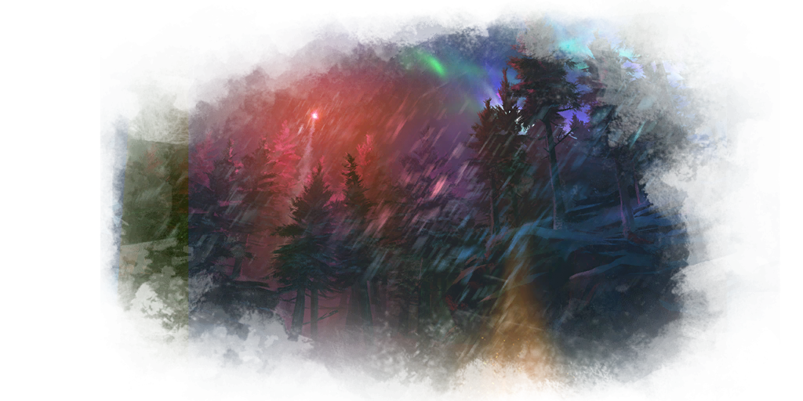

# Aftermath/Transcript

**Contents**

- [Leave the Community Hall.](#Leave_the_Community_Hall.)
- [Go to Signal Hill.](#Go_to_Signal_Hill.)
- [Use the Radio.](#Use_the_Radio.)
- [Enter the mine and leave Pleasant Valley](#Enter_the_mine_and_leave_Pleasant_Valley)
- [Find a way through the mine tunnels.](#Find_a_way_through_the_mine_tunnels.)
- [Find a way to fix the elevator](#Find_a_way_to_fix_the_elevator)

<table class="infobox">
<caption>Aftermath/Transcript</caption>
<colgroup>
<col style="width: 50%" />
<col style="width: 50%" />
</colgroup>
<tbody>
<tr>
<td colspan="2"><figure>

<figcaption>Missions_story_ep3_Aftermath.png</figcaption>
</figure></td>
</tr>
<tr>
<td>
Episode
</td>
<td>
<a href="./Episode%203%20-%20Crossroads%20Elegy.md" class="wikilink" title="Episode 3">Episode 3</a>|-
</td>
</tr>
<tr>
<td>
Previous
</td>
<td>
<a href="./Coming%20Storm%20%E2%80%94%20Transcript.md" class="wikilink" title="Coming Storm/Transcript">Coming Storm/Transcript</a>
</td>
</tr>
<tr>
<td>
Current
</td>
<td>
Aftermath/Transcript
</td>
</tr>
<tr>
<td>
Next
</td>
<td>
<a href="./Prologue%20%E2%80%94%20Transcript.md" class="wikilink" title="Prologue/Transcript">Prologue/Transcript</a>
</td>
</tr>
<tr>
<td>
Region
</td>
<td>
<a href="./Pleasant%20Valley.md" class="wikilink" title="Pleasant Valley">Pleasant Valley</a>
</td>
</tr>
<tr>
<td>
Characters
</td>
<td>
<a href="./Astrid%20Greenwood.md" class="wikilink" title="Astrid">Astrid</a> <a href="./Molly.md" class="wikilink" title="Molly">Molly</a> 
<a href="./Characters.md#Radio_Voice_Man" class="wikilink" title="Radio Voice Man">Radio Voice Man</a> 
<a href="./Will%20Mackenzie.md" class="wikilink" title="Will Mackenzie">Will Mackenzie</a> 
<a href="./Father%20Thomas.md" class="wikilink" title="Father Thomas">Father Thomas</a> (ending cameo)
</td>
</tr>
</tbody>
</table>

This is the mission transcript for mission 4 <a href="./Aftermath.md" class="wikilink" title="Aftermath">Aftermath</a> of <a href="./Episode%203%20-%20Crossroads%20Elegy.md" class="wikilink" title="Episode 3: Crossroads Elegy">Episode 3: Crossroads Elegy</a>.

The story continues in <a href="./Prologue%20%E2%80%94%20Transcript.md" class="wikilink" title="Prologue/Transcript">Prologue/Transcript</a>

## Leave the Community Hall.

CHAPTER FOUR

AFTERMATH

*As Astrid makes her way to the <a href="./Cinder%20Hills%20Coal%20Mine.md" class="wikilink" title="Cinder Hills Coal Mine">Cinder Hills Coal Mine</a>, the <a href="./Receiver.md" class="wikilink" title="Receiver">Receiver</a> rings at the entrance again and Astrid picks it up.*

<a href="./Astrid%20Greenwood.md" class="wikilink" title="Astrid Greenwood">Astrid Greenwood</a>: "Hello, Molly."

<a href="./Molly.md" class="wikilink" title="Molly">Molly</a>: "Woah, I hate to be a foregone conclusion."

Astrid: "Well, I don't seem to get a lot of other calls out here."

Molly: "I want to know something. Why did you work so hard to help those strangers? Would they have done the same for you?"

Astrid: "I have no idea."

Molly: "I doubt they would. You probably work all day, every day. Bust your ass to help people. Delivering babies or researching or whatever it is you do. Does anyone really notice?"

Astrid: "I'm not sure. But I don't do it for that."

Molly: "You don't do it for recognition because, you don't get any."

Astrid: "What is this about, really?"

Molly: "I could have been something, too. Something more than a farmer's wife. Something more than a cattleman's daughter."

Astrid: "I'm sure you could have, Molly."

Molly: "Don't patronize me. I could have been something, but I let him stop me. I let myself be small so he could feel like somebody. I gave up everything for him, and to him I didn't even exist. I let him make me small. Less than nothing."

Astrid: "What happened to him, Molly?"

Molly: "You wouldn't understand."

Astrid: "Did he hurt you? Did you...kill him?"

Molly: "There's different ways to hurt people. Some ways heal, others never do. And I told you, the wolves killed him. Nevermind that. I called to tell you something."

Astrid: "What did you call to tell me, Molly?"

Molly: "There's an old radio tower. Top of the hill overlooking my farm. You can see the tower from my porch. Not sure if you can get it working, but the radio up there'd be good enough to reach Perseverance Mills. You can maybe find out about your guy. The precious mystery thing you hope he has."

Astrid: "A radio? But...why'd you wait so long to tell me?"

Molly: "Well, I didn't know if I'd work. And...also. Girl gets lonely out here, I guess. It was nice to have someone to talk to."

*Molly hangs up, and Astrid does in suit. The blizzard that Father Thomas mentioned would arrive has finally come, and Astrid risks her life to make her way to <a href="./Signal%20Hill.md" class="wikilink" title="Signal Hill">Signal Hill</a> in the whiteout.*

## Go to Signal Hill.

*Astrid arrives outside the door of the radio shack, and sees another dead Convict in the snow with an arrow in his back*

Astrid: "More bodies, Molly?"

*She steps inside and warms herself up*

Astrid: "Can only hope the radio in here is in better shape than everything else in the valley."

## Use the Radio.

*She finds a shortwave radio and attempts to get it working, fiddling with power and knobs but getting no response*

Astrid: "Yup. The radio's sure dead. Well, that trip was a waste." *She sees a nearby bunk bed* "I should get some shut-eye, and strike off for the mine Father Tom mentioned in the morning. It's time to say bye to Pleasant Valley."

*Astrid goes to sleep, but awakes later that night to the power and electronics around her buzzing with energy and life*

Astrid: "The radio...it's working!"

*She rushes to the radio*

Astrid: "Damn! Why can't I get anything..."

<a href="./Characters.md#Radio_Voice_Man" class="wikilink" title="Radio Voice Man">Radio Voice Man</a>: "...\[static\]...Come in this is...Perseverance Mills."

*Astrid grabs the microphone and attempts to contact the Mills, but to no avail*

Astrid: "Hello? Can anyone hear me?"

<a href="./Characters.md#Radio_Voice_Man" class="wikilink" title="Radio Voice Man">Radio Voice Man</a>: "...\[static\]... Come in..."

<a href="./Will%20Mackenzie.md" class="wikilink" title="Will Mackenzie">Will Mackenzie</a>: "Hello? Is this the radio station at Perseverance Mills?"

Astrid: "Can you hear me?"

Radio Voice Man: "We need...help... There's some kind of...quarantine...situation."

Mackenzie: "Hello?"

*Astrid realizes Mackenzie is on the line*

Astrid: "Mackenzie."

Mackenzie: "What do you mean, quarantine?"

Astrid: "Mackenzie is that you?"

Mackenzie: "Is there a doctor with you?"

Radio Voice Man: "We need a...doctor... or medical assistance. Anything."

Astrid: "Shit, I can hear him but he can't hear me."

Radio Voice Man: "We're cut off."

*Astrid gives up attempting to use the radio, realizing she can't get a message out*

Astrid: "You're alive. Dammit Mackenzie...you're alive. And on your way to Perseverance Mills. I've got to get there."

## Enter the mine and leave Pleasant Valley

*Astrid gets up, and hears a <a href="./Receiver.md" class="wikilink" title="Receiver">Receiver</a> ring nearby*

Astrid: "electricity...must be reacting to the lights in the sky."

*She answers it.*

Astrid: "What is it, Molly?"

Molly: "We have a lot in common, you and I."

Astrid: "How's that?"

Molly: "We both left our man behind. We both like to be alone. We're both hiding from our pasts."

Astrid: "I...don't know what you mean."

Molly: "Yes, you do. I didn't kill him, you know. I wanted to...so many times. I just never had the courage. And as bad as it got at times...at least I wouldn't be alone. Being alone would be worse. That's what I told myself."

Astrid: "I don't judge you, Molly."

Molly: "I didn't kill him, but I may as well have. I watched while the wolves surrounded him. I knew what was coming. I had a rifle in my hands. I could have helped him."

Astrid: "Molly..."

Molly: "It all happened, in slow motion. You know, like a ballet. They were so...quiet. And confident. Like there was no other way it could end. And I just stood there, frozen. He was yelling at me to shoot. But...I couldn't They circled, and then they were on him. Like a force of nature."

Astrid: "Molly...why are you telling me this?"

Molly: "Because it's important for someone to know."

Astrid: "For someone to know what?"

Molly: "That I don't regret it. Not for a second."

Astrid: "The convict, outside with the arrows in the back. That your handiwork too?"

Molly: "Yup. They're all going to pay now, Astrid."

Astrid: "Who are?"

Molly: "All of them. We've been in the background, in the shadows. Invisible. Overlooked. For too long. Uh-uh. Not any more."

Astrid: "I'm not sure revenge is the answer, Molly."

Molly: "Ha! Maybe not. But it'll do for now." *Molly breaths a sigh of relief* "It feels good to be on this side of the hunt. So I'm making up for lost time. Take care of yourself, Doctor."

Astrid: "You too, Molly."

Molly: "Tell me one last thing. Your pilot. The one you left behind? He one of the good ones?"

Astrid: "Yes, he is. But things are...complicated...between us. Let's just say...I wouldn't want to find him with an arrow in his back."

Molly: "Then I hope to never meet him. It's been good talking with you, Astrid. For a little while, you took the loneliness away. I hope you find what you're looking for. I hope you can help those people up in Perseverance Mills, and...find some peace for yourself."

Astrid: "Thank you, Molly. I hope you can find some peace too."

*Molly hangs up, and Astrid hangs up the phone. Astrid then journeys through the still raging blizzard and then walks into the abandoned mine. The aurora fading in the sky and replaced with nothing but the wind and snow as the journey continues*

## Find a way through the mine tunnels.

Astrid: "Uh, looks iffy..."

*Astrid starts walking deeper into the mine, as another earthquake rocks the island*

Astrid: "It's a mine alright...air is thick."

*Astrid walks deeper into the mine, and finds a barred up section of the mine*

Astrid: "Dead end...right. Have to find another way."

*Astrid finds another path and then continues moving forward*

Astrid: "No way to know how deep it goes."

*Another light earthquake rocks the mine, followed by another. Small rocks begin falling from the celling with each tremor. Finally, as Astrid is walking across some wooden planks, a massive earthquake causes her to stop as the ceiling collapses and she falls through the floor.*

Astrid: "No, NO!"

*Astrid wakes up, buried in rocks and pushes them off her, finding the mine's artificial lights turned on by an aurora. She is in a deeper section of the mine*

Astrid: "Ok, nothing broken, still breathing."

*Astrid walks around and sees a partially collapsed path ahead*

Astrid: "I can probably duck under those rocks..."

*She continues on her path as another earthquake rocks the mine, large stones falling from the ceiling. She eventually comes across a pool of water spiking with electricity from downed live wires. She safely crosses to the other side, only for another light earthquake to rock the mine. Eventually she finds a powered elevator*

Astrid: "This elevator looks like the only way out of here."

*The elevator will not move, even when the floor buttons are pressed*

## Find a way to fix the elevator

*Astrid then begins tracing the power to the elevator, and finds several <a href="./Fuse%20Box.md" class="wikilink" title="Fuse Boxes">Fuse Boxes</a> with <a href="./Burned%20Out%20Fuse.md" class="wikilink" title="Burned Out Fuses">Burned Out Fuses</a>.*

Astrid: "Hmm. Needs fuses."

*She finds many <a href="./Replacement%20Fuse.md" class="wikilink" title="Replacement Fuses">Replacement Fuses</a> and fixes 3 Fuse Boxes after braving through more electrified water, earthquakes, and live wires*

Astrid: "Last one, assuming they work."

*She manages to leave via the elevator, and walks a good while until she finally finds an exit to the mine.*

Astrid: "Phew...a way out, finally."

*Stepping outside, a final cutscene plays. Astrid she sees the highway, as well as a dead pod of Orca whales on the ocean ice. A beached fishing vessel is present along the ice as well*

Astrid: "What...the...hell."

*Astrid begins walking down the hill, seeing and hearing crows over the dead pod*

Astrid: "The world is changing...has changed. The aurora. The weather. The wildlife. It somehow feels like Mother Nature is crying out. Or maybe she's warning us of what's to come. People like Molly, or Father Tom, or the crash survivors...They're just the ones left behind."

*Scene changes to show Molly smoking, then Father Thomas, then the Crash Survivors*

Astrid: "damaged people. The hopeful and the hopeless."

*Scene pans over the crashed passenger plane*

Astrid: "What will this new world do to them? Will it make them harder? Will it break them?"

*Scene changes to show <a href="./Molly%27s%20Husband.md" class="wikilink" title="Molly&#39;s Husband&#39;s">Molly's Husband's</a> arm, then the <a href="./Old%20Schoolhouse.md" class="wikilink" title="Old Schoolhouse">Old Schoolhouse</a>*

Astrid: "I'm not sure I can help them."

*Scene changes to the radio at Signal Hill*

Astrid: "And I don't know what I'll find when I get to where I'm going."

*Scene changes to show <a href="./Mackenzie%27s%20Crashed%20Plane.md" class="wikilink" title="Mackenzie&#39;s Crashed Plane">Mackenzie's Crashed Plane</a>*

Astrid: "But what I do know is this. Mackenzie is alive, and he's heading to <a href="./Perseverance%20Mills.md" class="wikilink" title="Perseverance Mills">Perseverance Mills</a>."

*Scene changes to show the dead Orca whale pod on the ice of <a href="./Coastal%20Highway.md" class="wikilink" title="Coastal Highway">Coastal Highway</a>, with crows circling over their bodies*

Astrid: "And that means...I have to get there before it's too late."

*Scene changes to show Astrid walking down the highway to <a href="./Crumbling%20Highway.md" class="wikilink" title="Crumbling Highway">Crumbling Highway</a>, with the aurora suddenly appearing in the sky*

Astrid: "I may not be able to stop this darkness from coming. But I'll be damned if I'm going to let it happen without a fight."

*Credits for the episode roll*

The story continues in <a href="./Prologue%20%E2%80%94%20Transcript.md" class="wikilink" title="Prologue/Transcript">Prologue/Transcript</a> **Lua execution error in Module:Navbox function navbox**

