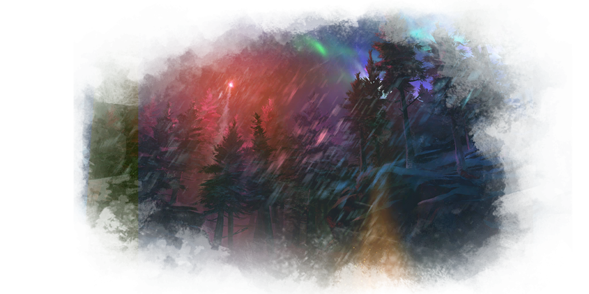
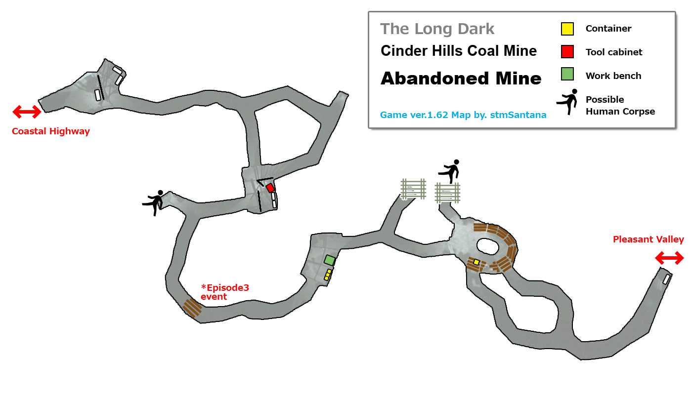
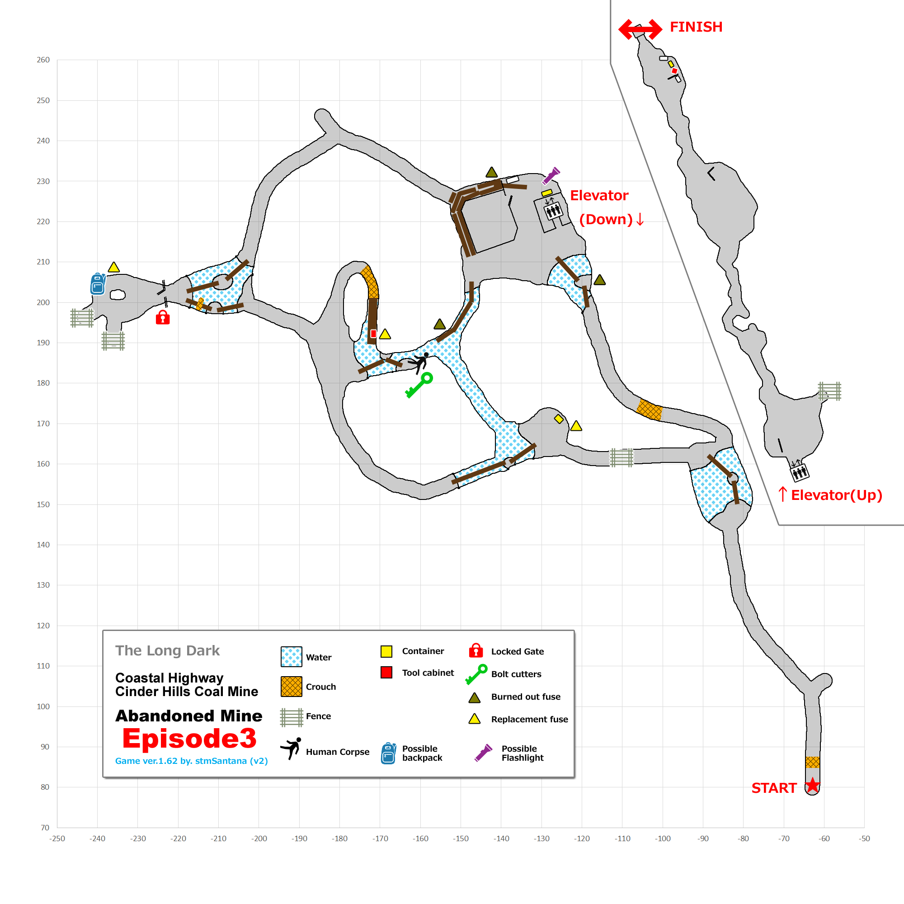

# Aftermath

**Categories:** Episode 3 · **Source:** [Fandom](https://thelongdark.fandom.com/wiki/Aftermath)

**Aftermath**

| Property | Details |
| --- | --- |
|  |  / _Missions\_story\_ep3\_Aftermath.png_ |
| Episode | [Episode 3](./Episode%203%20-%20Crossroads%20Elegy.md)\|- |
| Previous | [Coming Storm](./Coming%20Storm.md) |
| Current | Aftermath |
| Next | [Prologue](./Prologue.md) |
| Region | [Pleasant Valley](./Pleasant%20Valley.md) |
| Characters | [Astrid](./Astrid%20Greenwood.md) [Molly](./Molly.md) / [Radio Voice Man](./Characters.md#Radio_Voice_Man) / [Will Mackenzie](./Will%20Mackenzie.md) / [Father Thomas](./Father%20Thomas.md) (ending cameo) |

**Spoiler Warning:**__This page may contain spoilers from the [story](./Wintermute.md) of The Long Dark.__

> “__You've brought healing and respite to the people at Thomson's Crossing. Your work at the Community Hall is complete. Do what you need to do before leaving Pleasant Valley.__”

**Aftermath** is the fourth mission in [Episode 3](./Episode%203%20-%20Crossroads%20Elegy.md) of the [story](./Wintermute.md). In this mission, [Astrid](./Astrid%20Greenwood.md) prepares to leave [Pleasant Valley](./Pleasant%20Valley.md) and make her way to [Perseverance Mills](./Perseverance%20Mills.md) through the [Cinder Hills Coal Mine](./Cinder%20Hills%20Coal%20Mine.md).

## Objectives

- Leave the Community Hall.
- Go to Signal Hill.
- Use the radio.
- Enter the mine and leave Pleasant Valley. Once you enter the mine, you will not be able to return to Pleasant Valley.
- Find a way through the mine tunnels.
- Try the elevator.
- Find a way to fix the elevator.
  - Swap [burned out fuses](./Burned%20Out%20Fuse.md) with replacements \[0/3\].
- Use the elevator.

_Abandoned mine (EP3 - Start)_

_Abandoned Mine (Episode.3 - Finish)_

## Walkthrough

| Mission details |  |
| --- | --- |
|  |  |
