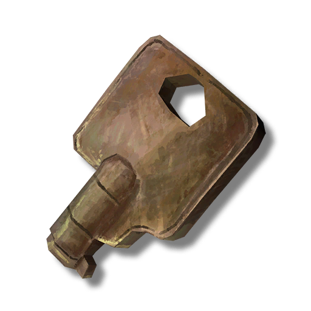

# Aid Station Medical Locker Key

<table class="infobox">
<caption>Aid Station Medical Locker Key</caption>
<colgroup>
<col style="width: 50%" />
<col style="width: 50%" />
</colgroup>
<tbody>
<tr>
<td colspan="2"><figure>

<figcaption>Aid_Station_Medical_Locker_Key_icon.png</figcaption>
</figure></td>
</tr>
<tr>
<td>
Release
</td>
<td>
<a href="./The%20Long%20Dark%20%E2%80%94%20Early%20Access%20Changelog.md#1.00" class="wikilink" title="1 August 2017">1 August 2017</a>
</td>
</tr>
<tr>
<td>
Wintermute
</td>
<td>
<a href="./Episode%202%20-%20Luminance%20Fugue.md" class="wikilink" title="Episode 2">Episode 2</a> - <a href="./The%20Wounded%20Trapper.md" class="wikilink" title="The Wounded Trapper">The Wounded Trapper</a>
</td>
</tr>
<tr>
<td colspan="2" class="section">
<strong>Properties</strong>
</td>
</tr>
<tr>
<td>
Item type
</td>
<td>
<a href="./Collectibles.md" class="wikilink" title="Collectibles">Collectibles</a>|-
</td>
</tr>
<tr>
<td>
Stackable
</td>
<td>
No
</td>
</tr>
<tr>
<td>
Examine
</td>
<td>
A key for the Medical Locker aid station in Carter Hydro Dam.
</td>
</tr>
<tr>
<td colspan="2" class="section">
<strong>Values</strong>
</td>
</tr>
<tr>
<td>
Weight
</td>
<td>
0.00 kg (0 lbs)
</td>
</tr>
<tr>
<td colspan="2" class="section">
<strong>Actions</strong>
</td>
</tr>
<tr>
<td>
Backpack
</td>
<td>
Examine
</td>
</tr>
<tr>
<td>
On ground
</td>
<td>
Take It, Leave It
</td>
</tr>
</tbody>
</table>

**Aid Station Medical Locker Key** is a <a href="./Collectibles.md" class="wikilink" title="Collectible">Collectible</a> item found in <a href="./Episode%202%20-%20Luminance%20Fugue.md" class="wikilink" title="Episode 2">Episode 2</a> of the <a href="./Wintermute.md" class="wikilink" title="Wintermute">Wintermute</a> story mode. It is found inside the <a href="./Carter%20Hydro%20Dam.md" class="wikilink" title="Carter Hydro Dam">Carter Hydro Dam</a> next to the <a href="./Elevator%20Maintenance%20Note.md" class="wikilink" title="Elevator Maintenance Note">Elevator Maintenance Note</a> in the upper locked office. The <a href="./Admin%20Office%20Key.md" class="wikilink" title="Admin Office Key">Admin Office Key</a> is needed to open the office first.

<table class="gallery">
<colgroup>
<col style="width: 100%" />
</colgroup>
<tbody>
<tr>
<td><figure>
[Missing image: Aid_Station_Medical_Locker_Key_in_game.jpg]
<figcaption>The 3D key model as seen in game</figcaption>
</figure></td>
</tr>
</tbody>
</table>

## Update history

- UPDATE **17 December 2018 (<a href="./The%20Long%20Dark%20%E2%80%94%20Changelog.md#1.41" class="wikilink" title="Update">Update</a>):**
  - Added a new 3D model for this key in the Redux edition.
- UPDATE **1 August 2017 (<a href="./The%20Long%20Dark%20%E2%80%94%20Changelog.md#1.00" class="wikilink" title="Update">Update</a>):**
  - Added to game.

**Lua execution error in Module:Navbox function navbox**

