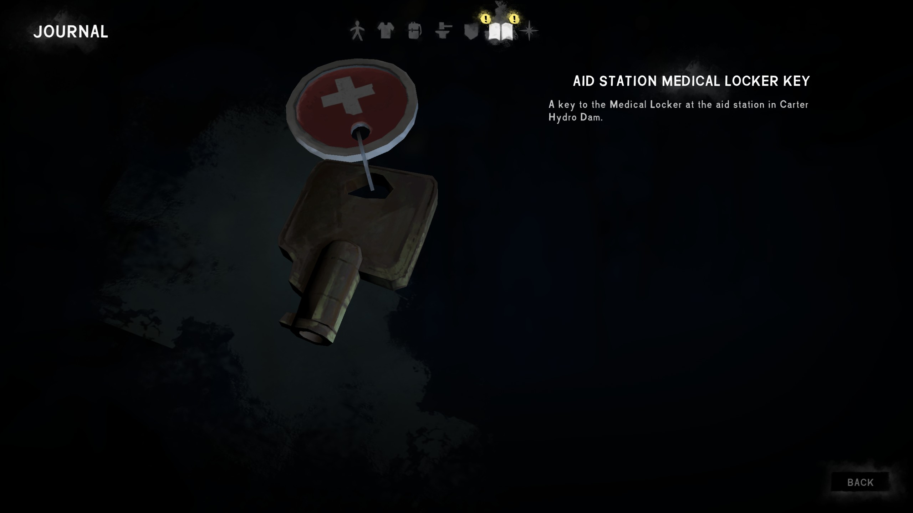

# Aid Station Medical Locker Key

**Categories:** Collectibles, Pages with update history · **Source:** [Fandom](https://thelongdark.fandom.com/wiki/Aid_Station_Medical_Locker_Key)

**Aid Station Medical Locker Key**

[Aid Station Medical Locker Key icon](../assets/Aid_Station_Medical_Locker_Key_icon.png)

**Release:** [1 August 2017](./The%20Long%20Dark%20%E2%80%94%20Changelog%20%E2%80%94%20Archive%201.md#1.00)

**Wintermute:** [Episode 2](./Episode%202%20-%20Luminance%20Fugue.md) - [The Wounded Trapper](./The%20Wounded%20Trapper.md)

**Properties**

**Item type:** [Collectibles](./Collectibles.md)

**Stackable:** No

**Examine:** A key for the Medical Locker aid station in Carter Hydro Dam.

**Values**

**Weight:** 0.00 kg (0 lbs)

**Actions**

**Backpack:** Examine

**On ground:** Take It, Leave It

**Aid Station Medical Locker Key** is a [Collectible](./Collectibles.md) item found in [Episode 2](./Episode%202%20-%20Luminance%20Fugue.md) of the [Wintermute](./Wintermute.md) story mode. It is found inside the [Carter Hydro Dam](./Carter%20Hydro%20Dam.md) next to the [Elevator Maintenance Note](./Elevator%20Maintenance%20Note.md) in the upper locked office. The [Admin Office Key](./Admin%20Office%20Key.md) is needed to open the office first.

## Update history

- UPDATE **17 December 2018 ([Update](./The%20Long%20Dark%20%E2%80%94%20Changelog%20%E2%80%94%20Archive%201.md#1.41)):**
  - Added a new 3D model for this key in the Redux edition.
- UPDATE **1 August 2017 ([Update](./The%20Long%20Dark%20%E2%80%94%20Changelog%20%E2%80%94%20Archive%201.md#1.00)):**
  - Added to game.
