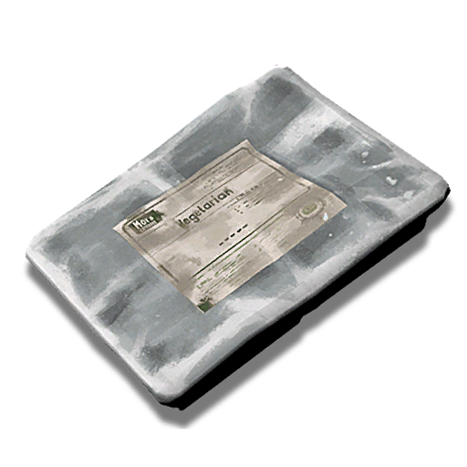

# Airline Food \- Vegetarian

<table class="infobox">
<caption>Airline Food - Vegetarian</caption>
<colgroup>
<col style="width: 50%" />
<col style="width: 50%" />
</colgroup>
<tbody>
<tr>
<td colspan="2"><figure>

<figcaption>Airline_Food_-_Vegetarian_icon.png</figcaption>
</figure></td>
</tr>
<tr>
<td>
Release
</td>
<td>
<a href="./The%20Long%20Dark%20%E2%80%94%20Changelog.md#1.60" class="wikilink" title="22 October 2019">22 October 2019</a>
</td>
</tr>
<tr>
<td>
Wintermute
</td>
<td>
Yes
</td>
</tr>
<tr>
<td>
Renewable
</td>
<td>
No
</td>
</tr>
<tr>
<td colspan="2" class="section">
<strong>Properties</strong>
</td>
</tr>
<tr>
<td>
Item type
</td>
<td>
<a href="./Food%20And%20Drink.md" class="wikilink" title="Food And Drink">Food And Drink</a>|-
</td>
</tr>
<tr>
<td>
Stackable
</td>
<td>
No
</td>
</tr>
<tr>
<td>
Examine
</td>
<td>
Bits of frozen broccoli and something that resembles mashed potatoes is visible under the wrapper. The veggie option never looked so good.
</td>
</tr>
<tr>
<td colspan="2" class="section">
<strong>Values</strong>
</td>
</tr>
<tr>
<td>
Calories
</td>
<td>
560 kcal
</td>
</tr>
<tr>
<td>
Hydration
</td>
<td>
5%
</td>
</tr>
<tr>
<td>
<a href="./Scurvy.md" class="wikilink" title="Vitamin C">Vitamin C</a>
</td>
<td>
Major (73%)
</td>
</tr>
<tr>
<td>
Weight
</td>
<td>
0.25 kg (0.55 lbs)
</td>
</tr>
<tr>
<td colspan="2" class="section">
<strong>Advanced data</strong>
</td>
</tr>
<tr>
<td>
Item key
</td>
<td>
GAMEPLAY_AirlineFoodVeg
</td>
</tr>
</tbody>
</table>

**Airline Food - Vegetarian** is a packaged <a href="./Food%20And%20Drink.md" class="wikilink" title="food">food</a> item in <a href="./The%20Long%20Dark.md" class="wikilink" title="The Long Dark"><em>The Long Dark</em></a>.

## Overview

Consuming Airline Food - Vegetarian provides up to 560 calories of <a href="./Hunger.md" class="wikilink" title="energy">energy</a> and 5% <a href="./Thirst.md" class="wikilink" title="hydration">hydration</a>. They are exclusive to the area surrounding the <a href="./Crash%20Site%20%28Pleasant%20Valley%29.md" class="wikilink" title="plane crash">plane crash</a> in <a href="./Pleasant%20Valley.md" class="wikilink" title="Pleasant Valley">Pleasant Valley</a> and <a href="./Cargo%20Container.md" class="wikilink" title="Cargo Containers">Cargo Containers</a> in <a href="./Timberwolf%20Mountain.md" class="wikilink" title="Timberwolf Mountain">Timberwolf Mountain</a>, with their abundance affected by <a href="./Survival%20Mode.md" class="wikilink" title="Survival Mode">Survival Mode</a>.

Airline Food - Vegetarian can cause <a href="./Food%20Poisoning.md" class="wikilink" title="Food Poisoning">Food Poisoning</a>, and <a href="./Decay.md" class="wikilink" title="decays">decays</a> more slowly when outdoors.

## Trivia

- Airline Food - Vegetarian and Chicken do not spawn on <a href="./Interloper.md" class="wikilink" title="Interloper">Interloper</a> mode.
- Airline Food - Vegetarian provides fewer calories than the <a href="./Airline%20Food%20-%20Chicken.md" class="wikilink" title="Airline Food - Chicken">Airline Food - Chicken</a>.
- There is no option to heat them over a fire spot, and the item will not become "Hot" by dropping them on the ground near an active fire.

## Update history

- UPDATE **22 October 2019 (<a href="./The%20Long%20Dark%20%E2%80%94%20Changelog.md#1.60" class="wikilink" title="Update">Update</a>):**
  - Added to game.

**Lua execution error in Module:Navbox function navbox** <a href="ru:%D0%95%D0%B4%D0%B0_%D0%B8%D0%B7_%D1%81%D0%B0%D0%BC%D0%BE%D0%BB%D1%91%D1%82%D0%B0_%E2%80%94_%D0%B2%D0%B5%D0%B3%D0%B5%D1%82%D0%B0%D1%80%D0%B8%D0%B0%D0%BD%D1%81%D0%BA%D0%B8%D0%B9_%D0%BE%D0%B1%D0%B5%D0%B4" class="wikilink" title="ru:Еда из самолёта — вегетарианский обед">ru:Еда из самолёта — вегетарианский обед</a>

