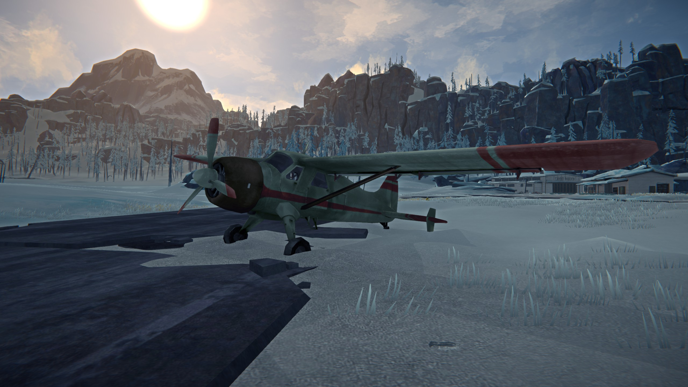
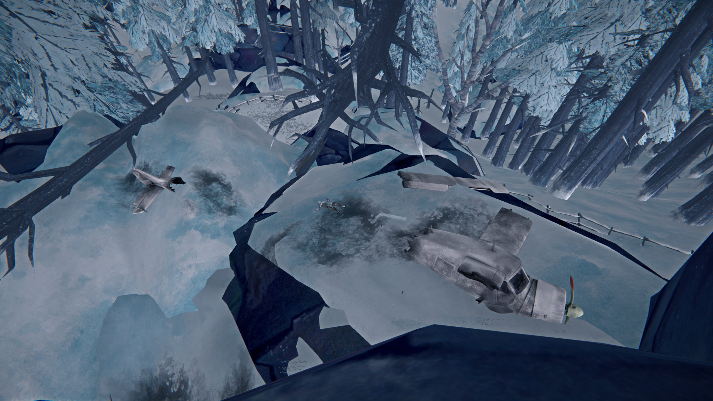
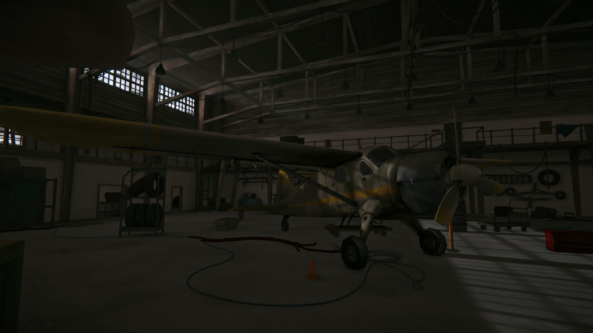
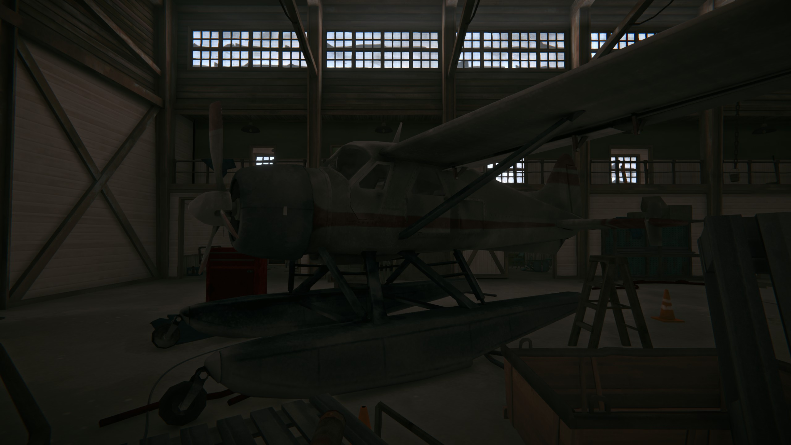
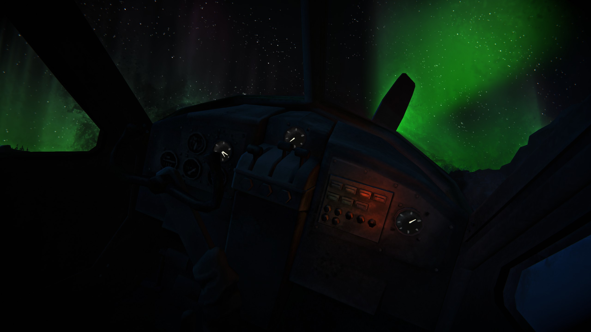

# Airplane

**Categories:** Interactable Objects · **Source:** [Fandom](https://thelongdark.fandom.com/wiki/Airplane)

**Contents**

- [Overview](#overview)
- [Intact Planes](#intact-planes)
- [Destroyed Planes](#destroyed-planes)
- [Gallery](#gallery)

 An **Airplane** is a rare stationary [Vehicle](./Vehicle.md) found in _The Long Dark_.

## Overview

### Intact Planes

The only intact planes that can be found are the various abandoned airplanes found near [Field 31](./Field%2031.md) in the [Forsaken Airfield](./Forsaken%20Airfield.md) region. These planes contain 2 storage hatches on the sides that can be looted. 4 doors on the sides can be entered into the passenger or pilot seats and often contain small amounts of loot inside the cabin. The inside can serve as temporary shelters from hostile wildlife and the cold or can be used as places to sleep.

### Destroyed Planes

 Occasionally, smaller [Plane Crashes](./Plane%20Crashes.md) can be found in the Lower Great Bear regions, but are always completely destroyed when the player finds them, with small amounts of loot and presumably the dead body of the pilot found nearby. The 2 storage hatches are still intact and can be looted and the cabin can be entered and sheltered in.

Other crashed planes are rarely found on the Island, and are almost always destroyed if a survivor does find one. Notable examples of planes include the [Crash Site (Pleasant Valley)](./Crash%20Site%20%28Pleasant%20Valley%29.md), the destroyed cargo plane found strewn across [Timberwolf Mountain](./Timberwolf%20Mountain.md) (see [Tail Section](./Tail%20Section.md)), and [Mackenzie's Crashed Plane](./Mackenzie%27s%20Crashed%20Plane.md).

## Gallery

