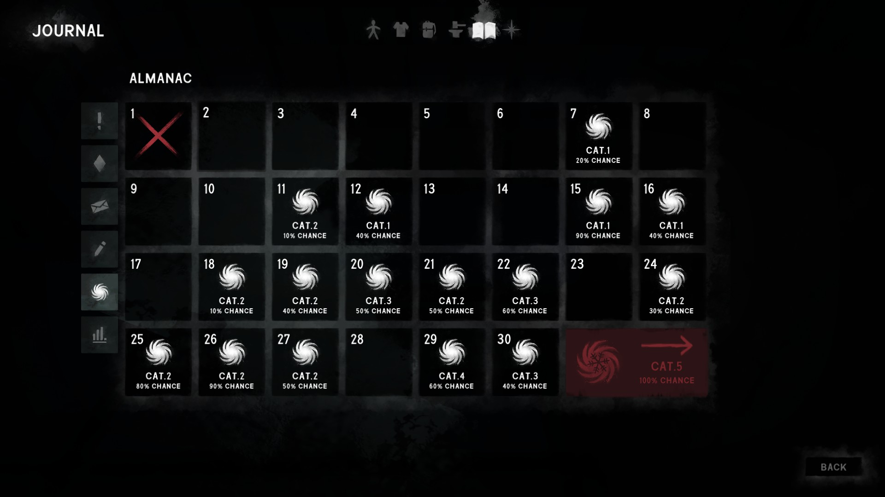
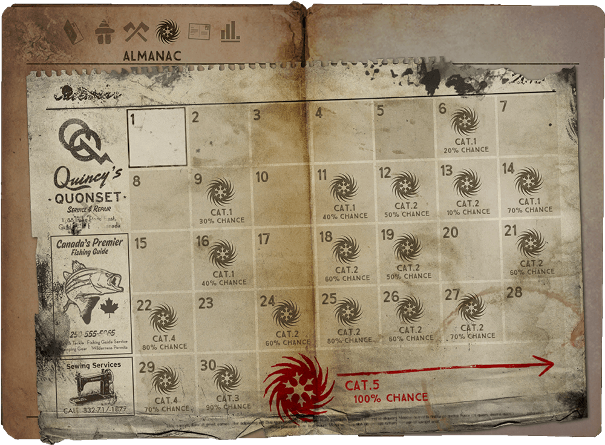

# Almanac

**Categories:** Challenges · **Source:** [Fandom](https://thelongdark.fandom.com/wiki/Almanac)

**Contents**

- [Trivia](#trivia)
- [Game history](#game-history)
- [Gallery](#gallery)
- [References](#references)

The **almanac** is a tool that can be used in the [Whiteout](./Whiteout.md) [challenge](./Challenge.md). The almanac contains predictions for blizzards during the thirty days of the challenge. The blizzard placement is somewhat randomized, however the blizzards increase in category and frequency as time passes.

The almanac is accessible through the journal. Each day will be marked with a red "X" when it passes.

## Trivia

- An almanac is an annual publication that includes information such as weather forecasts, farmers' planting dates, tide tables, and tabular information often arranged according to the calendar.[¹](#fn1)

- While the almanac in the game was previously formatted like a calendar, after the Faithful Cartographer update it now has eight days per week.

## Game history

The almanac was first introduced in version [0.346](./The%20Long%20Dark%20%E2%80%94%20Changelog.md#0.346) - also known as the Penitent Scholar update - to support gameplay for the [Whiteout](./Whiteout.md) [challenge](./Challenge.md).

## Gallery

_The previous almanac_

## References

&lt;div class="references-small" ;"&gt;

## Notes

---

1. Wikipedia, 2016, _Almanac_, viewed 3 October 2016 &lt;[https://en.wikipedia.org/wiki/Almanac](https://en.wikipedia.org/wiki/Almanac)&gt;[↩︎](#fnref1)
