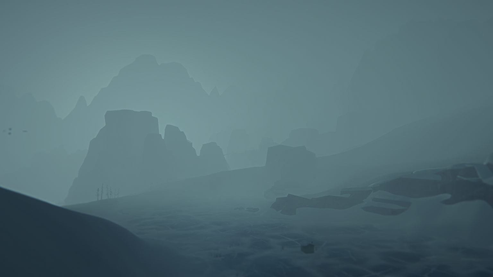

# Ambler's Lake

**Categories:** Lakes, Locations · **Source:** [Fandom](https://thelongdark.fandom.com/wiki/Ambler's_Lake)

**Ambler's Lake**

| Property | Details |
| --- | --- |
|  | [Ambler's Lake](../assets/Ambler%27s_Lake.jpg) |
| **Location** |  |
|  | [Ambler's Lake Location](../assets/Ambler%27s_Lake_Location.png) |
| Region |  |
| **General** |  |

**Ambler's Lake** is a small lake located in [Sundered Pass](./Sundered%20Pass.md). It is located a short walk down the hill from the cabin at [Final Refuge](./Final%20Refuge.md) and [Unyielding Inundation](./Unyielding%20Inundation.md).

## Overview

The lake features an abundance of [Cat Tail](./Cat%20Tail.md) plants growing around its shoreline, and features a single Ice [Fishing Hut](./Fishing%20Hut.md) near its center. Far to the east is a very long [Rope Climbing](./Rope%20Climbing.md) cliff that leads to [Roamer's Cave](./Roamer%27s%20Cave.md).

It is advised to use caution in the area and to be armed, as the open plain is stalked by several packs of [Tmberwolves](./Timberwolf.md) who may attack survivors who attempt to bring their catch back to the cabin at Final Refuge.

A [Moose](./Moose.md) can appear to the west of the lake, and a [Bear](./Bear.md) regularly patrols the area.

## Gallery

