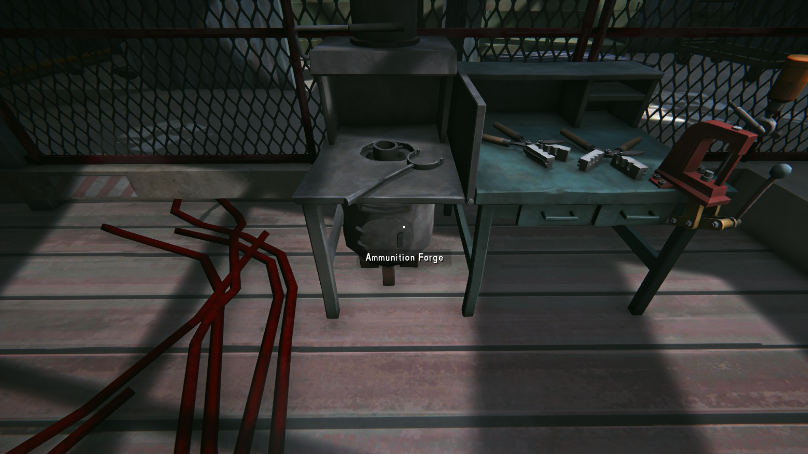
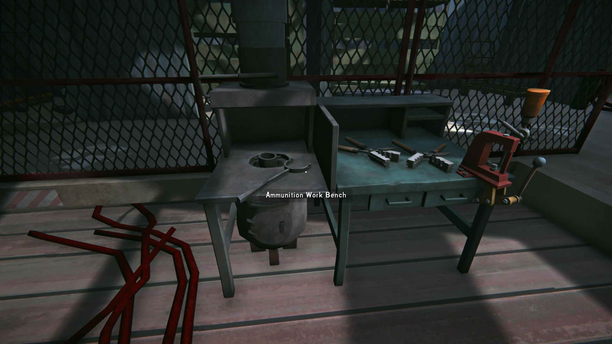

# Ammunition Work Bench

**Categories:** Interactable objects, Interactable Objects · **Source:** [Fandom](https://thelongdark.fandom.com/wiki/Ammunition_Work_Bench)

**Contents**

- [Overview](#overview)
- [Craftable items](#craftable-items)
- [Location](#location)
- [Tips](#tips)
- [General](#general)
- [Last Resort Cannery](#last-resort-cannery)
- [Blackrock Prison Workshop](#blackrock-prison-workshop)
- [Trivia](#trivia)
- [Gallery](#gallery)

**Ammunition Work Bench**

[Ammunition Work Bench](../assets/Ammunition_Work_Bench.png)

**Release:** 9 December 2019

**Update:** [1.64](./The%20Long%20Dark%20%E2%80%94%20Changelog.md#1.64)

**Story item:** No

**Location:** [Last Resort Cannery](./Last%20Resort%20Cannery.md) [Blackrock Prison](./Blackrock%20Prison.md)

**Advanced data**

**Object key:** GAMEPLAY\_AmmoWorkBench

_For the Forge next to the Work Bench, see [Ammunition Forge](./Ammunition%20Forge.md)._

The **Ammunition Work Bench** is a workstation in _[The Long Dark](./The%20Long%20Dark.md)_ used for [Crafting](./Crafting.md)_,_ introduced in the Errant Pilgrim update alongside [Bleak Inlet](./Bleak%20Inlet.md). The Workbench is used to craft ingredients for ammunition and to produce [Hunting Rifle](./Hunting%20Rifle.md) and [Revolver](./Revolver.md) ammunition, along with [Noisemakers](./Noisemaker.md) as of the [Perilous Constraint](./The%20Long%20Dark%20%E2%80%94%20Changelog.md) update. Use of the Ammunition Work Bench, [Ammunition Forge](./Ammunition%20Forge.md), and [Research Books](./Research%20Book.md) are the only means to increase [Gunsmithing](./Gunsmithing.md) skill.

## Overview

The Ammunition Work Bench is a workstation used for Gunsmithing; it can be found in the [Bleak Inlet](./Bleak%20Inlet.md) and [Blackrock](./Blackrock.md) regions. Use of this Workbench requires light; both workshops will receive sufficient artificial lighting to craft during the night while an [Aurora](./Aurora.md) is active.

It is composed of two items, the Ammunition Work Bench table itself (with two storage [Drawers](./Drawer.md)) and an [Ammunition Forge](./Ammunition%20Forge.md).

In the Bleak Inlet workshop, electrified wires present around the room will be active during an Aurora, and will cause [Burns](./Burns.md) on contact and rapid condition loss.

## Craftable items

Normal crafting and forging is not possible at the Ammunition Workbench, only the production of Gunsmithing items. The Ammunition Workbench can be used to craft the following:

-  [Can of Gunpowder](./Can%20of%20Gunpowder.md) 0.5 kg (1.1 lbs)
-  [Rifle Ammunition](./Rifle%20Ammunition.md)
-  [Revolver Ammunition](./Revolver%20Ammunition.md)
-  [Noisemaker](./Noisemaker.md)

An Ammunition Forge is present to the bottom left of the Work Bench, which must be lit and fueled to produce:

-  [Bullet](./Bullet.md) (x6)

Unlike a regular [Forge](./Forge.md), the temperature does not need to be raised above +150 C in order to cast bullets.

## Location

The Ammunition Workbench is unique across all of [Great Bear Island](./Great%20Bear%20Island.md) to two locations:

- The [Workshop](./Workshop.md) of the [Last Resort Cannery](./Last%20Resort%20Cannery.md) in [Bleak Inlet](./Bleak%20Inlet.md)
- The [Blackrock Penitentiary](./Blackrock%20Prison.md) workshop in [Blackrock](./Blackrock.md).

Both workbenches are also accompanied by a [Milling Machine](./Milling%20Machine.md).

The Ammunition Workbenches in both locations are initially sealed away behind electronically-locked doors which can only be opened during an active [Aurora](./Aurora.md), and require an Access Code found on a collectible note left in isolated corners of their respective region. The code for the Workshop in the [Cannery Pier](./Cannery%20Pier.md) in [Bleak Inlet](./Bleak%20Inlet.md) can be found in [Echo One Radio Tower](./Echo%20One%20Radio%20Tower.md) on the high plateau. The code for the workshop at [Blackrock Penitentiary](./Blackrock%20Prison.md) can be found in the mine at [Last Prospect](./Last%20Prospect.md), in a locker near where the detonators are found in [Episode 4](./Episode%204%20-%20Fury%2C%20Then%20Silence.md). Once the codes are retrieved and the doors are unlocked during an Aurora, they will remain unlocked and can be opened at any time.

## Tips

### General

- [Car Batteries](./Car%20Battery.md) are extremely heavy (15kg); use a [Hacksaw](./Hacksaw.md) to harvest them into lighter [Scrap Lead](./Scrap%20Lead.md) (1.5kg).
- Crafting [Bullets](./Bullet.md) requires 1 hour of fuel per unit inside of the lit Ammunition Forge (attached to the Ammunition Workbench).
- Higher Gunsmithing Skill increases the quality of produced Ammunition, reducing the likelihood of misfires (0% chance of misfiring at Level 5 Gunsmithing).
- At level 5 Gunsmithing Skill, Revolver and Rifle ammunition may be disassembled for all of their components, allowing lossless conversion of one type into the other.
- As of Hesitant Prospect (November 2020) an average world contains 55 Car Batteries, or enough lead to produce almost 2,000 Bullets.
- The Ammunition Furnace attached to the Ammunition Workbench is the only firebox which cannot be used for cooking (possibly due to the danger of ingesting lead). A nearby [Fire Barrel](./Fire%20Barrel.md) inside the Workshop, or one just outside its door may be used instead.
- The Ammunition Workbench is accessible in Interloper and Custom (with Firearms disabled), but has little use other than crafting [gunpowder](./Can%20of%20Gunpowder.md), which can only be used as an accelerant for campfires due to the lack of firearms. As of Perilous Constraint, the Ammunition Workbench can be used to craft [Noisemakers](./Noisemaker.md), giving it a use in worlds that do not have firearms.

### Last Resort Cannery

- No [Bed](./Bed.md) is present inside in the workshop. It is recommended to bring a [Bedroll](./Bedroll.md) to spend extended periods of time crafting ammunition.
- [Bleak Inlet](./Bleak%20Inlet.md) is home to multiple packs of [Timberwolves](./Timberwolf.md), several [Moose](./Moose.md), and a [Bear](./Bear.md). One large pack will always guard the cannery entrance, and another will likely patrol the ice beneath the workshop.
- Bleak Inlet is very cold and windy with few shelters, natural or artificial. It also has an above-average number of Auroras at night. While its weather is less severe weather than [Pleasant Valley](./Pleasant%20Valley.md), it is comparably cold to [Timberwolf Mountain](./Timberwolf%20Mountain.md) and [Ash Canyon](./Ash%20Canyon.md).
- Accessing Bleak Inlet can be difficult: requiring either traversing [Forlorn Muskeg](./Forlorn%20Muskeg.md) and a cave, or two [rope climbs](./Mountaineering%20Rope.md) from [The Ravine](./The%20Ravine.md).
- Accessing the workshop itself requires a short rope climb inside of the complex, which prevents the player from bringing large amounts of crafting materials in one trip.

### Blackrock Prison Workshop

- Retrieving the code for the prison workshop is much more dangerous compared to Bleak Inlet. It requires the player to climb up to the mine from the northern end of the ravine that runs through the middle of the region, along a route with two long rope climbs that have no shelter between them. A wolf might spawn at the end of the ravine. Nevertheless, there are nearby caves prior the first and after the second rope and an edge for a quick rest at the middle of the lower rope. The upper level is free of wolves.
- The mine contains one section with the poisonous fog from [Episode 4: Fury, then Silence](./Episode%204%20-%20Fury%2C%20Then%20Silence.md). The timer is generous to compensate for the permadeath nature of survival, but it is possible to get caught in the fog if the player does not have sprint stamina or is injured. The elevator crank is also required to raise the elevator at the end of the fog section.
- Once the code note has been retrieved, the same process must be followed as the door at the [Last Resort Cannery](./Last%20Resort%20Cannery.md).
- There are no live wires or wolf inside of the [Blackrock](./Blackrock.md) workshop.
- There are no mandatory rope climbs to reach the workshop in Blackrock, which means a much larger amount of materials can be brought on a crafting trip.

## Trivia

- Both Access Code notes to unlock either workshop door need only to have been read to unlock their respective doors, and do not need to be added to the player's collection (though it has no weight).

## Gallery

