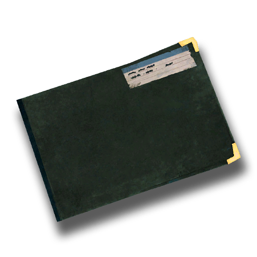

# An Old Logbook

<table class="infobox">
<caption>An Old Logbook</caption>
<colgroup>
<col style="width: 50%" />
<col style="width: 50%" />
</colgroup>
<tbody>
<tr>
<td colspan="2"><figure>

<figcaption>An_Old_Logbook_icon.png</figcaption>
</figure></td>
</tr>
<tr>
<td>
Release
</td>
<td>
<a href="./The%20Long%20Dark%20%E2%80%94%20Changelog.md#2.52" class="wikilink" title="31 March 2026">31 March 2026</a>
</td>
</tr>
<tr>
<td>
Wintermute
</td>
<td>
<a href="./Episode%205%20-%20The%20Light%20At%20The%20End%20Of%20All%20Things.md" class="wikilink" title="Episode 5: The Light At The End Of All Things">Episode 5: The Light At The End Of All Things</a>
</td>
</tr>
<tr>
<td colspan="2" class="section">
<strong>Properties</strong>
</td>
</tr>
<tr>
<td>
Item type
</td>
<td>
<a href="./Collectibles.md" class="wikilink" title="Collectibles">Collectibles</a>|-
</td>
</tr>
<tr>
<td>
Stackable
</td>
<td>
No
</td>
</tr>
<tr>
<td>
Examine
</td>
<td>
The Constable's Ledger
</td>
</tr>
<tr>
<td colspan="2" class="section">
<strong>Values</strong>
</td>
</tr>
<tr>
<td>
Weight
</td>
<td>
0.00 kg (0 lbs)
</td>
</tr>
<tr>
<td colspan="2" class="section">
<strong>Actions</strong>
</td>
</tr>
<tr>
<td>
Backpack
</td>
<td>
Examine
</td>
</tr>
<tr>
<td>
On ground
</td>
<td>
Take It, Read Text, Leave It
</td>
</tr>
</tbody>
</table>

**An Old Logbook** is a <a href="./Collectibles.md" class="wikilink" title="Collectibles">Collectibles</a> found in <a href="./Episode%205%20-%20The%20Light%20At%20The%20End%20Of%20All%20Things.md" class="wikilink" title="Episode 5">Episode 5</a> of the <a href="./Wintermute.md" class="wikilink" title="Wintermute">Wintermute</a> story. It is found in the <a href="./Constable%27s%20Office.md" class="wikilink" title="Constable&#39;s Office">Constable's Office</a> during the main mission <a href="./Perseverance.md" class="wikilink" title="Perseverance">Perseverance</a>.

## Transcript

The following text is transcribed from **An Old Logbook**

\[Last Entry\]\
I am heading out on a grid search. None of the locals have offered to help. And these blasted lights in the sky keep coming and going. Power only comes back at random.

The local doctor's quarantine is sitting heavy with them I think. They want to break out as much as hole up at home.

And now the Doctor has vanished. Along with what looks like half his patient summaries.

I am heading up the river way, into the wildlands. There is a boat the previous Constable stashed up there, at the old launch on the far bank before the chokepoint into town. The plan is to use it to go downriver and return to the coast if things go bad. No radios, no GPS, no backup.

No choice.

Signing off.

## Update history

\* UPDATE **31 March 2026 (<a href="./The%20Long%20Dark%20%E2%80%94%20Changelog.md#2.52" class="wikilink" title="Update">Update</a>):**

- - Added to game.

**Lua execution error in Module:Navbox function navbox**

