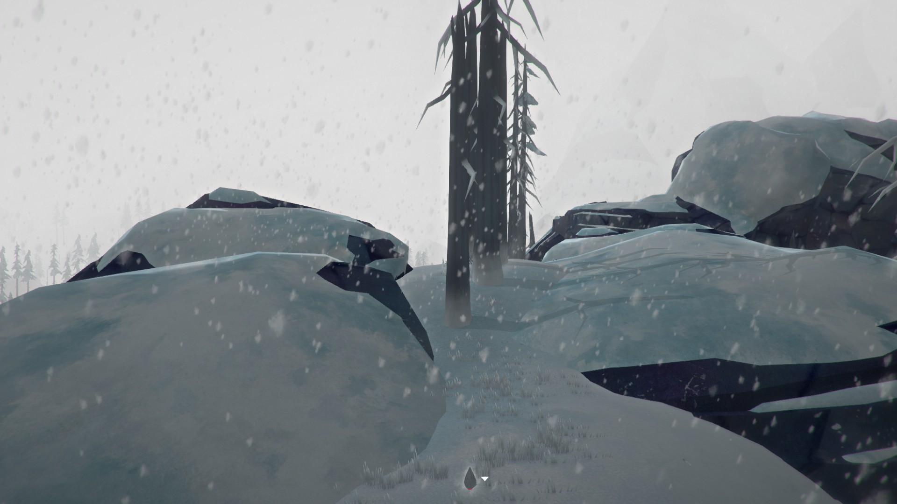

# Andre's Peak

**Andre's Peak**

| Property | Details |
| --- | --- |
|  |  / *andres\_peak.jpg* |
| **Location** |  |
|  |  / *Andre's\_Peak\_Location.png* |
| Region | [Timberwolf Mountain](./Timberwolf%20Mountain.md)\|- |
| Description | A small area on the top of a hill |
| **General** |  |
| Type | Outdoors\|- |
