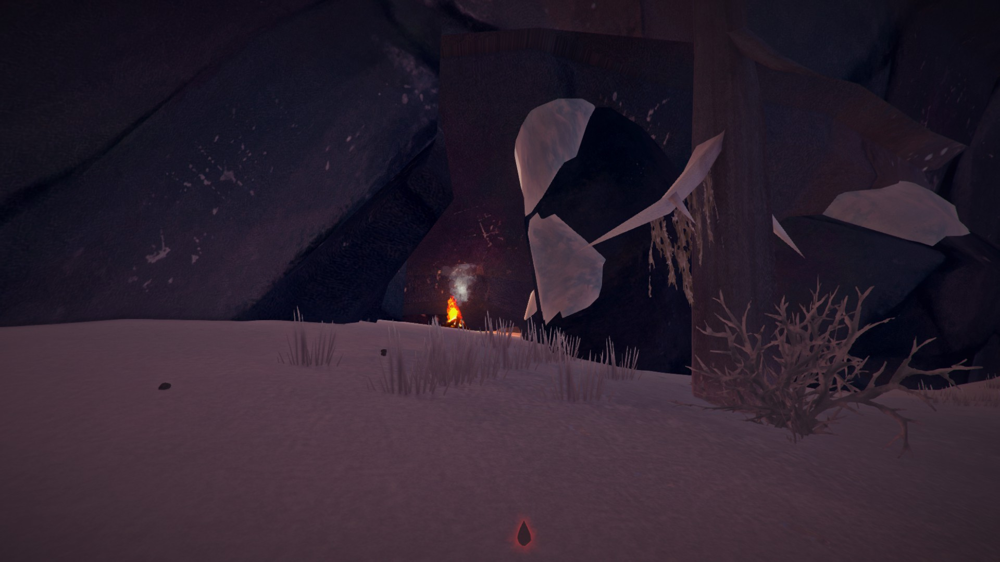
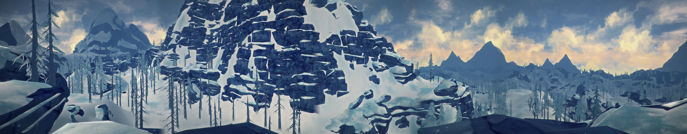

# Andre's Peak

**Categories:** Locations, Locations in Timberwolf Mountain, Outdoor locations, Sheltered locations · **Source:** [Fandom](https://thelongdark.fandom.com/wiki/Andre's_Peak)

**Andre's Peak**

| Property | Details |
| --- | --- |
|  | [Andres peak](../assets/Andres_peak.jpg) |
| **Location** |  |
|  | [Andre's Peak Location](../assets/Andre%27s_Peak_Location.png) |
| Region | [Timberwolf Mountain](./Timberwolf%20Mountain.md)\|- |
| Description | A small area on the top of a hill |
| **General** |  |
| Type | Outdoors\|- |

## Overview

On the peak is [Old Man's Beard Lichen](./Old%20Man%27s%20Beard%20Lichen.md), [rose hips](./Rose%20Hip.md) and sometimes a [corpse](./Frozen%20Corpse.md). There is also a small cave nearby that may have some supplies such as [coal](./Coal.md) and firewood.

## Gallery

## Trivia

- Andre's Peak is named for Andre da Rosa, a UI programmer at [Hinterland Studio](./Hinterland%20Studio%20Inc..md)
