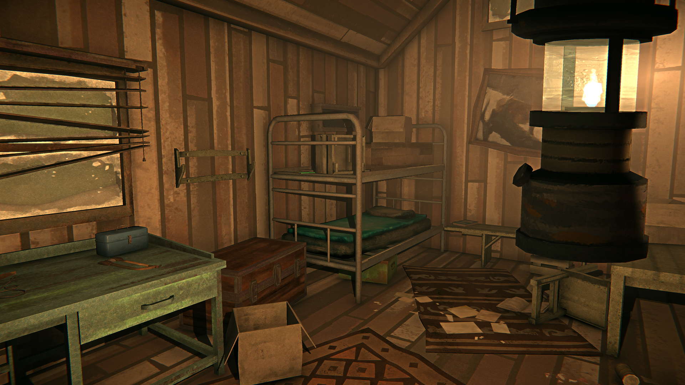
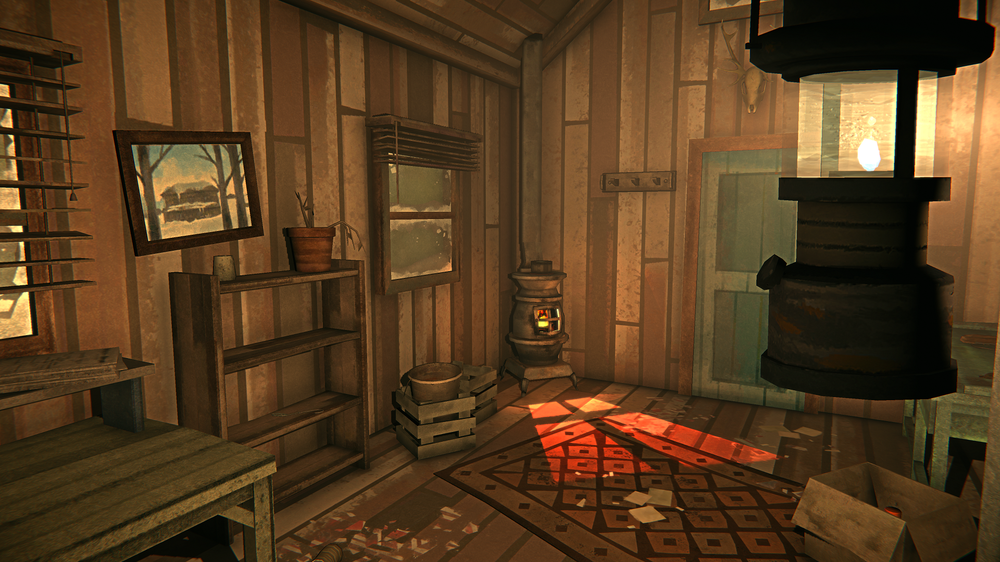
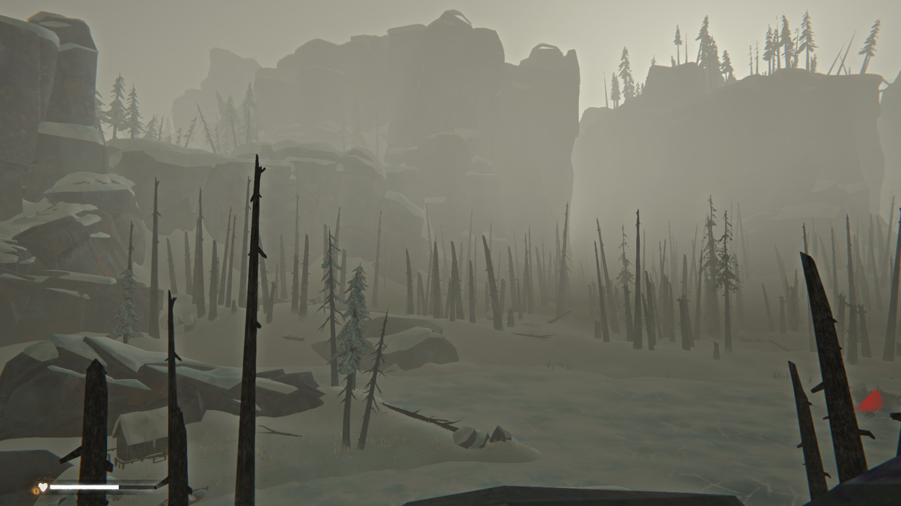
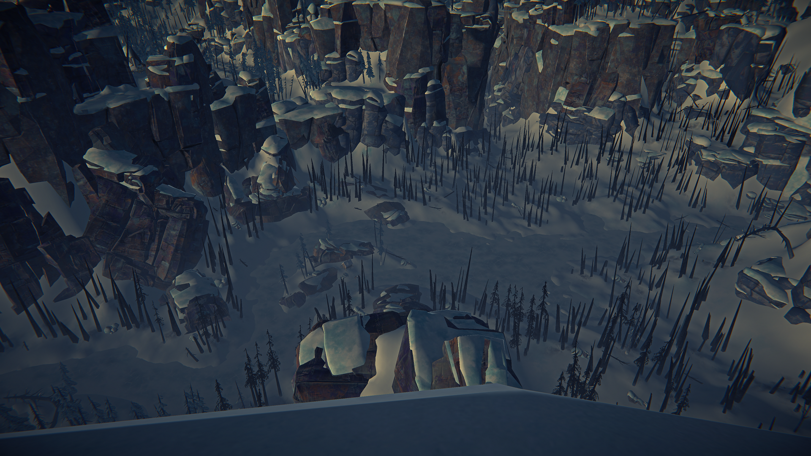
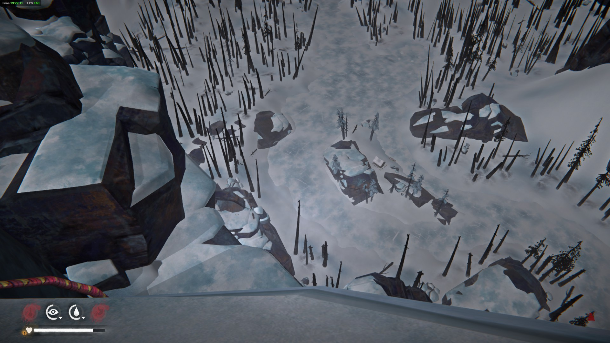

# Angler's Den

**Categories:** Indoor locations, Islands, Locations, Locations in Ash Canyon, Locations with a workbench, Military/Sporting locations · **Source:** [Fandom](https://thelongdark.fandom.com/wiki/Angler's_Den)

**Angler's Den**

[AnglersDenOutside 1080p](../assets/AnglersDenOutside_1080p.png)

**Location**

[Angler's Den Location](../assets/Angler%27s_Den_Location.png)

**Region:** [Ash Canyon](./Ash%20Canyon.md)

**General**

**Type:** Military/Sporting

[Bed icon](../assets/Bed_icon.png)

Has a bed

[Workbench icon green](../assets/Workbench_icon_green.png)

Has a workbench

## Overview

The Angler's Den is centrally located by one of the region's low-lying rivers. Despite its compact size the cabin hosts several useful features inside, including: bed, [Pot Belly Stove](./Pot%20Belly%20Stove.md) and [Work Bench](./Work%20Bench.md) as well as a storage trunk.

The cabin itself contains ample loot, including food and clothing, including potentially [mukluks](./Mukluks.md), [Hunting Rifle](./Hunting%20Rifle.md), [arrowheads](./Arrowhead.md), [snare](./Snare.md), and a [Research Book](./Research%20Book.md) atop of the bunkbed. A [note](./A%20Note%20Left%20Behind.md) can be found near the Workbench. Outside on the deck several [flares](./Flare.md) or [marine flares](./Marine%20Flare.md) may be found.

### Use as a base

With its central location, ample storage, and workbench the Angler's Den makes for a suitable [Safe House](./Safehouse.md). [Deer](./Deer.md) and a rabbit grove may be found nearby, providing plentiful food as well as a [Fire Barrel](./Fire%20Barrel.md) near [Broad Falls](./Broad%20Falls.md), enabling longer-duration fires to be lit outdoors. If lamp oil is needed, that can be obtained by fishing in [Bitter Marsh](./Bitter%20Marsh.md). The one major disadvantage of this base are the [Wolves](./Wolf.md). While they generally don't spawn immediately surrounding the cabin, they spawn on every trail leading to and from the cabin, which can make visiting other parts of the region more challenging.

## Gallery

