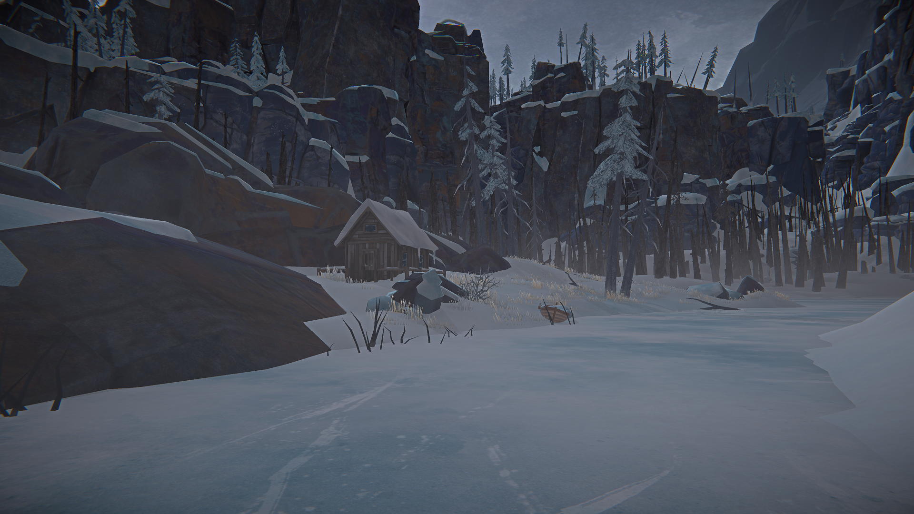

# Angler's Den

**Angler's Den**

| Property | Details |
| --- | --- |
|  |  / *AnglersDenOutside\_1080p.png* |
| **Location** |  |
|  |  / *Angler's\_Den\_Location.png* |
| Region | [Ash Canyon](./Ash%20Canyon.md)\|- |
| **General** |  |
| Type | Military/Sporting\|- |
|  / *bed\_icon.png* | Has a bed |
|  / *workbench\_icon\_green.png* | Has a workbench\|- |
