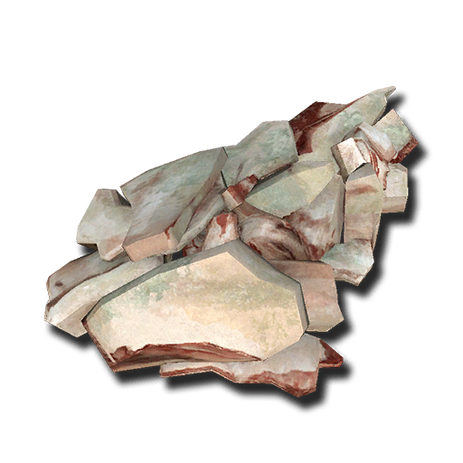

# Animal Fat

**Categories:** DLC Content, Food And Drink · **Source:** [Fandom](https://thelongdark.fandom.com/wiki/Animal_Fat)

**Contents**

- [Overview](#overview)
- [Wildlife](#wildlife)
- [Cooking](#cooking)
- [Gallery](#gallery)
- [Game history](#game-history)

_Ptarmigan\_icon.png_

**DLC-Exclusive content.** / This content requires the [Tales from the Far Territory](./Tales%20from%20the%20Far%20Territory.md) addon to be installed before it can be seen or used in regular gameplay.

_Animal\_Fat\_icon.png_

**Release:** [2 December 2024](./The%20Long%20Dark%20%E2%80%94%20Changelog.md#2.33)

**Wintermute:** No

**Properties**

**Item type:** [Food And Drink](./Food%20And%20Drink.md)

**Stackable:** No

**Examine:** Pure animal fat. Useful in Cooking, but can also be eaten on its own if desperate for Calories...

**Values**

**Calories:** 900 kcal

**Weight:** 1.00 kg (2.2 lbs)

_Fresh_

_Gamey_

_Mouldy_

_Rancid_

_Ruined_
