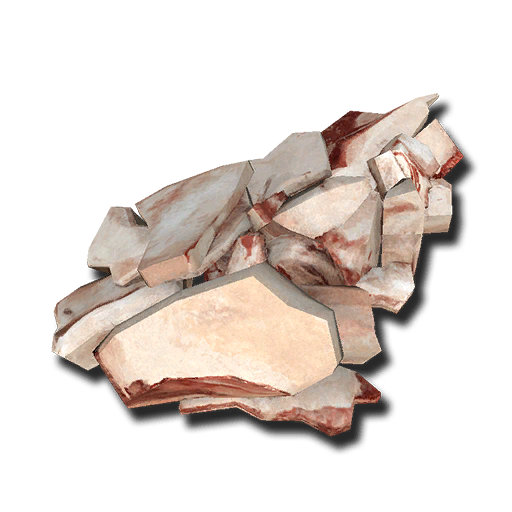
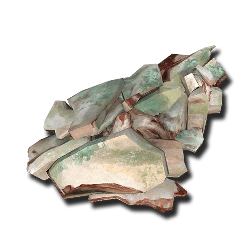

# Animal Fat

**Contents**

- [Overview](#Overview)
- [Wildlife](#Wildlife)
- [Cooking](#Cooking)
- [Gallery](#Gallery)
- [Game history](#Game_history)

<table>
<colgroup>
<col style="width: 33%" />
<col style="width: 33%" />
<col style="width: 33%" />
</colgroup>
<tbody>
<tr>
<td width="40px"><figure>
[Missing image: Ptarmigan_icon.png]
<figcaption>Ptarmigan_icon.png</figcaption>
</figure></td>
<td>
<strong>DLC-Exclusive content.</strong> 

This content requires the <a href="./Tales%20from%20the%20Far%20Territory.md" class="wikilink" title="Tales from the Far Territory">Tales from the Far Territory</a> addon to be installed before it can be seen or used in regular gameplay.

</td>
<td>
|}

<table class="infobox">
<caption>Animal Fat</caption>
<colgroup>
<col style="width: 50%" />
<col style="width: 50%" />
</colgroup>
<tbody>
<tr>
<td colspan="2"><figure>

<figcaption>Animal_Fat_icon.png</figcaption>
</figure></td>
</tr>
<tr>
<td>
Release
</td>
<td>
<a href="./The%20Long%20Dark%20%E2%80%94%20Changelog.md#2.33" class="wikilink" title="2 December 2024">2 December 2024</a>
</td>
</tr>
<tr>
<td>
Wintermute
</td>
<td>
No
</td>
</tr>
<tr>
<td colspan="2" class="section">
<strong>Properties</strong>
</td>
</tr>
<tr>
<td>
Item type
</td>
<td>
<a href="./Food%20And%20Drink.md" class="wikilink" title="Food And Drink">Food And Drink</a>|-
</td>
</tr>
<tr>
<td>
Stackable
</td>
<td>
No
</td>
</tr>
<tr>
<td>
Examine
</td>
<td>
Pure animal fat. Useful in Cooking, but can also be eaten on its own if desperate for Calories...
</td>
</tr>
<tr>
<td colspan="2" class="section">
<strong>Values</strong>
</td>
</tr>
<tr>
<td>
Calories
</td>
<td>
900 kcal
</td>
</tr>
<tr>
<td>
Weight
</td>
<td>
1.00 kg (2.2 lbs)
</td>
</tr>
</tbody>
</table>

<strong>Animal Fat</strong> is a raw food item acquired from <a href="./Carcass%20Harvesting.md" class="wikilink" title="Carcass Harvesting">Carcass Harvesting</a>.

<h2 id="Overview">Overview</h2>

Animal Fat is produced when Harvesting <a href="./Wildlife.md" class="wikilink" title="Wildlife">Wildlife</a> Carcasses and can be eaten for calories, though at the high cost of acquiring <a href="./Food%20Poisoning.md" class="wikilink" title="Food Poisoning">Food Poisoning</a>, regardless of <a href="./Cooking.md" class="wikilink" title="Cooking Skill">Cooking Skill</a>. The option to harvest Animal Fat does not appear when in the Carcass Harvesting menu, as it is automatically produced when Harvesting raw meat (either directly from the Carcass or from a Quarter bag). Producing Animal Fat is somewhat similar to how cooking fish produces <a href="./Lantern%20Fuel.md" class="wikilink" title="Lantern Fuel">Lantern Fuel</a>.

There is 50% chance of acquiring <a href="./Food%20Poisoning.md" class="wikilink" title="Food Poisoning">Food Poisoning</a> even at 100% condition, which rises to 90% chance when condition drops below 75%.

Animal Fat naturally gives off <a href="./Scent.md" class="wikilink" title="Scent">Scent</a>, and can be dropped for <a href="./Scent.md#Baiting%2FDecoys" class="wikilink" title="Baiting">Baiting</a>.

<h2 id="Wildlife">Wildlife</h2>

The weight of raw meat harvested is proportional to the amount of Animal Fat harvested.

<ul>
<li><a href="./Deer.md" class="wikilink" title="Deer">Deer</a> yield the highest base amount amount of fat with 0.20 kg for every kg of meat harvested. Stags produce more fat due to being larger than Does.</li>
<li><a href="./Moose.md" class="wikilink" title="Moose">Moose</a> have the second highest ratio of fat with 0.15 kg per kg of meat. This is less than Deer, but due to the amount of raw meat on a Moose, they technically produce the most Animal Fat of any animal.</li>
<li>All predators (<a href="./Wolf.md" class="wikilink" title="Wolf">Wolf</a>, <a href="./Timberwolf.md" class="wikilink" title="Timberwolf">Timberwolf</a>, <a href="./Bear.md" class="wikilink" title="Bear">Bear</a>, <a href="./Cougar.md" class="wikilink" title="Cougar">Cougar</a>) will yield 0.10 kg of Animal Fat per kg. Bears produce the most fat of any predator due to their large bodies.</li>
<li><a href="./Poisoned%20Wolf.md" class="wikilink" title="Poisoned Wolves">Poisoned Wolves</a> have no harvestable meat and thus no Animal Fat.</li>
<li><a href="./Ptarmigan.md" class="wikilink" title="Ptarmigans">Ptarmigans</a> and <a href="./Rabbit.md" class="wikilink" title="Rabbits">Rabbits</a> do not produce any Animal Fat despite having harvestable raw meat.</li>
<li>Fish do not produce Animal Fat.</li>
</ul>
<h2 id="Cooking">Cooking</h2>

Animal Fat cannot be Cooked on a fire to be eaten safely, but it can be used in the following recipes:

<h2 id="Gallery">Gallery</h2>
<table class="gallery">
<colgroup>
<col style="width: 25%" />
<col style="width: 25%" />
<col style="width: 25%" />
<col style="width: 25%" />
</colgroup>
<tbody>
<tr>
<td><figure>

<figcaption>Fresh</figcaption>
</figure></td>
<td><figure>

<figcaption>Gamey</figcaption>
</figure></td>
<td><figure>

<figcaption>Mouldy</figcaption>
</figure></td>
<td><figure>

<figcaption>Rancid</figcaption>
</figure></td>
</tr>
<tr>
<td><figure>

<figcaption>Ruined</figcaption>
</figure></td>
<td></td>
<td></td>
<td></td>
</tr>
</tbody>
</table>
<h2 id="Game_history">Game history</h2>

<strong>Template:update historyLua execution error in Module:Navbox function navbox</strong>

<a href="ru:%D0%96%D0%B8%D0%B2%D0%BE%D1%82%D0%BD%D1%8B%D0%B9_%D0%B6%D0%B8%D1%80" class="wikilink" title="ru:Животный жир">ru:Животный жир</a>
</td>
</tr>
</tbody>
</table>

