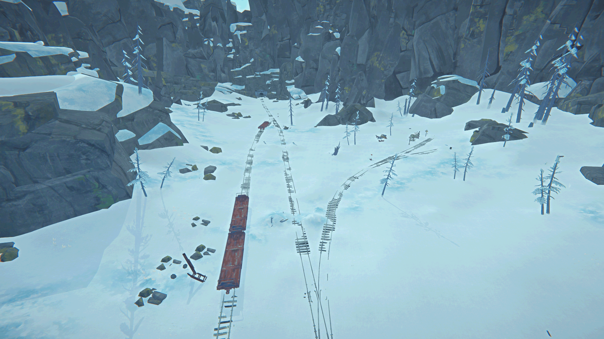

# Anna Island \-\- Track Section 1

**Contents**

- [Overview](#Overview)
- [Locations](#Locations)
- [Wildlife management](#Wildlife_management)
- [Survivability](#Survivability)
- [Safe houses](#Safe_houses)
- [Gallery](#Gallery)
- [Maps](#Maps)
- [Locations](#Locations_2)

<table>
<colgroup>
<col style="width: 33%" />
<col style="width: 33%" />
<col style="width: 33%" />
</colgroup>
<tbody>
<tr>
<td width="40px"><figure>

<figcaption>Seal_icon.png</figcaption>
</figure></td>
<td>
<strong>DLC-Exclusive content.</strong> 

This content requires the <a href="./Iron%20Road.md" class="wikilink" title="Iron Road">Iron Road</a> addon to be installed before it can be seen or used in regular gameplay.

</td>
<td>
|}

<table class="infobox">
<caption>Anna Island -- Track Section 1</caption>
<colgroup>
<col style="width: 50%" />
<col style="width: 50%" />
</colgroup>
<tbody>
<tr>
<td colspan="2"><figure>
[Missing image: Anna_Island_--_Track_Section_1.jpg]
<figcaption>Anna_Island_--_Track_Section_1.jpg</figcaption>
</figure></td>
</tr>
<tr>
<td colspan="2" class="section">
<strong>Location on <a href="./Cauldron%20Island.md" class="wikilink" title="Cauldron Island">Cauldron Island</a></strong>
</td>
</tr>
<tr>
<td colspan="2"><figure>

<figcaption>No_picture.png</figcaption>
</figure></td>
</tr>
<tr>
<td colspan="2"><figure>

<figcaption>Anna_Island_Track_Section_1_Map.png</figcaption>
</figure></td>
</tr>
<tr>
<td colspan="2" class="section">
<strong>Details</strong>
</td>
</tr>
<tr>
<td>
Connecting Regions
</td>
<td>
<a href="./Port%20Remnant.md" class="wikilink" title="Port Remnant">Port Remnant</a> <a href="./Anna%20Island%20--%20Track%20Section%202.md" class="wikilink" title="Anna Island -- Track Section 2">Anna Island -- Track Section 2</a>
</td>
</tr>
<tr>
<td>
Interloper Region Spawn
</td>
<td>
No
</td>
</tr>
<tr>
<td>
Date Added
</td>
<td>
October 27 2026
</td>
</tr>
</tbody>
</table>

<strong>Anna Island -- Track Section 1</strong> is a <a href="./Region.md" class="wikilink" title="Region">Region</a> on <a href="./Cauldron%20Island.md" class="wikilink" title="Cauldron Island">Cauldron Island</a> in <em><a href="./The%20Long%20Dark.md" class="wikilink" title="The Long Dark">The Long Dark</a>.</em>

<h2 id="Overview">Overview</h2>

A continuation of the coastline from the previously numbered region.

<ul>
<li>The west of the map leads to <a href="./Anna%20Island%20--%20Track%20Section%202.md" class="wikilink" title="Anna Island -- Track Section 2">Anna Island -- Track Section 2</a>, while the east leads to <a href="./Port%20Remnant.md" class="wikilink" title="Port Remnant">Port Remnant</a>.</li>
<li>Parts of the ocean can be used for <a href="./Ice%20Fishing.md" class="wikilink" title="Ice Fishing">Ice Fishing</a> by creating Free Form Ice Fishing Holes.</li>
</ul>
<h2 id="Locations">Locations</h2>

There are 6 named locations within Track Section 1, including:

<table>
<colgroup>
<col style="width: 50%" />
<col style="width: 50%" />
</colgroup>
<tbody>
<tr>
<td><ul>
<li><a href="./Railyard%20%28Track%20Section%201%29.md" class="wikilink" title="Railyard (Track Section 1)">Railyard (Track Section 1)</a> (East)</li>
<li><a href="./Railyard%20%28Track%20Section%201%29.md" class="wikilink" title="Railyard (Track Section 1)">Railyard (Track Section 1)</a> (West)</li>
<li><a href="./Bridge.md" class="wikilink" title="Bridge">Bridge</a></li>
<li><a href="./Huts.md" class="wikilink" title="Huts">Huts</a></li>
</ul></td>
<td data-valign="top" style="width: 50%"><ul>
<li>To Port Remnant (Region Transition to <a href="./Port%20Remnant.md" class="wikilink" title="Port Remnant">Port Remnant</a>)</li>
<li>To Anna Island Track Section 2 (Region Transition to <a href="./Anna%20Island%20--%20Track%20Section%202.md" class="wikilink" title="Anna Island -- Track Section 2">Anna Island -- Track Section 2</a>)</li>
</ul></td>
</tr>
</tbody>
</table>

{| class="" style="background-color:transparent; color:inherit; width:100%;"
</td>
</tr>
<tr>
<td></td>
<td data-valign="top" style="width: 50%"></td>
<td></td>
</tr>
</tbody>
</table>

There are also a single <a href="./Warm%20Cave.md" class="wikilink" title="Warm Cave">Warm Cave</a> near the middle of the map.

There is also a single cabin at the Huts location.

There is one <a href="./Oil%20Tank.md" class="wikilink" title="Whale Oil Tank">Whale Oil Tank</a> in this region and it is located at the Eastern Railyard before the transition to <a href="./Anna%20Island%20--%20Track%20Section%202.md" class="wikilink" title="Anna Island -- Track Section 2">Anna Island -- Track Section 2</a>.

- 

## Wildlife management

## Survivability

## Safe houses

\- <a href="./Warm%20Cave.md" class="wikilink" title="Cave">Cave</a> located before the junction to <a href="./Anna%20Island%20--%20Track%20Section%202.md" class="wikilink" title="Track Section 2">Track Section 2</a> with minor loot and a bed

\- <a href="./Warm%20Cave.md" class="wikilink" title="Cave">Cave</a> located in the middle of the region with minor loot and a bed

\- Cabin with a bed at Huts.

## Gallery

<table class="gallery">
<colgroup>
<col style="width: 25%" />
<col style="width: 25%" />
<col style="width: 25%" />
<col style="width: 25%" />
</colgroup>
<tbody>
<tr>
<td><figure>

<figcaption><strong>Transition to Track Section 2</strong></figcaption>
</figure></td>
<td><figure>
[Missing image: Anna_Island_--_Track_Section_1_Transition_to_PR.jpg]
<figcaption><strong>Transition to Port Remnant</strong></figcaption>
</figure></td>
<td><figure>
[Missing image: Anna_Island_--_Track_Section_1_Cave.jpg]
<figcaption><strong>Cave in the middle of Track Section 1</strong></figcaption>
</figure></td>
<td><figure>

<figcaption><strong>Cave before Transition to Track Section 2</strong></figcaption>
</figure></td>
</tr>
</tbody>
</table>

### Maps

### Locations

<table class="gallery">
<colgroup>
<col style="width: 33%" />
<col style="width: 33%" />
<col style="width: 33%" />
</colgroup>
<tbody>
<tr>
<td><figure>

<figcaption>Huts</figcaption>
</figure></td>
<td><figure>
[Missing image: Railyard_(Track_Section_1_East).jpg]
<figcaption>Railyard East</figcaption>
</figure></td>
<td><figure>
[Missing image: Railyard_(Track_Section_1_West).jpg]
<figcaption>Railyard West</figcaption>
</figure></td>
</tr>
</tbody>
</table>

**Lua execution error in Module:Navbox function navboxLua execution error in Module:Navbox function navbox**

<a href="ru:%D0%9E%D1%81%D1%82%D1%80%D0%BE%D0%B2_%D0%90%D0%BD%D0%BD%D1%8B_%E2%80%94_%D0%A3%D1%87%D0%B0%D1%81%D1%82%D0%BE%D0%BA_%D0%BF%D1%83%D1%82%D0%B8_1" class="wikilink" title="ru:Остров Анны — Участок пути 1">ru:Остров Анны — Участок пути 1</a>

