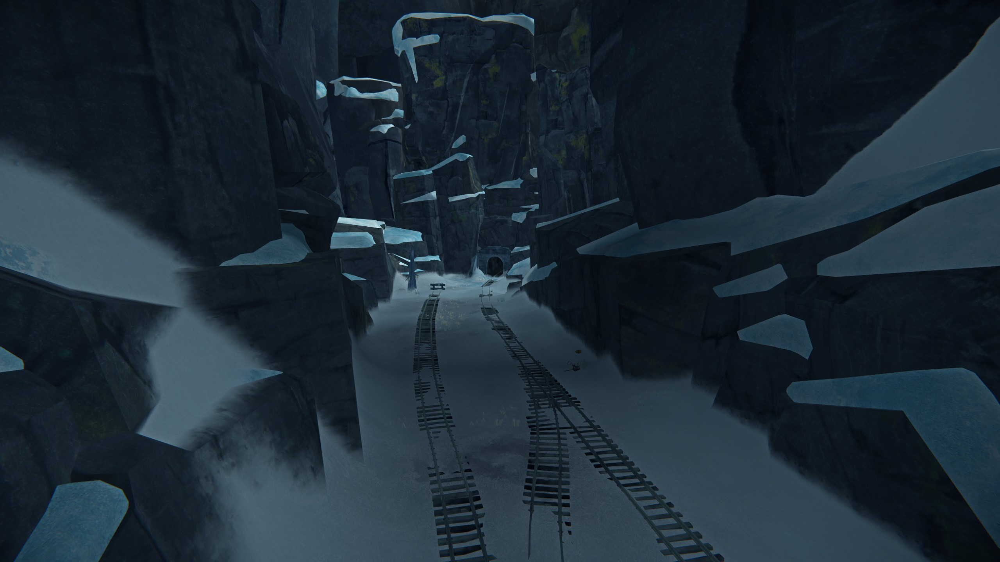

# Anna Island \-\- Track Section 1

**Contents**

- [Overview](#overview)
- [Locations](#locations)
- [Wildlife management](#wildlife-management)
- [Survivability](#survivability)
- [Safe houses](#safe-houses)
- [Gallery](#gallery)
- [Maps](#maps)
- [Locations](#locations-1)

| Column 1 | Column 2 | Column 3 |
| --- | --- | --- |
|  / *Seal\_icon.png* | **DLC-Exclusive content.** / This content requires the [Iron Road](./Iron%20Road.md) addon to be installed before it can be seen or used in regular gameplay. | \|} / **Anna Island -- Track Section 1** / \| Property \| Details \| / \| --- \| --- \| / \|  \|  / *Anna\_Island\_--\_Track\_Section\_1.jpg* \| / \| **Location on [Cauldron Island](./Cauldron%20Island.md)** \|  \| / \|  \|  / *No\_picture.png* \| / \|  \|  / *Anna\_Island\_Track\_Section\_1\_Map.png* \| / \| **Details** \|  \| / \| Connecting Regions \| [Port Remnant](./Port%20Remnant.md) [Anna Island -- Track Section 2](./Anna%20Island%20--%20Track%20Section%202.md) \| / \| Interloper Region Spawn \| No \| / \| Date Added \| October 27 2026 \| / **Anna Island -- Track Section 1** is a [Region](./Region.md) on [Cauldron Island](./Cauldron%20Island.md) in *[The Long Dark](./The%20Long%20Dark.md).* / ## Overview / A continuation of the coastline from the previously numbered region. / - The west of the map leads to [Anna Island -- Track Section 2](./Anna%20Island%20--%20Track%20Section%202.md), while the east leads to [Port Remnant](./Port%20Remnant.md). / - Parts of the ocean can be used for [Ice Fishing](./Ice%20Fishing.md) by creating Free Form Ice Fishing Holes. / ## Locations / There are 6 named locations within Track Section 1, including: / \| Column 1 \| Column 2 \| / \| --- \| --- \| / \| - [Railyard (Track Section 1)](./Railyard%20%28Track%20Section%201%29.md) (East) / - [Railyard (Track Section 1)](./Railyard%20%28Track%20Section%201%29.md) (West) / - [Bridge](./Bridge.md) / - [Huts](./Huts.md) \| - To Port Remnant (Region Transition to [Port Remnant](./Port%20Remnant.md)) / - To Anna Island Track Section 2 (Region Transition to [Anna Island -- Track Section 2](./Anna%20Island%20--%20Track%20Section%202.md)) \| / {\| class="" style="background-color:transparent; color:inherit; width:100%;" |
|  / *Anna\_Island\_--\_Track\_Section\_1.jpg* |  |  |
| **Location on [Cauldron Island](./Cauldron%20Island.md)** |  |  |
|  / *No\_picture.png* |  |  |
|  / *Anna\_Island\_Track\_Section\_1\_Map.png* |  |  |
| **Details** |  |  |
| Connecting Regions | [Port Remnant](./Port%20Remnant.md) [Anna Island -- Track Section 2](./Anna%20Island%20--%20Track%20Section%202.md) |  |
| Interloper Region Spawn | No |  |
| Date Added | October 27 2026 |  |
| - [Railyard (Track Section 1)](./Railyard%20%28Track%20Section%201%29.md) (East) / - [Railyard (Track Section 1)](./Railyard%20%28Track%20Section%201%29.md) (West) / - [Bridge](./Bridge.md) / - [Huts](./Huts.md) | - To Port Remnant (Region Transition to [Port Remnant](./Port%20Remnant.md)) / - To Anna Island Track Section 2 (Region Transition to [Anna Island -- Track Section 2](./Anna%20Island%20--%20Track%20Section%202.md)) |  |
|  |  |  |

There are also a single [Warm Cave](./Warm%20Cave.md) near the middle of the map.

There is also a single cabin at the Huts location.

There is one [Whale Oil Tank](./Oil%20Tank.md) in this region and it is located at the Eastern Railyard before the transition to [Anna Island -- Track Section 2](./Anna%20Island%20--%20Track%20Section%202.md).

- 

## Wildlife management

## Survivability

## Safe houses

- [Cave](./Warm%20Cave.md) located before the junction to [Track Section 2](./Anna%20Island%20--%20Track%20Section%202.md) with minor loot and a bed

- [Cave](./Warm%20Cave.md) located in the middle of the region with minor loot and a bed

- Cabin with a bed at Huts.

## Gallery

| Column 1 | Column 2 | Column 3 | Column 4 |
| --- | --- | --- | --- |
|  / ***Transition to Track Section 2*** |  / ***Transition to Port Remnant*** |  / ***Cave in the middle of Track Section 1*** |  / ***Cave before Transition to Track Section 2*** |

### Maps

### Locations

| Column 1 | Column 2 | Column 3 |
| --- | --- | --- |
|  / *Huts* |  / *Railyard East* |  / *Railyard West* |

**Lua execution error in Module:Navbox function navbox****Lua execution error in Module:Navbox function navbox**

[ru:Остров Анны — Участок пути 1](ru:%D0%9E%D1%81%D1%82%D1%80%D0%BE%D0%B2_%D0%90%D0%BD%D0%BD%D1%8B_%E2%80%94_%D0%A3%D1%87%D0%B0%D1%81%D1%82%D0%BE%D0%BA_%D0%BF%D1%83%D1%82%D0%B8_1)
