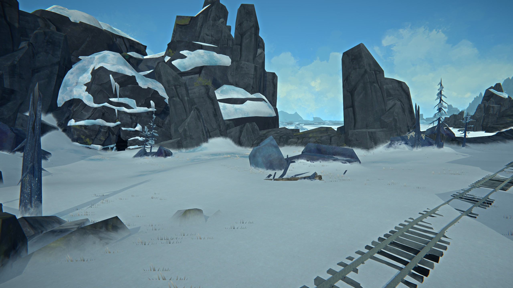
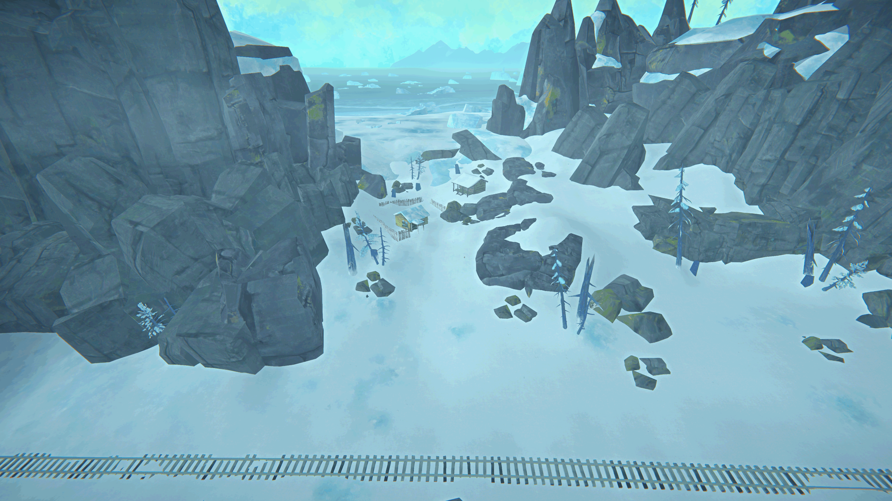

# Anna Island \-\- Track Section 1

**Categories:** DLC Content · **Source:** [Fandom](https://thelongdark.fandom.com/wiki/Anna_Island_--_Track_Section_1)

**Contents**

- [Overview](#overview)
- [Locations](#locations-1)
- [Safe houses](#safe-houses)
- [Gallery](#gallery)
- [Locations](#locations-1)

**DLC-Exclusive content.**

This content requires the [Iron Road](./Iron%20Road.md) addon to be installed before it can be seen or used in regular gameplay.

**Anna Island -- Track Section 1**

| Property | Details |
| --- | --- |
|  | [Anna Island Track Section 1](../assets/Anna_Island_--_Track_Section_1.jpg) |
| **Location on [Cauldron Island](./Cauldron%20Island.md)** |  |
|  | [No picture](../assets/No_picture.png) |
|  | [Anna Island Track Section 1 Map](../assets/Anna_Island_Track_Section_1_Map.png) |
| **Details** |  |
| Connecting Regions | [Port Remnant](./Port%20Remnant.md) [Anna Island -- Track Section 2](./Anna%20Island%20--%20Track%20Section%202.md) |
| Interloper Region Spawn | No |
| Date Added | October 27 2026 |

**Anna Island -- Track Section 1** is a [Region](./Region.md) on [Cauldron Island](./Cauldron%20Island.md) in _[The Long Dark](./The%20Long%20Dark.md)._

## Overview

A continuation of the coastline from the previously numbered region.

- The west of the map leads to [Anna Island -- Track Section 2](./Anna%20Island%20--%20Track%20Section%202.md), while the east leads to [Port Remnant](./Port%20Remnant.md).
- Parts of the ocean can be used for [Ice Fishing](./Ice%20Fishing.md) by creating Free Form Ice Fishing Holes.

## Locations

There are 6 named locations within Track Section 1, including:

- [Railyard (Track Section 1)](./Railyard%20%28Track%20Section%201%29.md) (East)
- [Railyard (Track Section 1)](./Railyard%20%28Track%20Section%201%29.md) (West)
- [Bridge](./Bridge.md)
- [Huts](./Huts.md)

- To Port Remnant (Region Transition to [Port Remnant](./Port%20Remnant.md))
- To Anna Island Track Section 2 (Region Transition to [Anna Island -- Track Section 2](./Anna%20Island%20--%20Track%20Section%202.md))

There are also a single [Warm Cave](./Warm%20Cave.md) near the middle of the map.

There is also a single cabin at the Huts location.

There is one [Whale Oil Tank](./Oil%20Tank.md) in this region and it is located at the Eastern Railyard before the transition to [Anna Island -- Track Section 2](./Anna%20Island%20--%20Track%20Section%202.md).

## Safe houses

- [Cave](./Warm%20Cave.md) located before the junction to [Track Section 2](./Anna%20Island%20--%20Track%20Section%202.md) with minor loot and a bed

- [Cave](./Warm%20Cave.md) located in the middle of the region with minor loot and a bed

- Cabin with a bed at Huts.

## Gallery

_**Transition to Track Section 2**_

_**Transition to Port Remnant**_

_**Cave in the middle of Track Section 1**_

_**Cave before Transition to Track Section 2**_

### Locations

