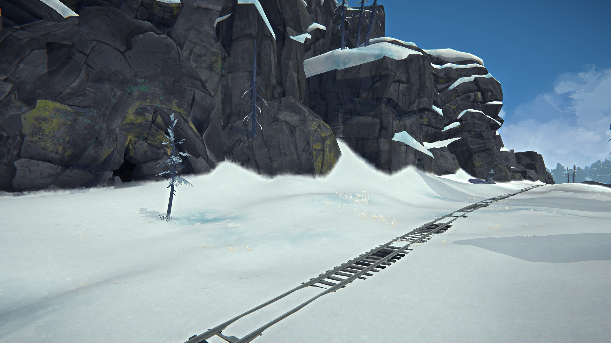
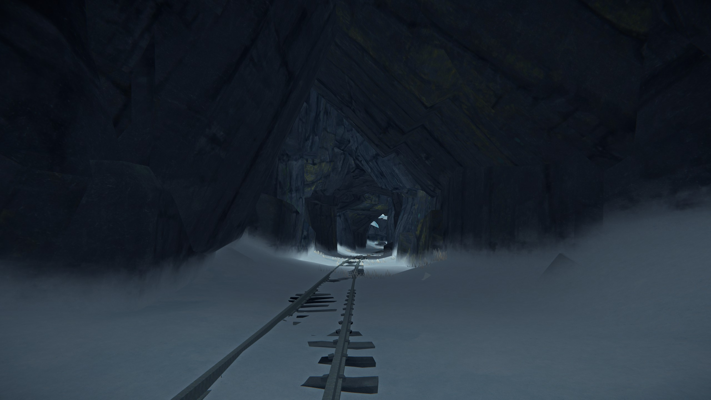
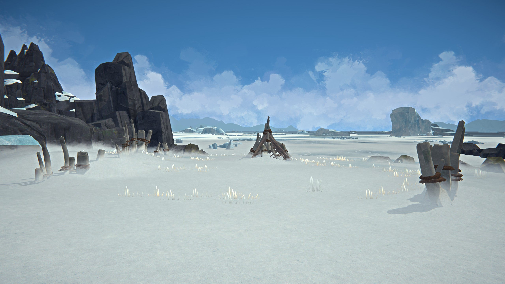

# Anna Island \-\- Track Section 2

**Contents**

- [Overview](#overview)
- [Locations](#locations)
- [Wildlife management](#wildlife-management)
- [Survivability](#survivability)
- [Gallery](#gallery)
- [Maps](#maps)
- [Locations](#locations-1)
- [Miscellaneous](#miscellaneous)

| Column 1 | Column 2 | Column 3 | Column 4 |
| --- | --- | --- | --- |
|  / *Seal\_icon.png* | **DLC-Exclusive content.** / This content requires the [Iron Road](./Iron%20Road.md) addon to be installed before it can be seen or used in regular gameplay. | \|} / **Anna Island -- Track Section 2** / \| Property \| Details \| / \| --- \| --- \| / \|  \|  / *Track\_Section\_2\_Turn\_Circle.jpg* \| / \| **Location on [Cauldron Island](./Cauldron%20Island.md)** \|  \| / \|  \|  / *No\_picture.png* \| / \|  \|  / *Anna\_Island\_Track\_Section\_2\_Map.png* \| / \| **Details** \|  \| / \| Description \| A long stretch of coastal railway. \| / \| Connecting Regions \| [Anna Island -- Track Section 1](./Anna%20Island%20--%20Track%20Section%201.md) [Anna Island -- Track Section 3](./Anna%20Island%20--%20Track%20Section%203.md) \| / \| Interloper Region Spawn \| No \| / \| Date Added \| October 27 2026 \| / **Anna Island -- Track Section 2** is a [Region](./Region.md) on [Cauldron Island](./Cauldron%20Island.md) in *[The Long Dark](./The%20Long%20Dark.md).* / ## Overview / A continuation of the coastline from the previously numbered region. / - Anna Island -- Track Section 2 contains a turn circle to the west that allows you to turn the [Prototype Train](./Prototype%20Train.md) around. / - The west of the map leads to [Anna Island -- Track Section 1](./Anna%20Island%20--%20Track%20Section%201.md), while the east leads to [Anna Island -- Track Section 3](./Anna%20Island%20--%20Track%20Section%203.md). / - The western section of the map houses a Railyard and a Repair Depot for repairs and refueling. This region's Repair Depot contains the unique [McLeod Ultra-Efficiency Whale Oil Heater](./McLeod%20Ultra-Efficiency%20Whale%20Oil%20Heater.md) inside. / - There is one [Water Tower](./Water%20Tower.md) next to the western Railyard's Repair Depot, and one Water Tower and [Oil Tank](./Oil%20Tank.md) together at the middle railyard near Criss Cross. / - Parts of the ocean can be used for [Ice Fishing](./Ice%20Fishing.md) by creating Free Form Ice Fishing Holes. / A small set of tracks goes into a mountain tunnel in this region, but the tunnel there is collapsed. Turning the train around and attempting to ram the tunnel will result in possibly getting the train stuck. / ## Locations / There are 7 named locations within Track Section 2, including: / - To Anna Island Track Section 1 (Region Transition to [Anna Island -- Track Section 1](./Anna%20Island%20--%20Track%20Section%201.md)) / - [Railyard (Track Section 2)](./Railyard%20%28Track%20Section%202%29.md) (east) / - [Tunnel](./Tunnel.md) (east) / - [Criss Cross](./Railyard%20%28Track%20Section%202%29.md) (center of the map) / - [Tunnel](./Tunnel.md) (west) / - [Railyard (Track Section 2)](./Railyard%20%28Track%20Section%202%29.md) (west) / - To Anna Island Track Section 3 (Region Transition to [Anna Island -- Track Section 3](./Anna%20Island%20--%20Track%20Section%203.md)) / There is also an indoor location that is tracked in the [Journal](./Journal.md). / - [Repair Depot](./Repair%20Depot.md) - located at the western Railyard / Some other notable locations in this region include: / - 2 [Warm Caves](./Warm%20Cave.md) can also be found in the Region: / - One near just past the Eastern Railyard / - One near the Mid-West of the map / - There are 2 unmarked [Campfires](./Campfire.md) in this region: / - Past the East Tunnel is a rock formation that goes out to see. Walking across you will find a burned out Campfire, a [Snow Shelter](./Snow%20Shelter.md), and 5 [Green Maple Sapling](./Green%20Maple%20Sapling.md). / - The second campfire is in a cave just south of the middle section of Criss Cross, direct center of the map. 2 entrances give way to a rock tunnel, with the campfire located in the middle with some [Cedar Firewood](./Cedar%20Firewood.md), a [Bedroll](./Bedroll.md), and some [Reclaimed Wood](./Reclaimed%20Wood.md). / - There is an unmarked [Whale Bone Shrine](./Whale%20Bone%20Shrine.md) just south of the previous Campfire tunnel, though there is no loot nearby. / - / - / ## Wildlife management / - Some [wolves](./Wolf.md) can be found in several places in the region. Notably, at the Railyards and Criss Cross. / - Rabbits can also be found at the eastern Railyard. / ## Survivability / ## Gallery / \| Column 1 \| Column 2 \| Column 3 \| Column 4 \| / \| --- \| --- \| --- \| --- \| / \|  / ***Transition to Track Section 1*** \|  / ***Transition to Track Section 3*** \|  / ***Repair Depot*** \|  / *The turn circle to the west of the region* \| / \|  / *Warm cave near the middle-west of the map* \|  / *Cave to the west of the map before the Railyard.* \|  / *The inaccessible collapsed tunnel* \|  \| / ### Maps / ### Locations / \| Column 1 \| Column 2 \| Column 3 \| Column 4 \| / \| --- \| --- \| --- \| --- \| / \|  / *Railyard west* \|  / *Tunnel West* \|  / *Criss Cross* \|  / *Tunnel East* \| / \|  / *Railyard East* \|  \|  \|  \| / ### Miscellaneous / \| Column 1 \| / \| --- \| / \|  / *The unmarked Whale Bone Shrine in the middle of the map* \| / **Lua execution error in Module:Navbox function navbox****Lua execution error in Module:Navbox function navbox** [ru:Остров Анны — Участок пути 2](ru:%D0%9E%D1%81%D1%82%D1%80%D0%BE%D0%B2_%D0%90%D0%BD%D0%BD%D1%8B_%E2%80%94_%D0%A3%D1%87%D0%B0%D1%81%D1%82%D0%BE%D0%BA_%D0%BF%D1%83%D1%82%D0%B8_2) |  |
|  / *Track\_Section\_2\_Turn\_Circle.jpg* |  |  |  |
| **Location on [Cauldron Island](./Cauldron%20Island.md)** |  |  |  |
|  / *No\_picture.png* |  |  |  |
|  / *Anna\_Island\_Track\_Section\_2\_Map.png* |  |  |  |
| **Details** |  |  |  |
| Description | A long stretch of coastal railway. |  |  |
| Connecting Regions | [Anna Island -- Track Section 1](./Anna%20Island%20--%20Track%20Section%201.md) [Anna Island -- Track Section 3](./Anna%20Island%20--%20Track%20Section%203.md) |  |  |
| Interloper Region Spawn | No |  |  |
| Date Added | October 27 2026 |  |  |
|  / ***Transition to Track Section 1*** |  / ***Transition to Track Section 3*** |  / ***Repair Depot*** |  / *The turn circle to the west of the region* |
|  / *Warm cave near the middle-west of the map* |  / *Cave to the west of the map before the Railyard.* |  / *The inaccessible collapsed tunnel* |  |
|  / *Railyard west* |  / *Tunnel West* |  / *Criss Cross* |  / *Tunnel East* |
|  / *Railyard East* |  |  |  |
|  / *The unmarked Whale Bone Shrine in the middle of the map* |  |  |  |
