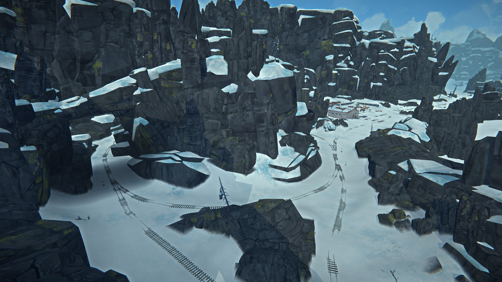
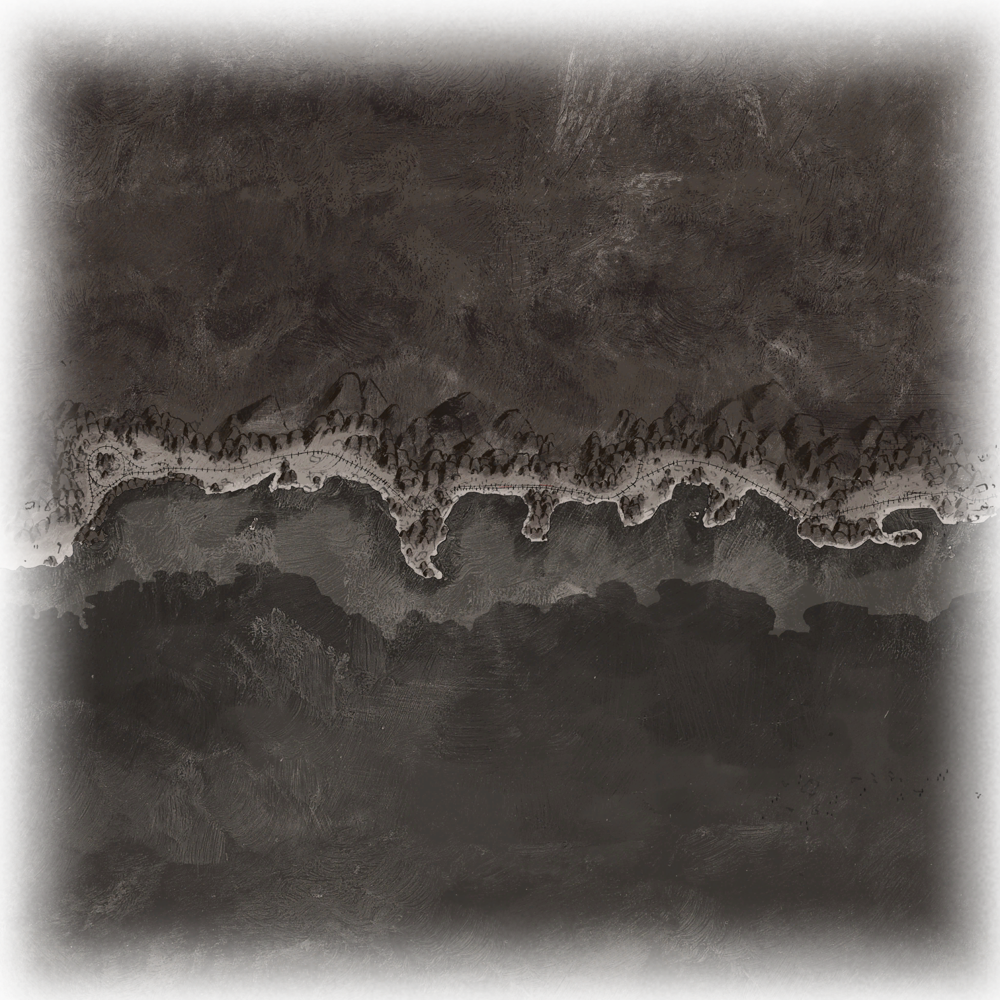
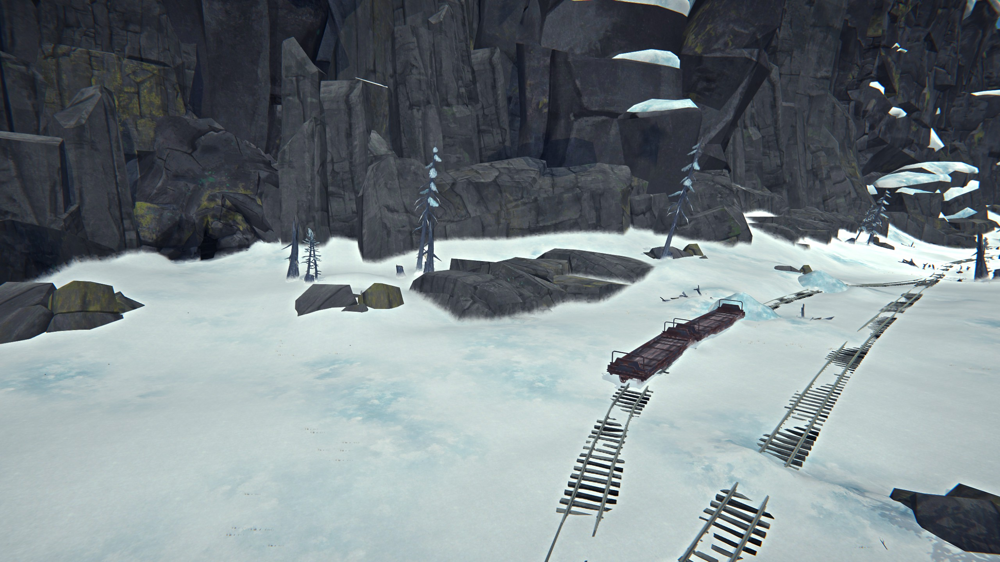
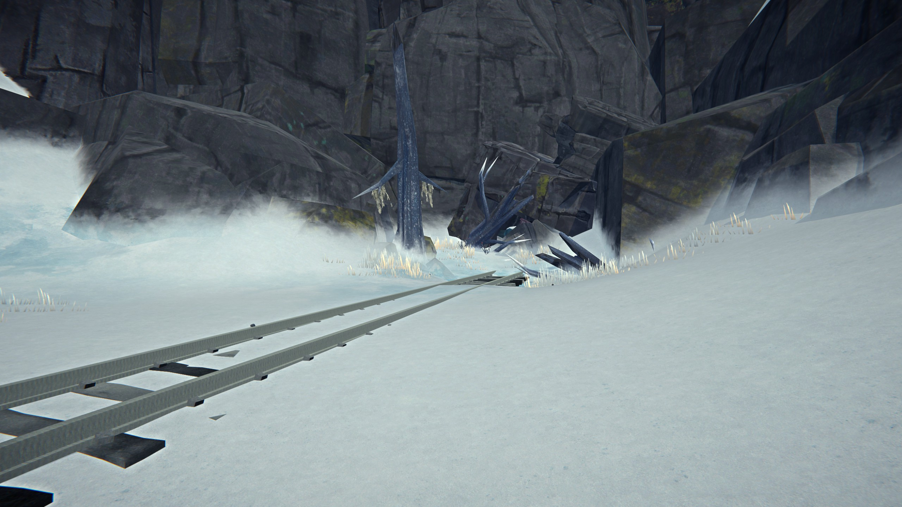
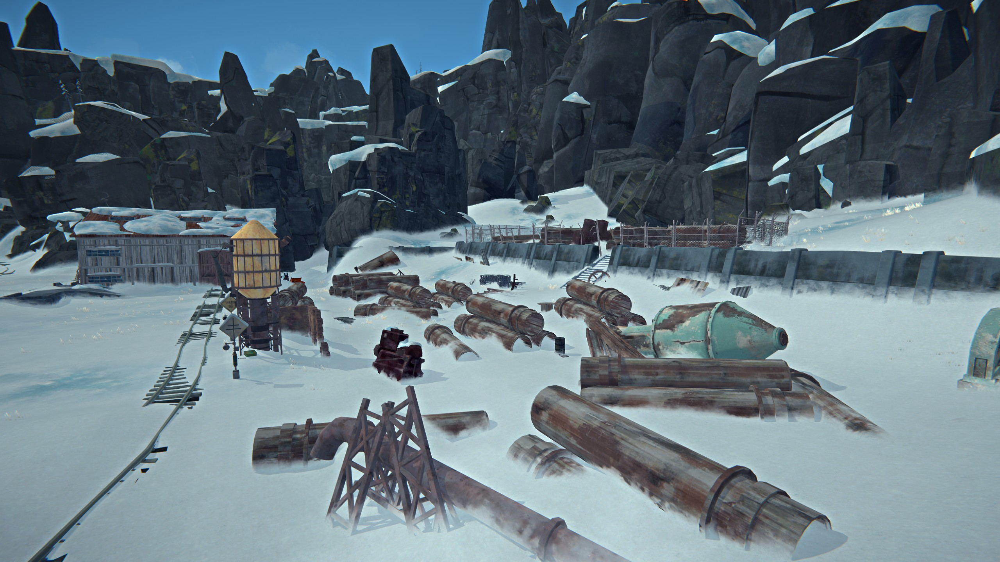

# Anna Island \-\- Track Section 2

**Categories:** DLC Content · **Source:** [Fandom](https://thelongdark.fandom.com/wiki/Anna_Island_--_Track_Section_2)

**Contents**

- [Overview](#overview)
- [Locations](#locations)
- [Wildlife management](#wildlife-management)
- [Survivability](#survivability)
- [Gallery](#gallery)
- [Maps](#maps)
- [Locations](#locations-1)
- [Miscellaneous](#miscellaneous)

| Column 1 | Column 2 | Column 3 | Column 4 |
| --- | --- | --- | --- |

|  / _Track\_Section\_2\_Turn\_Circle.jpg_ |  |  |  |
| **Location on [Cauldron Island](./Cauldron%20Island.md)** |  |  |  |
|  / _No\_picture.png_ |  |  |  |
|  / _Anna\_Island\_Track\_Section\_2\_Map.png_ |  |  |  |
| **Details** |  |  |  |
| Description | A long stretch of coastal railway. |  |  |
| Connecting Regions | [Anna Island -- Track Section 1](./Anna%20Island%20--%20Track%20Section%201.md) [Anna Island -- Track Section 3](./Anna%20Island%20--%20Track%20Section%203.md) |  |  |
| Interloper Region Spawn | No |  |  |
| Date Added | October 27 2026 |  |  |
|  / _**Transition to Track Section 1**_ |  / _**Transition to Track Section 3**_ |  / _**Repair Depot**_ |  / _The turn circle to the west of the region_ |
|  / _Warm cave near the middle-west of the map_ |  / _Cave to the west of the map before the Railyard._ |  / _The inaccessible collapsed tunnel_ |  |
|  / _Railyard west_ |  / _Tunnel West_ |  / _Criss Cross_ |  / _Tunnel East_ |
|  / _Railyard East_ |  |  |  |
|  / _The unmarked Whale Bone Shrine in the middle of the map_ |  |  |  |
