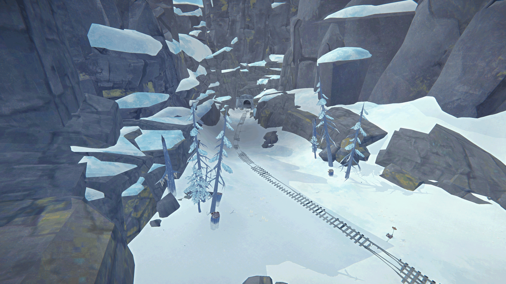
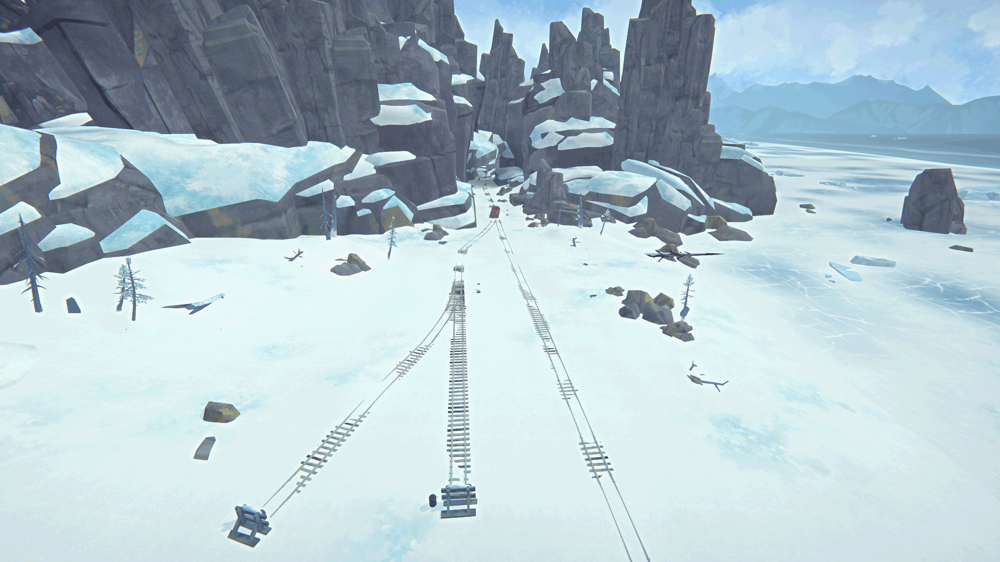
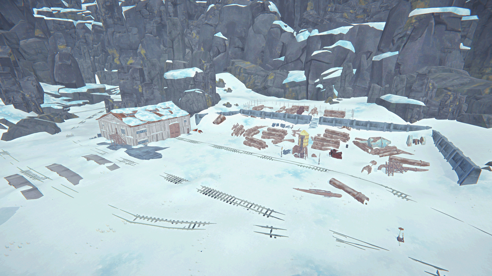

# Anna Island \-\- Track Section 2

**Contents**

- [Overview](#Overview)
- [Locations](#Locations)
- [Wildlife management](#Wildlife_management)
- [Survivability](#Survivability)
- [Gallery](#Gallery)
- [Maps](#Maps)
- [Locations](#Locations_2)
- [Miscellaneous](#Miscellaneous)

<table>
<colgroup>
<col style="width: 33%" />
<col style="width: 33%" />
<col style="width: 33%" />
</colgroup>
<tbody>
<tr>
<td width="40px"><figure>

<figcaption>Seal_icon.png</figcaption>
</figure></td>
<td>
<strong>DLC-Exclusive content.</strong> 

This content requires the <a href="./Iron%20Road.md" class="wikilink" title="Iron Road">Iron Road</a> addon to be installed before it can be seen or used in regular gameplay.

</td>
<td>
|}

<table class="infobox">
<caption>Anna Island -- Track Section 2</caption>
<colgroup>
<col style="width: 50%" />
<col style="width: 50%" />
</colgroup>
<tbody>
<tr>
<td colspan="2"><figure>
[Missing image: Track_Section_2_Turn_Circle.jpg]
<figcaption>Track_Section_2_Turn_Circle.jpg</figcaption>
</figure></td>
</tr>
<tr>
<td colspan="2" class="section">
<strong>Location on <a href="./Cauldron%20Island.md" class="wikilink" title="Cauldron Island">Cauldron Island</a></strong>
</td>
</tr>
<tr>
<td colspan="2"><figure>

<figcaption>No_picture.png</figcaption>
</figure></td>
</tr>
<tr>
<td colspan="2"><figure>

<figcaption>Anna_Island_Track_Section_2_Map.png</figcaption>
</figure></td>
</tr>
<tr>
<td colspan="2" class="section">
<strong>Details</strong>
</td>
</tr>
<tr>
<td>
Description
</td>
<td>
A long stretch of coastal railway.
</td>
</tr>
<tr>
<td>
Connecting Regions
</td>
<td>
<a href="./Anna%20Island%20--%20Track%20Section%201.md" class="wikilink" title="Anna Island -- Track Section 1">Anna Island -- Track Section 1</a> <a href="./Anna%20Island%20--%20Track%20Section%203.md" class="wikilink" title="Anna Island -- Track Section 3">Anna Island -- Track Section 3</a>
</td>
</tr>
<tr>
<td>
Interloper Region Spawn
</td>
<td>
No
</td>
</tr>
<tr>
<td>
Date Added
</td>
<td>
October 27 2026
</td>
</tr>
</tbody>
</table>

<strong>Anna Island -- Track Section 2</strong> is a <a href="./Region.md" class="wikilink" title="Region">Region</a> on <a href="./Cauldron%20Island.md" class="wikilink" title="Cauldron Island">Cauldron Island</a> in <em><a href="./The%20Long%20Dark.md" class="wikilink" title="The Long Dark">The Long Dark</a>.</em>

<h2 id="Overview">Overview</h2>

A continuation of the coastline from the previously numbered region.

<ul>
<li>Anna Island -- Track Section 2 contains a turn circle to the west that allows you to turn the <a href="./Prototype%20Train.md" class="wikilink" title="Prototype Train">Prototype Train</a> around.</li>
<li>The west of the map leads to <a href="./Anna%20Island%20--%20Track%20Section%201.md" class="wikilink" title="Anna Island -- Track Section 1">Anna Island -- Track Section 1</a>, while the east leads to <a href="./Anna%20Island%20--%20Track%20Section%203.md" class="wikilink" title="Anna Island -- Track Section 3">Anna Island -- Track Section 3</a>.</li>
<li>The western section of the map houses a Railyard and a Repair Depot for repairs and refueling. This region's Repair Depot contains the unique <a href="./McLeod%20Ultra-Efficiency%20Whale%20Oil%20Heater.md" class="wikilink" title="McLeod Ultra-Efficiency Whale Oil Heater">McLeod Ultra-Efficiency Whale Oil Heater</a> inside.</li>
<li>There is one <a href="./Water%20Tower.md" class="wikilink" title="Water Tower">Water Tower</a> next to the western Railyard's Repair Depot, and one Water Tower and <a href="./Oil%20Tank.md" class="wikilink" title="Oil Tank">Oil Tank</a> together at the middle railyard near Criss Cross.</li>
<li>Parts of the ocean can be used for <a href="./Ice%20Fishing.md" class="wikilink" title="Ice Fishing">Ice Fishing</a> by creating Free Form Ice Fishing Holes.</li>
</ul>

A small set of tracks goes into a mountain tunnel in this region, but the tunnel there is collapsed. Turning the train around and attempting to ram the tunnel will result in possibly getting the train stuck.

<h2 id="Locations">Locations</h2>

There are 7 named locations within Track Section 2, including:

<ul>
<li>To Anna Island Track Section 1 (Region Transition to <a href="./Anna%20Island%20--%20Track%20Section%201.md" class="wikilink" title="Anna Island -- Track Section 1">Anna Island -- Track Section 1</a>)</li>
<li><a href="./Railyard%20%28Track%20Section%202%29.md" class="wikilink" title="Railyard (Track Section 2)">Railyard (Track Section 2)</a> (east)</li>
<li><a href="./Tunnel.md" class="wikilink" title="Tunnel">Tunnel</a> (east)</li>
<li><a href="./Railyard%20%28Track%20Section%202%29.md" class="wikilink" title="Criss Cross">Criss Cross</a> (center of the map)</li>
<li><a href="./Tunnel.md" class="wikilink" title="Tunnel">Tunnel</a> (west)</li>
<li><a href="./Railyard%20%28Track%20Section%202%29.md" class="wikilink" title="Railyard (Track Section 2)">Railyard (Track Section 2)</a> (west)</li>
<li>To Anna Island Track Section 3 (Region Transition to <a href="./Anna%20Island%20--%20Track%20Section%203.md" class="wikilink" title="Anna Island -- Track Section 3">Anna Island -- Track Section 3</a>)</li>
</ul>

There is also an indoor location that is tracked in the <a href="./Journal.md" class="wikilink" title="Journal">Journal</a>.

<ul>
<li><a href="./Repair%20Depot.md" class="wikilink" title="Repair Depot">Repair Depot</a> - located at the western Railyard</li>
</ul>

Some other notable locations in this region include:

<ul>
<li>2 <a href="./Warm%20Cave.md" class="wikilink" title="Warm Caves">Warm Caves</a> can also be found in the Region:
<ul>
<li>One near just past the Eastern Railyard</li>
<li>One near the Mid-West of the map</li>
</ul></li>
<li>There are 2 unmarked <a href="./Campfire.md" class="wikilink" title="Campfires">Campfires</a> in this region:
<ul>
<li>Past the East Tunnel is a rock formation that goes out to see. Walking across you will find a burned out Campfire, a <a href="./Snow%20Shelter.md" class="wikilink" title="Snow Shelter">Snow Shelter</a>, and 5 <a href="./Green%20Maple%20Sapling.md" class="wikilink" title="Green Maple Sapling">Green Maple Sapling</a>.</li>
<li>The second campfire is in a cave just south of the middle section of Criss Cross, direct center of the map. 2 entrances give way to a rock tunnel, with the campfire located in the middle with some <a href="./Cedar%20Firewood.md" class="wikilink" title="Cedar Firewood">Cedar Firewood</a>, a <a href="./Bedroll.md" class="wikilink" title="Bedroll">Bedroll</a>, and some <a href="./Reclaimed%20Wood.md" class="wikilink" title="Reclaimed Wood">Reclaimed Wood</a>.
<ul>
<li>There is an unmarked <a href="./Whale%20Bone%20Shrine.md" class="wikilink" title="Whale Bone Shrine">Whale Bone Shrine</a> just south of the previous Campfire tunnel, though there is no loot nearby.
<ul>
<li></li>
</ul></li>
</ul></li>
</ul></li>
</ul>
<ul>
<li></li>
</ul>
<h2 id="Wildlife_management">Wildlife management</h2>
<ul>
<li>Some <a href="./Wolf.md" class="wikilink" title="wolves">wolves</a> can be found in several places in the region. Notably, at the Railyards and Criss Cross.</li>
<li>Rabbits can also be found at the eastern Railyard.</li>
</ul>
<h2 id="Survivability">Survivability</h2>
<h2 id="Gallery">Gallery</h2>
<table class="gallery">
<colgroup>
<col style="width: 25%" />
<col style="width: 25%" />
<col style="width: 25%" />
<col style="width: 25%" />
</colgroup>
<tbody>
<tr>
<td><figure>

<figcaption><strong>Transition to Track Section 1</strong></figcaption>
</figure></td>
<td><figure>

<figcaption><strong>Transition to Track Section 3</strong></figcaption>
</figure></td>
<td><figure>

<figcaption><strong>Repair Depot</strong></figcaption>
</figure></td>
<td><figure>
[Missing image: Track_Section_2_Turn_Circle.jpg]
<figcaption>The turn circle to the west of the region</figcaption>
</figure></td>
</tr>
<tr>
<td><figure>
[Missing image: Cave_Track_Section_2.jpg]
<figcaption>Warm cave near the middle-west of the map</figcaption>
</figure></td>
<td><figure>
[Missing image: Cave_2_Track_Section_2.jpg]
<figcaption>Cave to the west of the map before the Railyard.</figcaption>
</figure></td>
<td><figure>
[Missing image: Anna_Island_Track_2_Collapsed_Tunnel.jpg]
<figcaption>The inaccessible collapsed tunnel</figcaption>
</figure></td>
<td></td>
</tr>
</tbody>
</table>
<h3 id="Maps">Maps</h3>
<h3 id="Locations_2">Locations</h3>
<table class="gallery">
<colgroup>
<col style="width: 25%" />
<col style="width: 25%" />
<col style="width: 25%" />
<col style="width: 25%" />
</colgroup>
<tbody>
<tr>
<td><figure>
[Missing image: Track_Section_2_Repair_Depot.jpg]
<figcaption>Railyard west</figcaption>
</figure></td>
<td><figure>
[Missing image: Tunnel_West.jpg]
<figcaption>Tunnel West</figcaption>
</figure></td>
<td><figure>
[Missing image: Criss_Cross.jpg]
<figcaption>Criss Cross</figcaption>
</figure></td>
<td><figure>
[Missing image: Tunnel_East.jpg]
<figcaption>Tunnel East</figcaption>
</figure></td>
</tr>
<tr>
<td><figure>
[Missing image: Railyard_(Track_Section_2_East).jpg]
<figcaption>Railyard East</figcaption>
</figure></td>
<td></td>
<td></td>
<td></td>
</tr>
</tbody>
</table>
<h3 id="Miscellaneous">Miscellaneous</h3>
<table class="gallery">
<colgroup>
<col style="width: 100%" />
</colgroup>
<tbody>
<tr>
<td><figure>
[Missing image: Whale_Bone_Shrine_Track_Section_2.jpg]
<figcaption>The unmarked Whale Bone Shrine in the middle of the map</figcaption>
</figure></td>
</tr>
</tbody>
</table>

<strong>Lua execution error in Module:Navbox function navboxLua execution error in Module:Navbox function navbox</strong> <a href="ru:%D0%9E%D1%81%D1%82%D1%80%D0%BE%D0%B2_%D0%90%D0%BD%D0%BD%D1%8B_%E2%80%94_%D0%A3%D1%87%D0%B0%D1%81%D1%82%D0%BE%D0%BA_%D0%BF%D1%83%D1%82%D0%B8_2" class="wikilink" title="ru:Остров Анны — Участок пути 2">ru:Остров Анны — Участок пути 2</a>
</td>
</tr>
</tbody>
</table>

