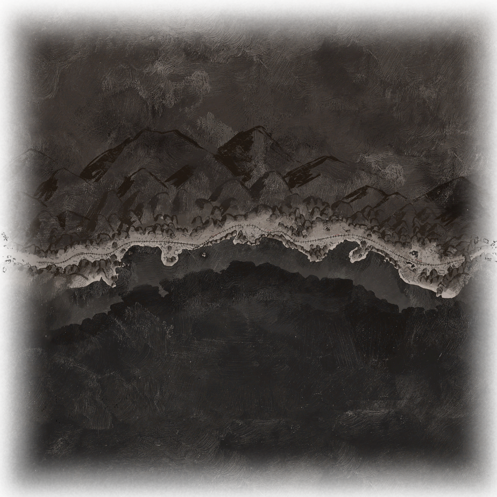

# Anna Island \-\- Track Section 3

**Categories:** DLC Content · **Source:** [Fandom](https://thelongdark.fandom.com/wiki/Anna_Island_--_Track_Section_3)

**Contents**

- [Overview](#overview)
- [Locations](#locations)
- [Wildlife management](#wildlife-management)
- [Survivability](#survivability)
- [Gallery](#gallery)
- [Maps](#maps)
- [Locations](#locations-1)

| Column 1 | Column 2 | Column 3 | Column 4 |
| --- | --- | --- | --- |

|  / _Anna\_Island\_--\_Track\_Section\_3.jpg_ |  |  |  |
| **Location on [Cauldron Island](./Cauldron%20Island.md)** |  |  |  |
|  / _No\_picture.png_ |  |  |  |
|  / _Anna\_Island\_Track\_Section\_3\_Map.png_ |  |  |  |
| **Details** |  |  |  |
| Description | A continuation of coastal railway line. |  |  |
| Connecting Regions | [Anna Island -- Track Section 2](./Anna%20Island%20--%20Track%20Section%202.md) [Anna Island -- Track Section 4](./Anna%20Island%20--%20Track%20Section%204.md) |  |  |
| Interloper Region Spawn | No |  |  |
| Date Added | October 27 2026 |  |  |
|  / _**Transition to Track Section 4**_ |  / _**Transition to Track Section 2**_ |  / _**Railyard**_ |  / _Cove Cabin_ |
|  / _Pond\_(Track\_Section\_3).jpg_ |  |  |  |
