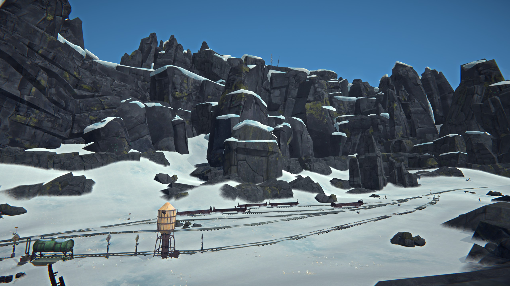

# Anna Island \-\- Track Section 3

**Contents**

- [Overview](#overview)
- [Locations](#locations)
- [Wildlife management](#wildlife-management)
- [Survivability](#survivability)
- [Gallery](#gallery)
- [Maps](#maps)
- [Locations](#locations-1)

| Column 1 | Column 2 | Column 3 | Column 4 |
| --- | --- | --- | --- |
|  / *Seal\_icon.png* | **DLC-Exclusive content.** / This content requires the [Iron Road](./Iron%20Road.md) addon to be installed before it can be seen or used in regular gameplay. | \|} / **Anna Island -- Track Section 3** / \| Property \| Details \| / \| --- \| --- \| / \|  \|  / *Anna\_Island\_--\_Track\_Section\_3.jpg* \| / \| **Location on [Cauldron Island](./Cauldron%20Island.md)** \|  \| / \|  \|  / *No\_picture.png* \| / \|  \|  / *Anna\_Island\_Track\_Section\_3\_Map.png* \| / \| **Details** \|  \| / \| Description \| A continuation of coastal railway line. \| / \| Connecting Regions \| [Anna Island -- Track Section 2](./Anna%20Island%20--%20Track%20Section%202.md) [Anna Island -- Track Section 4](./Anna%20Island%20--%20Track%20Section%204.md) \| / \| Interloper Region Spawn \| No \| / \| Date Added \| October 27 2026 \| / **Anna Island -- Track Section 3** is a [Region](./Region.md) on [Cauldron Island](./Cauldron%20Island.md) in *[The Long Dark](./The%20Long%20Dark.md).* / ## Overview / Another coastal Track Section that runs around Anna Island, this region has only a handful of notable locations. / Certain parts of the ocean support [Ice Fishing](./Ice%20Fishing.md) via Free Form Ice Fishing Holes. / ## Locations / There are 5 named locations within Track Section 3, including: / - [Railyard (Track Section 3)](./Railyard%20%28Track%20Section%203%29.md) / - [Cove (Track Section 3)](./Cove%20%28Track%20Section%203%29.md) / - [Pond (Track Section 3)](./Pond%20%28Track%20Section%203%29.md) / - To Anna Island Track Section 2 (Region Transition to [Anna Island -- Track Section 2](./Anna%20Island%20--%20Track%20Section%202.md)) / - To Anna Island Track Section 4 (Region Transition to [Anna Island -- Track Section 4](./Anna%20Island%20--%20Track%20Section%204.md)) / There is also 1 indoor location that is tracked in the [Journal](./Journal.md). / - A single Cabin at the Cove. / There is one [Whale Oil Tank](./Oil%20Tank.md) and one [Water Tower](./Water%20Tower.md) at the Railyard. / - / ## Wildlife management / A [Bear](./Bear.md) patrols the cave leading up to the Cove cabin. / ## Survivability / ## Gallery / ### Maps / ### Locations / \| Column 1 \| Column 2 \| Column 3 \| Column 4 \| / \| --- \| --- \| --- \| --- \| / \|  / ***Transition to Track Section 4*** \|  / ***Transition to Track Section 2*** \|  / ***Railyard*** \|  / *Cove Cabin* \| / \|  / *Pond\_(Track\_Section\_3).jpg* \|  \|  \|  \| / **Lua execution error in Module:Navbox function navbox****Lua execution error in Module:Navbox function navbox** / [ru:Остров Анны — Участок пути 3](ru:%D0%9E%D1%81%D1%82%D1%80%D0%BE%D0%B2_%D0%90%D0%BD%D0%BD%D1%8B_%E2%80%94_%D0%A3%D1%87%D0%B0%D1%81%D1%82%D0%BE%D0%BA_%D0%BF%D1%83%D1%82%D0%B8_3) |  |
|  / *Anna\_Island\_--\_Track\_Section\_3.jpg* |  |  |  |
| **Location on [Cauldron Island](./Cauldron%20Island.md)** |  |  |  |
|  / *No\_picture.png* |  |  |  |
|  / *Anna\_Island\_Track\_Section\_3\_Map.png* |  |  |  |
| **Details** |  |  |  |
| Description | A continuation of coastal railway line. |  |  |
| Connecting Regions | [Anna Island -- Track Section 2](./Anna%20Island%20--%20Track%20Section%202.md) [Anna Island -- Track Section 4](./Anna%20Island%20--%20Track%20Section%204.md) |  |  |
| Interloper Region Spawn | No |  |  |
| Date Added | October 27 2026 |  |  |
|  / ***Transition to Track Section 4*** |  / ***Transition to Track Section 2*** |  / ***Railyard*** |  / *Cove Cabin* |
|  / *Pond\_(Track\_Section\_3).jpg* |  |  |  |
