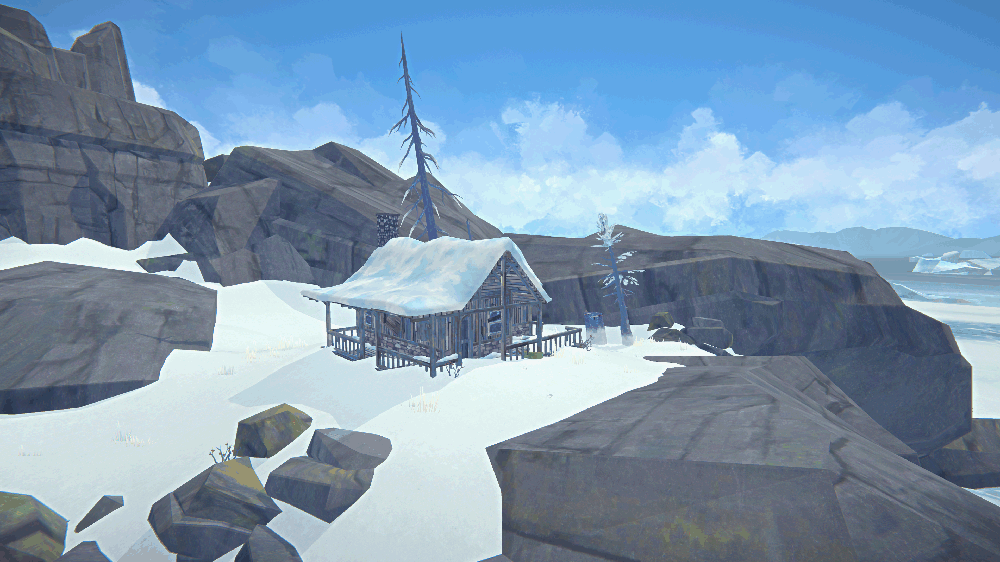

# Anna Island \-\- Track Section 3

**Categories:** DLC Content · **Source:** [Fandom](https://thelongdark.fandom.com/wiki/Anna_Island_--_Track_Section_3)

**Contents**

- [Overview](#overview)
- [Locations](#locations)
- [Wildlife management](#wildlife-management)
- [Survivability](#survivability)
- [Gallery](#gallery)
- [Maps](#maps)
- [Locations](#locations-1)

**DLC-Exclusive content.**

This content requires the [Iron Road](./Iron%20Road.md) addon to be installed before it can be seen or used in regular gameplay.

**Anna Island -- Track Section 3**

[Anna Island Track Section 3](../assets/Anna_Island_--_Track_Section_3.jpg)

**Location on [Cauldron Island](./Cauldron%20Island.md)**

[No picture](../assets/No_picture.png)

[Anna Island Track Section 3 Map](../assets/Anna_Island_Track_Section_3_Map.png)

**Details**

**Description:** A continuation of coastal railway line.

**Connecting Regions:** [Anna Island -- Track Section 2](./Anna%20Island%20--%20Track%20Section%202.md) [Anna Island -- Track Section 4](./Anna%20Island%20--%20Track%20Section%204.md)

**Interloper Region Spawn:** No

**Date Added:** October 27 2026

**Anna Island -- Track Section 3** is a [Region](./Region.md) on [Cauldron Island](./Cauldron%20Island.md) in _[The Long Dark](./The%20Long%20Dark.md)._

## Overview

Another coastal Track Section that runs around Anna Island, this region has only a handful of notable locations.

Certain parts of the ocean support [Ice Fishing](./Ice%20Fishing.md) via Free Form Ice Fishing Holes.

## Locations

There are 5 named locations within Track Section 3, including:

- [Railyard (Track Section 3)](./Railyard%20%28Track%20Section%203%29.md)
- [Cove (Track Section 3)](./Cove%20%28Track%20Section%203%29.md)
- [Pond (Track Section 3)](./Pond%20%28Track%20Section%203%29.md)
- To Anna Island Track Section 2 (Region Transition to [Anna Island -- Track Section 2](./Anna%20Island%20--%20Track%20Section%202.md))
- To Anna Island Track Section 4 (Region Transition to [Anna Island -- Track Section 4](./Anna%20Island%20--%20Track%20Section%204.md))

There is also 1 indoor location that is tracked in the [Journal](./Journal.md).

- A single Cabin at the Cove.

There is one [Whale Oil Tank](./Oil%20Tank.md) and one [Water Tower](./Water%20Tower.md) at the Railyard.

## Wildlife management

A [Bear](./Bear.md) patrols the cave leading up to the Cove cabin.

## Survivability

## Gallery

### Maps

### Locations

_**Transition to Track Section 4**_

_**Transition to Track Section 2**_

_**Railyard**_

