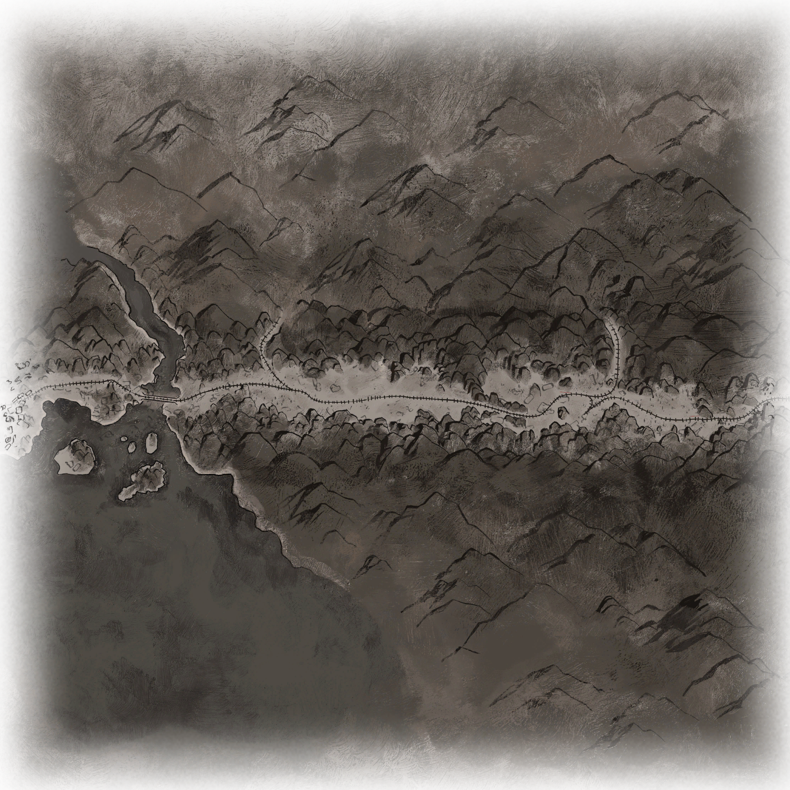
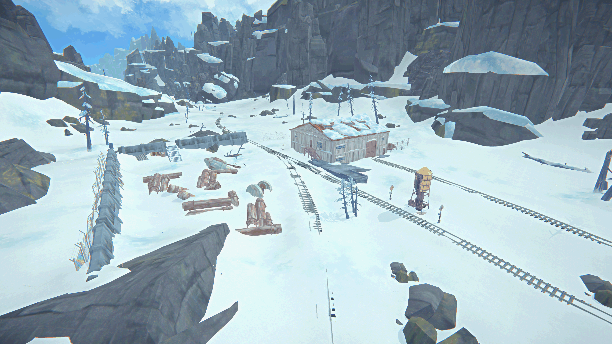

# Anna Island \-\- Track Section 4

**Contents**

- [Overview](#Overview)
- [Locations](#Locations)
- [Wildlife management](#Wildlife_management)
- [Survivability](#Survivability)
- [Safe houses](#Safe_houses)
- [Gallery](#Gallery)
- [Maps](#Maps)
- [Locations](#Locations_2)

<table>
<colgroup>
<col style="width: 33%" />
<col style="width: 33%" />
<col style="width: 33%" />
</colgroup>
<tbody>
<tr>
<td width="40px"><figure>

<figcaption>Seal_icon.png</figcaption>
</figure></td>
<td>
<strong>DLC-Exclusive content.</strong> 

This content requires the <a href="./Iron%20Road.md" class="wikilink" title="Iron Road">Iron Road</a> addon to be installed before it can be seen or used in regular gameplay.

</td>
<td>
|}

<table class="infobox">
<caption>Anna Island -- Track Section 4</caption>
<colgroup>
<col style="width: 50%" />
<col style="width: 50%" />
</colgroup>
<tbody>
<tr>
<td colspan="2"><figure>
[Missing image: Railyard_(Track_Section_4_West).jpg]
<figcaption>Railyard_(Track_Section_4_West).jpg</figcaption>
</figure></td>
</tr>
<tr>
<td colspan="2" class="section">
<strong>Location on <a href="./Cauldron%20Island.md" class="wikilink" title="Cauldron Island">Cauldron Island</a></strong>
</td>
</tr>
<tr>
<td colspan="2"><figure>

<figcaption>No_picture.png</figcaption>
</figure></td>
</tr>
<tr>
<td colspan="2"><figure>

<figcaption>Anna_Island_Track_Section_4_Map.png</figcaption>
</figure></td>
</tr>
<tr>
<td colspan="2" class="section">
<strong>Details</strong>
</td>
</tr>
<tr>
<td>
Description
</td>
<td>
A mountain track region that transitions to the next major island and 3 other Track Sections on Anna Island.
</td>
</tr>
<tr>
<td>
Connecting Regions
</td>
<td>
<a href="./Anna%20Island%20--%20Track%20Section%203.md" class="wikilink" title="Anna Island -- Track Section 3">Anna Island -- Track Section 3</a> <a href="./Anna%20Island%20--%20Track%20Section%205.md" class="wikilink" title="Anna Island -- Track Section 5">Anna Island -- Track Section 5</a> 
<a href="./Anna%20Island%20--%20Track%20Section%206.md" class="wikilink" title="Anna Island -- Track Section 6">Anna Island -- Track Section 6</a> 

</td>
</tr>
<tr>
<td>
Interloper Region Spawn
</td>
<td>
No
</td>
</tr>
<tr>
<td>
Date Added
</td>
<td>
October 27 2026
</td>
</tr>
</tbody>
</table>

<strong>Anna Island -- Track Section 4</strong> is a <a href="./Region.md" class="wikilink" title="Region">Region</a> on <a href="./Cauldron%20Island.md" class="wikilink" title="Cauldron Island">Cauldron Island</a> in <em><a href="./The%20Long%20Dark.md" class="wikilink" title="The Long Dark">The Long Dark</a>.</em>

<h2 id="Overview">Overview</h2>

One of the many coastal rail regions on Anna Island, this Track Region is unique in that it transitions to 4 other regions. This will be the first proper region where the player can use the <a href="./Prototype%20Train.md" class="wikilink" title="Prototype Train">Prototype Train</a>, having just recently acquiring it from Track Section 6.

<ul>
<li>Western most corner leads to a bridge with an Aurora Gate that must be raised during an <a href="./Aurora.md" class="wikilink" title="Aurora">Aurora</a>. Leads to the next major island (early access part not out yet.)</li>
<li>Western North section leads to <a href="./Anna%20Island%20--%20Track%20Section%203.md" class="wikilink" title="Anna Island -- Track Section 3">Anna Island -- Track Section 3</a></li>
<li>Eastern North section leads to <a href="./Anna%20Island%20--%20Track%20Section%206.md" class="wikilink" title="Anna Island -- Track Section 6">Anna Island -- Track Section 6</a></li>
<li>Eastern most corner leads to <a href="./Anna%20Island%20--%20Track%20Section%205.md" class="wikilink" title="Anna Island -- Track Section 5">Anna Island -- Track Section 5</a></li>
</ul>

There is one <a href="./Water%20Tower.md" class="wikilink" title="Water Tower">Water Tower</a> next to the <a href="./Repair%20Depot.md" class="wikilink" title="Repair Depot">Repair Depot</a>, and an <a href="./Oil%20Tank.md" class="wikilink" title="Oil Tank">Oil Tank</a> just outside the Depot walls. The Repair Depot also contains enough supplies to repair the Train, as well as a place to safely rest.

Despite the map showing a set of tracks at the eastern Railyard that the player can use to turn around and head east, these tracks do not exist, and only form a Y out of the Section 6 tunnel. The tracks leading out of the previous region will always take the player west as a result, so the player will have to circle around Anna Island fully to return to <a href="./Port%20Remnant.md" class="wikilink" title="Port Remnant">Port Remnant</a>.

<h2 id="Locations">Locations</h2>

There are 7 named locations within Track Section 4, including:{| class="" style="background-color:transparent; color:inherit; width:100%;"
</td>
</tr>
<tr>
<td><ul>
<li><a href="./Railyard%20%28Track%20Section%204%29.md" class="wikilink" title="Railyard (Track Section 4)">Railyard (Track Section 4)</a> (east)</li>
<li><a href="./Railyard%20%28Track%20Section%204%29.md" class="wikilink" title="Railyard (Track Section 4)">Railyard (Track Section 4)</a> (west)</li>
<li><a href="./Pond%20%28Track%20Section%204%29.md" class="wikilink" title="Pond (Track Section 4)">Pond (Track Section 4)</a></li>
<li><a href="./Canyon.md" class="wikilink" title="Canyon">Canyon</a></li>
</ul></td>
<td data-valign="top" style="width: 50%"><ul>
<li>To Anna Island Track Section 2 (Region Transition to <a href="./Anna%20Island%20--%20Track%20Section%203.md" class="wikilink" title="Anna Island -- Track Section 3">Anna Island -- Track Section 3</a>)</li>
<li>To Anna Island Track Section 2 (Region Transition to <a href="./Anna%20Island%20--%20Track%20Section%205.md" class="wikilink" title="Anna Island -- Track Section 5">Anna Island -- Track Section 5</a>)</li>
<li>To Anna Island Track Section 2 (Region Transition to <a href="./Anna%20Island%20--%20Track%20Section%206.md" class="wikilink" title="Anna Island -- Track Section 6">Anna Island -- Track Section 6</a>)</li>
</ul></td>
<td></td>
</tr>
</tbody>
</table>

{\| class="" style="background-color:transparent; color:inherit; width:100%;" \|- \| \| valign="top" style="width:50%;" \|

\|} There is also 1 indoor location that is tracked in the <a href="./Journal.md" class="wikilink" title="Journal">Journal</a>.

- There is a <a href="./Repair%20Depot.md" class="wikilink" title="Repair Depot">Repair Depot</a> at the western Railyard, just before the Aurora Gate bridge.

<!-- -->

- 

## Wildlife management

Much like the other Track Section regions, wildlife is quite sparse and only appears in a handful of locations.

- <a href="./Rabbit.md" class="wikilink" title="Rabbit">Rabbit</a> can be found.
- <a href="./Deer.md" class="wikilink" title="Deer">Deer</a> can be found by the Repair Depot
- <a href="./Wolf.md" class="wikilink" title="Wolf">Wolf</a> can be found by the Repair Depot

## Survivability

## Safe houses

Key shelters in Port Remnant include: Repair Depot.

## Gallery

<table class="gallery">
<colgroup>
<col style="width: 25%" />
<col style="width: 25%" />
<col style="width: 25%" />
<col style="width: 25%" />
</colgroup>
<tbody>
<tr>
<td><figure>

<figcaption><strong>Transition to Track Section 3</strong></figcaption>
</figure></td>
<td><figure>

<figcaption><strong>Transition to Track Section 5</strong></figcaption>
</figure></td>
<td><figure>

<figcaption><strong>Transition to Track Section 6</strong></figcaption>
</figure></td>
<td><figure>

<figcaption><strong>Aurora Bridge to next Island</strong></figcaption>
</figure></td>
</tr>
<tr>
<td><figure>

<figcaption><strong>Repair Depot</strong></figcaption>
</figure></td>
<td><figure>
[Missing image: Track_Section_6_Tunnel.jpg]
<figcaption>The tunnel leading to Track Section 6 that Alice McLeod rammed through to hide the train.</figcaption>
</figure></td>
<td></td>
<td></td>
</tr>
</tbody>
</table>

### Maps

### Locations

<table class="gallery">
<colgroup>
<col style="width: 25%" />
<col style="width: 25%" />
<col style="width: 25%" />
<col style="width: 25%" />
</colgroup>
<tbody>
<tr>
<td><figure>
[Missing image: Railyard_(Track_Section_4_East).jpg]
<figcaption>Railyard (East)</figcaption>
</figure></td>
<td><figure>
[Missing image: Canyon.jpg]
<figcaption>Canyon</figcaption>
</figure></td>
<td><figure>
[Missing image: Pond_(Track_Section_4).jpg]
<figcaption>Pond</figcaption>
</figure></td>
<td><figure>
[Missing image: Railyard_(Track_Section_4_West).jpg]
<figcaption>Railyard (West) and Repair Depot</figcaption>
</figure></td>
</tr>
</tbody>
</table>

**Lua execution error in Module:Navbox function navboxLua execution error in Module:Navbox function navbox**

<a href="ru:%D0%9E%D1%81%D1%82%D1%80%D0%BE%D0%B2_%D0%90%D0%BD%D0%BD%D1%8B_%E2%80%94_%D0%A3%D1%87%D0%B0%D1%81%D1%82%D0%BE%D0%BA_%D0%BF%D1%83%D1%82%D0%B8_4" class="wikilink" title="ru:Остров Анны — Участок пути 4">ru:Остров Анны — Участок пути 4</a>

