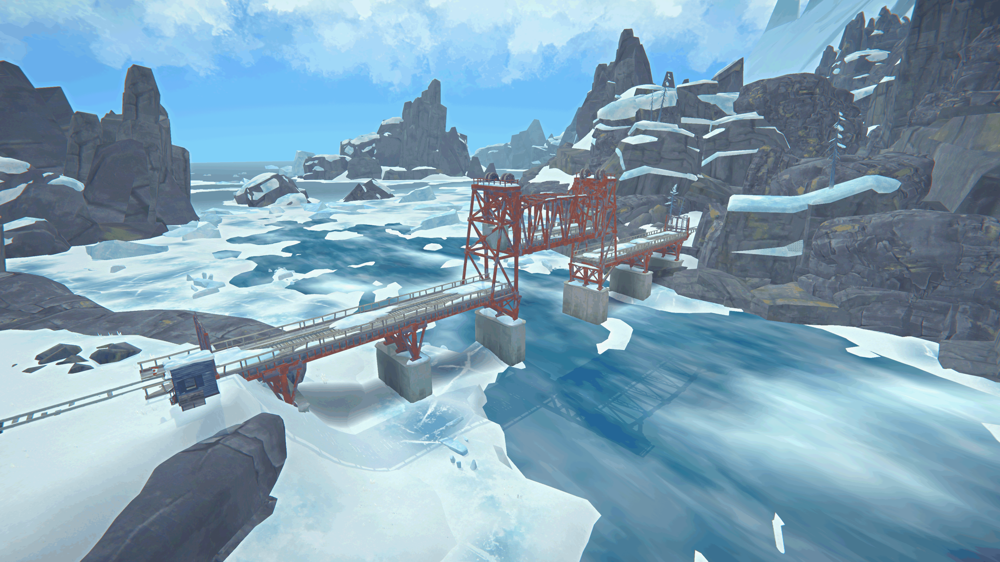

# Anna Island \-\- Track Section 4

**Categories:** DLC Content · **Source:** [Fandom](https://thelongdark.fandom.com/wiki/Anna_Island_--_Track_Section_4)

**Contents**

- [Overview](#overview)
- [Locations](#locations-1)
- [Wildlife management](#wildlife-management)
- [Survivability](#survivability)
- [Safe houses](#safe-houses)
- [Gallery](#gallery)
- [Maps](#maps)
- [Locations](#locations-1)

**DLC-Exclusive content.**

This content requires the [Iron Road](./Iron%20Road.md) addon to be installed before it can be seen or used in regular gameplay.

**Anna Island -- Track Section 4**

[Railyard (Track Section 4 West)](../assets/Railyard_%28Track_Section_4_West%29.jpg)

**Location on [Cauldron Island](./Cauldron%20Island.md)**

[No picture](../assets/No_picture.png)

[Anna Island Track Section 4 Map](../assets/Anna_Island_Track_Section_4_Map.png)

**Details**

**Description:** A mountain track region that transitions to the next major island and 3 other Track Sections on Anna Island.

**Connecting Regions:** [Anna Island -- Track Section 3](./Anna%20Island%20--%20Track%20Section%203.md) [Anna Island -- Track Section 5](./Anna%20Island%20--%20Track%20Section%205.md) [Anna Island -- Track Section 6](./Anna%20Island%20--%20Track%20Section%206.md)

**Interloper Region Spawn:** No

**Date Added:** October 27 2026

**Anna Island -- Track Section 4** is a [Region](./Region.md) on [Cauldron Island](./Cauldron%20Island.md) in _[The Long Dark](./The%20Long%20Dark.md)._

## Overview

One of the many coastal rail regions on Anna Island, this Track Region is unique in that it transitions to 4 other regions. This will be the first proper region where the player can use the [Prototype Train](./Prototype%20Train.md), having just recently acquiring it from Track Section 6.

- Western most corner leads to a bridge with an Aurora Gate that must be raised during an [Aurora](./Aurora.md). Leads to the next major island (early access part not out yet.)
- Western North section leads to [Anna Island -- Track Section 3](./Anna%20Island%20--%20Track%20Section%203.md)
- Eastern North section leads to [Anna Island -- Track Section 6](./Anna%20Island%20--%20Track%20Section%206.md)
- Eastern most corner leads to [Anna Island -- Track Section 5](./Anna%20Island%20--%20Track%20Section%205.md)

There is one [Water Tower](./Water%20Tower.md) next to the [Repair Depot](./Repair%20Depot.md), and an [Oil Tank](./Oil%20Tank.md) just outside the Depot walls. The Repair Depot also contains enough supplies to repair the Train, as well as a place to safely rest.

Despite the map showing a set of tracks at the eastern Railyard that the player can use to turn around and head east, these tracks do not exist, and only form a Y out of the Section 6 tunnel. The tracks leading out of the previous region will always take the player west as a result, so the player will have to circle around Anna Island fully to return to [Port Remnant](./Port%20Remnant.md).

## Locations

There are 7 named locations within Track Section 4, including:

- [Railyard (Track Section 4)](./Railyard%20%28Track%20Section%204%29.md) (east)
- [Railyard (Track Section 4)](./Railyard%20%28Track%20Section%204%29.md) (west)
- [Pond (Track Section 4)](./Pond%20%28Track%20Section%204%29.md)
- [Canyon](./Canyon.md)

- To Anna Island Track Section 2 (Region Transition to [Anna Island -- Track Section 3](./Anna%20Island%20--%20Track%20Section%203.md))
- To Anna Island Track Section 2 (Region Transition to [Anna Island -- Track Section 5](./Anna%20Island%20--%20Track%20Section%205.md))
- To Anna Island Track Section 2 (Region Transition to [Anna Island -- Track Section 6](./Anna%20Island%20--%20Track%20Section%206.md))

 |- | | valign="top" style="width:50%;" |

 There is also 1 indoor location that is tracked in the [Journal](./Journal.md).

- There is a [Repair Depot](./Repair%20Depot.md) at the western Railyard, just before the Aurora Gate bridge.

## Wildlife management

Much like the other Track Section regions, wildlife is quite sparse and only appears in a handful of locations.

- [Rabbit](./Rabbit.md) can be found.
- [Deer](./Deer.md) can be found by the Repair Depot
- [Wolf](./Wolf.md) can be found by the Repair Depot

## Safe houses

Key shelters in Port Remnant include: Repair Depot.

## Gallery

_**Transition to Track Section 3**_

_**Transition to Track Section 5**_

_**Transition to Track Section 6**_

_**Aurora Bridge to next Island**_

_**Repair Depot**_

### Locations

