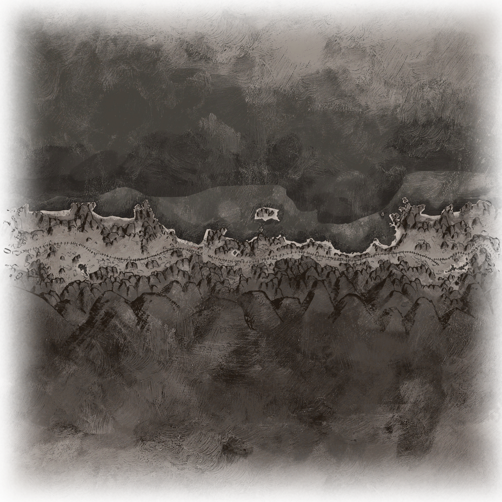
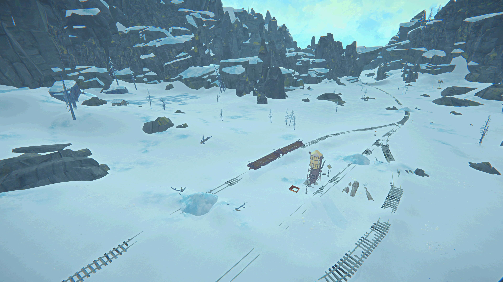

# Anna Island \-\- Track Section 5

**Contents**

- [Overview](#Overview)
- [Locations](#Locations)
- [Wildlife management](#Wildlife_management)
- [Survivability](#Survivability)
- [Gallery](#Gallery)
- [Maps](#Maps)
- [Locations](#Locations_2)

<table>
<colgroup>
<col style="width: 33%" />
<col style="width: 33%" />
<col style="width: 33%" />
</colgroup>
<tbody>
<tr>
<td width="40px"><figure>

<figcaption>Seal_icon.png</figcaption>
</figure></td>
<td>
<strong>DLC-Exclusive content.</strong> 

This content requires the <a href="./Iron%20Road.md" class="wikilink" title="Iron Road">Iron Road</a> addon to be installed before it can be seen or used in regular gameplay.

</td>
<td>
|}

<table class="infobox">
<caption>Anna Island -- Track Section 5</caption>
<colgroup>
<col style="width: 50%" />
<col style="width: 50%" />
</colgroup>
<tbody>
<tr>
<td colspan="2"><figure>
[Missing image: Anna_Island_Track_Section_5.jpg]
<figcaption>Anna_Island_Track_Section_5.jpg</figcaption>
</figure></td>
</tr>
<tr>
<td colspan="2" class="section">
<strong>Location on <a href="./Cauldron%20Island.md" class="wikilink" title="Cauldron Island">Cauldron Island</a></strong>
</td>
</tr>
<tr>
<td colspan="2"><figure>

<figcaption>No_picture.png</figcaption>
</figure></td>
</tr>
<tr>
<td colspan="2"><figure>

<figcaption>Anna_Island_Track_Section_5_Map.png</figcaption>
</figure></td>
</tr>
<tr>
<td colspan="2" class="section">
<strong>Details</strong>
</td>
</tr>
<tr>
<td>
Description
</td>
<td>
A mountainous, linear railway region near Port Remnant
</td>
</tr>
<tr>
<td>
Connecting Regions
</td>
<td>
<a href="./Port%20Remnant.md" class="wikilink" title="Port Remnant">Port Remnant</a> <a href="./Anna%20Island%20--%20Track%20Section%204.md" class="wikilink" title="Anna Island -- Track Section 4">Anna Island -- Track Section 4</a> 
<a href="./Anna%20Island%20--%20Track%20Section%206.md" class="wikilink" title="Anna Island -- Track Section 6">Anna Island -- Track Section 6</a>
</td>
</tr>
<tr>
<td>
Interloper Region Spawn
</td>
<td>
No
</td>
</tr>
<tr>
<td>
Date Added
</td>
<td>
October 27 2026
</td>
</tr>
</tbody>
</table>

<strong>Anna Island -- Track Section 5</strong> is a <a href="./Region.md" class="wikilink" title="Region">Region</a> on <a href="./Cauldron%20Island.md" class="wikilink" title="Cauldron Island">Cauldron Island</a> in <em><a href="./The%20Long%20Dark.md" class="wikilink" title="The Long Dark">The Long Dark</a>.</em>

<h2 id="Overview">Overview</h2>

This is the first of the 6 Track Section regions of Anna Island, and will unfortunately have to be traversed by foot on your first trek through the region. The region is very long, so patience and preparedness are required to traverse it on foot.

A metal gate blocks the path to the most western section of the map, barring access to <a href="./Anna%20Island%20--%20Track%20Section%204.md" class="wikilink" title="Anna Island -- Track Section 4">Anna Island -- Track Section 4</a>. A hidden mountain passage can be accessed via a <a href="./Mountaineering%20Rope.md" class="wikilink" title="Mountaineering Rope">Mountaineering Rope</a> that leads to <a href="./Anna%20Island%20--%20Track%20Section%206.md" class="wikilink" title="Anna Island -- Track Section 6">Anna Island -- Track Section 6</a> (the player is lead there via the <a href="./Map%20%28Train%29.md" class="wikilink" title="Map (Train)">Map (Train)</a> note while following the trail of clues left behind by Alice McLeod), which will lead to the <a href="./Prototype%20Train.md" class="wikilink" title="Prototype Train">Prototype Train</a>.

A single <a href="./Warm%20Cave.md" class="wikilink" title="Warm Cave">Warm Cave</a> is found in the middle of the map to help the Survivor rest while walking through the region, and two Railways can be found to the East and West of the map.

Two unmarked ponds filled with <a href="./Cat%20Tail.md" class="wikilink" title="Cat Tails">Cat Tails</a> and <a href="./Rabbit.md" class="wikilink" title="Rabbits">Rabbits</a> can be found to the most eastern and western Railways of the map, close to the region transitions.

When revisiting the region with the <a href="./Prototype%20Train.md" class="wikilink" title="Prototype Train">Prototype Train</a>, there is one <a href="./Water%20Tower.md" class="wikilink" title="Water Tower">Water Tower</a> by the East Railyard near Transition to <a href="./Port%20Remnant.md" class="wikilink" title="Port Remnant">Port Remnant</a> and one <a href="./Oil%20Tank.md" class="wikilink" title="Whale Oil Tank">Whale Oil Tank</a> by the West Railyard near Transition to <a href="./Anna%20Island%20--%20Track%20Section%204.md" class="wikilink" title="Anna Island -- Track Section 4">Anna Island -- Track Section 4</a> that can be used.

<a href="./Ice%20Fishing.md" class="wikilink" title="Ice Fishing">Ice Fishing</a> is possible in this region by taking the <a href="./Path%20%28Track%20Section%205%29.md" class="wikilink" title="Path (Track Section 5)">Path (Track Section 5)</a> down to the sea.

<h2 id="Locations">Locations</h2>

There are 7 named locations within Track Section 5, including:{| class="" style="background-color:transparent; color:inherit; width:100%;"
</td>
</tr>
<tr>
<td><ul>
<li><a href="./Cave%20%28Track%20Section%205%29.md" class="wikilink" title="Cave (Track Section 5)">Cave (Track Section 5)</a></li>
<li><a href="./Path%20%28Track%20Section%205%29.md" class="wikilink" title="Path (Track Section 5)">Path (Track Section 5)</a></li>
<li><a href="./Railyard%20%28Track%20Section%205%29.md" class="wikilink" title="Railyard (Track Section 5)">Railyard (Track Section 5)</a> (west)</li>
<li><a href="./Railyard%20%28Track%20Section%205%29.md" class="wikilink" title="Railyard (Track Section 5)">Railyard (Track Section 5)</a> (east)</li>
</ul></td>
<td data-valign="top" style="width: 50%"><ul>
<li>To Port Remnant (Region Transition to <a href="./Port%20Remnant.md" class="wikilink" title="Port Remnant">Port Remnant</a>)</li>
<li>To Anna Island Track Section 4 (Region Transition to <a href="./Anna%20Island%20--%20Track%20Section%204.md" class="wikilink" title="Anna Island -- Track Section 4">Anna Island -- Track Section 4</a>)</li>
<li>To Anna Island Track Section 6 (Region Transition to <a href="./Anna%20Island%20--%20Track%20Section%206.md" class="wikilink" title="Anna Island -- Track Section 6">Anna Island -- Track Section 6</a>)</li>
</ul></td>
<td></td>
</tr>
</tbody>
</table>

{\| class="" style="background-color:transparent; color:inherit; width:100%;" \|- \| \| valign="top" style="width:50%;" \|

\|}

## Wildlife management

- <a href="./Deer.md" class="wikilink" title="Deer">Deer</a> and <a href="./Rabbit.md" class="wikilink" title="Rabbit">Rabbit</a> can be found throughout the region.

## Survivability

Your first walkthrough through this area will be an annoying one, as you will not have the train to quickly travel the region. Traveling here at night or during a blizzard can be detrimental because of the lack of shelter, so make sure you are prepared before entering the region. Several animals can be hunted and the Railyard ponds can be foraged if you are lacking in calories.

Returning with the train will make travelling through the region much easier on your second return however, trivializing survivability concerns.

## Gallery

<table class="gallery">
<colgroup>
<col style="width: 25%" />
<col style="width: 25%" />
<col style="width: 25%" />
<col style="width: 25%" />
</colgroup>
<tbody>
<tr>
<td><figure>

<figcaption><strong>Railyard and Cabin</strong></figcaption>
</figure></td>
<td><figure>

<figcaption><strong>Transition Rope to Track Section 6</strong></figcaption>
</figure></td>
<td><figure>

<figcaption><strong>Transition to Port Remnant</strong></figcaption>
</figure></td>
<td><figure>

<figcaption><strong>Transition to Track Section 4</strong></figcaption>
</figure></td>
</tr>
</tbody>
</table>

### Maps

### Locations

<table class="gallery">
<colgroup>
<col style="width: 33%" />
<col style="width: 33%" />
<col style="width: 33%" />
</colgroup>
<tbody>
<tr>
<td><figure>
[Missing image: Railyard_(Track_Section_5_West).jpg]
<figcaption>Railyard west</figcaption>
</figure></td>
<td><figure>
[Missing image: Railyard_(Track_Section_5_East).jpg]
<figcaption>Railyard east</figcaption>
</figure></td>
<td><figure>
[Missing image: Cave_(Track_Section_5).jpg]
<figcaption>Cave middle of region</figcaption>
</figure></td>
</tr>
</tbody>
</table>

**Lua execution error in Module:Navbox function navboxLua execution error in Module:Navbox function navbox**

<a href="ru:%D0%9E%D1%81%D1%82%D1%80%D0%BE%D0%B2_%D0%90%D0%BD%D0%BD%D1%8B_%E2%80%94_%D0%A3%D1%87%D0%B0%D1%81%D1%82%D0%BE%D0%BA_%D0%BF%D1%83%D1%82%D0%B8_5" class="wikilink" title="ru:Остров Анны — Участок пути 5">ru:Остров Анны — Участок пути 5</a>

