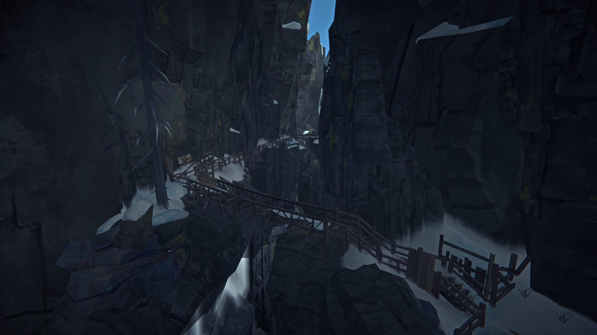
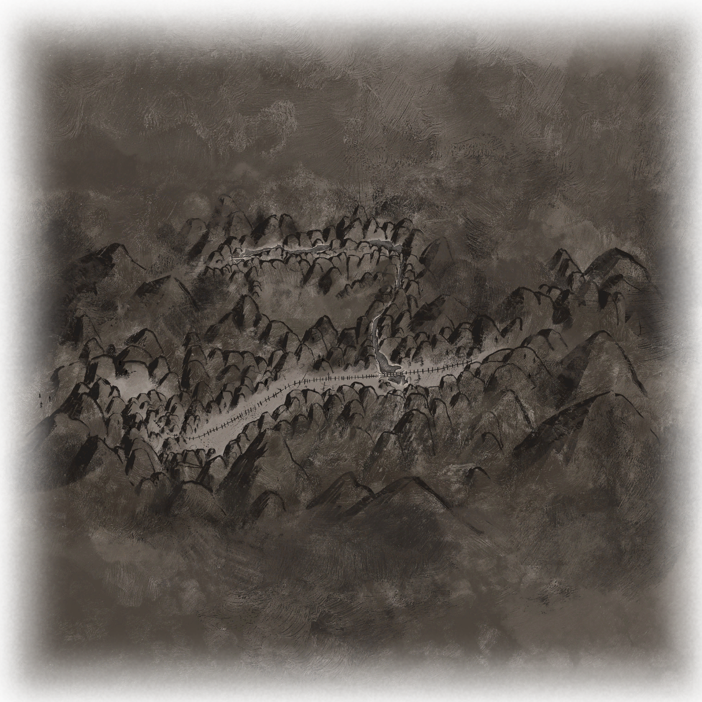

# Anna Island \-\- Track Section 6

**Categories:** DLC Content · **Source:** [Fandom](https://thelongdark.fandom.com/wiki/Anna_Island_--_Track_Section_6)

**Contents**

- [Overview](#overview)
- [Locations](#locations)
- [Wildlife Management](#wildlife-management)
- [Survivability](#survivability)
- [Gallery](#gallery)
- [Maps](#maps)
- [Locations](#locations-1)

**DLC-Exclusive content.** This content requires the [Iron Road](./Iron%20Road.md) addon to be installed before it can be seen or used in regular gameplay.

 **Anna Island -- Track Section 6**  **Location on [Cauldron Island](./Cauldron%20Island.md)**   **Details** **Connecting Regions:** [Anna Island -- Track Section 4](./Anna%20Island%20--%20Track%20Section%204.md) [Anna Island -- Track Section 5](./Anna%20Island%20--%20Track%20Section%205.md) **Interloper Region Spawn:** No **Date Added:** October 27 2026 **Anna Island -- Track Section 6** is a [Region](./Region.md) on [Cauldron Island](./Cauldron%20Island.md) in _[The Long Dark](./The%20Long%20Dark.md)._

## Overview

A mountainous region hidden from the rest of Anna Island, Track Section 6 is initially accessed on foot via a mountain passage from [Anna Island -- Track Section 5](./Anna%20Island%20--%20Track%20Section%205.md), and the rail line leading out of the region goes to [Anna Island -- Track Section 4](./Anna%20Island%20--%20Track%20Section%204.md).

The northern section of the region is a mountainous series of bridges overlooking a deep chasm, similar to the hike to the [High Peak Plateau](./High%20Peak%20Plateau.md) in [Sundered Pass](./Sundered%20Pass.md), eventually breaking way to the site of a rusting orange train trestle. Once the player finally finds the tracks again, a metal gate blocks the path out of the region, forcing you to head west to the Train Shelter where you can find the train and return with it to ram the gates and escape the region.

In the southwestern most section of the map, the [Prototype Train](./Prototype%20Train.md) is hidden here. It is in this region that the _Iron Road_ expansion truly opens up, unlocking the rest of Anna Island now that you can destroy the various metal fences that block exploration around the Island with your newly acquire iron train.

A small detail that can be observed is that when entering Track Section 5, the tunnel leading out shows evidence that it was once bricked up, but was destroyed. [Alice McLeod's Journal 01](./Alice%20McLeod%27s%20Journal%2001.md) mentions that she used the Prototype Train to ram the brick wall and force her way into the region to hide the train at the shelter, before leaving it behind for the next person to pick up her Wax Cylinders.

There is no [Whale Oil Tank](./Oil%20Tank.md) or [Water Tower](./Water%20Tower.md) in this region.

## Locations

There are only 3 named locations within Track Section 6, including:

- [Train Shelter](./Train%20Shelter.md)
- To Anna Island Track Section 4 (Region Transition to [Anna Island -- Track Section 4](./Anna%20Island%20--%20Track%20Section%204.md))
- To Anna Island Track Section 5 (Region Transition to [Anna Island -- Track Section 5](./Anna%20Island%20--%20Track%20Section%205.md))

## Wildlife Management

There are no wildlife in this region.

## Survivability

There is a single bed, [Pot Belly Stove](./Pot%20Belly%20Stove.md), and [Bed](./Bed.md) at the shelter at the Train Shelter, as well as some plants here and there that can be found. The Train Shelter itself has very few resources that can be picked up or harvested. The Train Shelter does not support [Safehouse Customization](./Safehouse%20Customization.md). All in all, there is very little reason to return to this region after acquiring the train.

## Gallery

### Maps

### Locations

