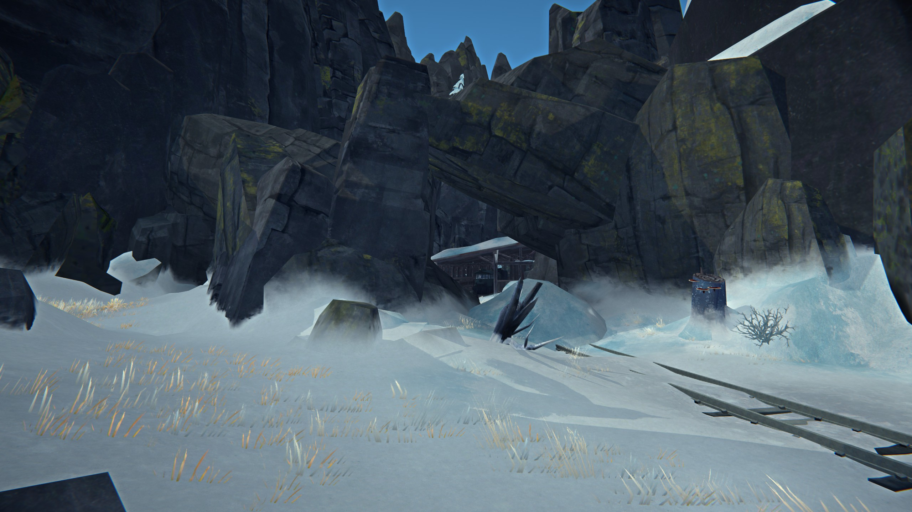
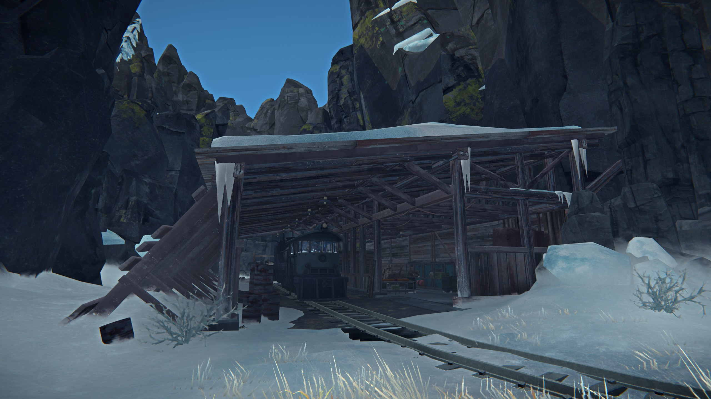
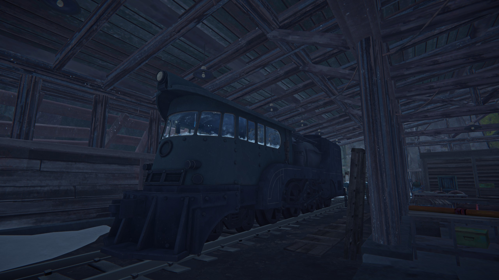
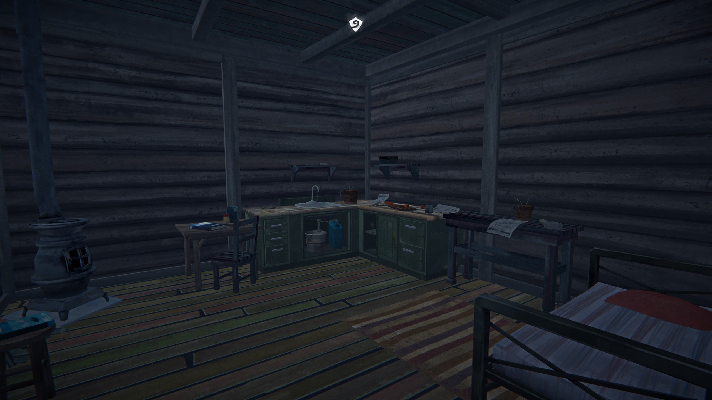
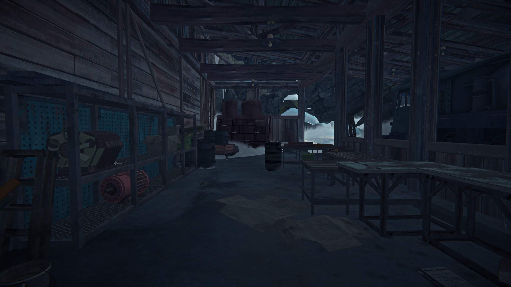
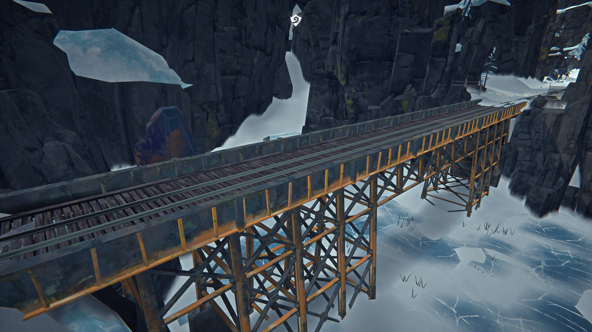
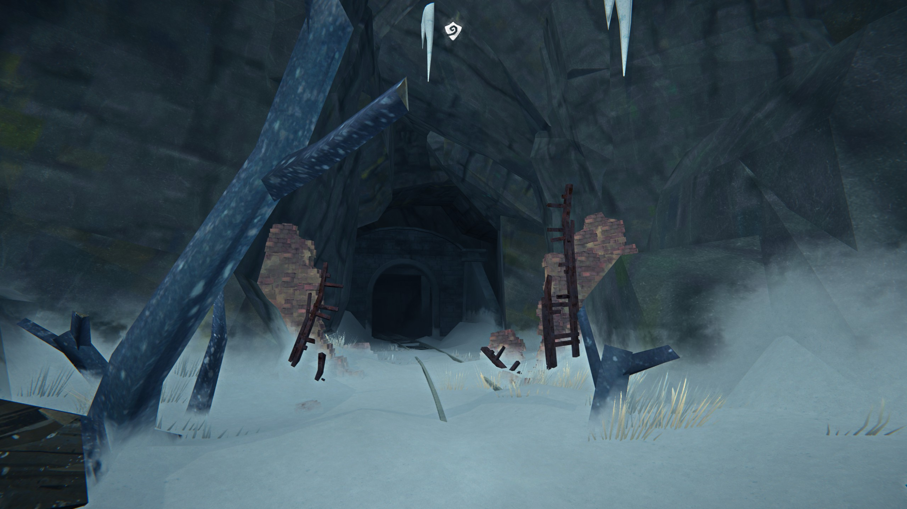

# Anna Island \-\- Track Section 6

**Categories:** DLC Content · **Source:** [Fandom](https://thelongdark.fandom.com/wiki/Anna_Island_--_Track_Section_6)

**Contents**

- [Overview](#overview)
- [Locations](#locations)
- [Wildlife Management](#wildlife-management)
- [Survivability](#survivability)
- [Gallery](#gallery)
- [Maps](#maps)
- [Locations](#locations-1)

| Column 1 | Column 2 | Column 3 | Column 4 |
| --- | --- | --- | --- |

|  / _Anna\_Island\_Track\_Section\_6.jpg_ |  |  |  |
| **Location on [Cauldron Island](./Cauldron%20Island.md)** |  |  |  |
|  / _No\_picture.png_ |  |  |  |
|  / _Anna\_Island\_Track\_Section\_6\_Map.png_ |  |  |  |
| **Details** |  |  |  |
| Connecting Regions | [Anna Island -- Track Section 4](./Anna%20Island%20--%20Track%20Section%204.md) [Anna Island -- Track Section 5](./Anna%20Island%20--%20Track%20Section%205.md) |  |  |
| Interloper Region Spawn | No |  |  |
| Date Added | October 27 2026 |  |  |
|  / _The Train Shelter upon first approach_ |  / _The Train Shelter_ |  / _Finding the Prototype Train in the Shelter_ |  / _The small house inside the Train Shelter_ |
|  / _Train Shelter interior_ |  / _The Trestle leading out of the region._ |  / _The tunnel leading out of the region as observed in the Track Section 5 region_ |  |
