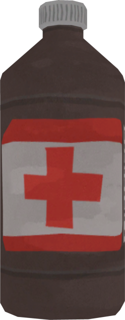

# Antiseptic

**Contents**

- [Overview](#Overview)
- [Use](#Use)
- [Treatment](#Treatment)
- [Gallery](#Gallery)

<table class="infobox">
<caption>Antiseptic</caption>
<colgroup>
<col style="width: 50%" />
<col style="width: 50%" />
</colgroup>
<tbody>
<tr>
<td colspan="2"><figure>

<figcaption>Antiseptic_icon.png</figcaption>
</figure></td>
</tr>
<tr>
<td>
Release
</td>
<td>
<a href="./The%20Long%20Dark%20%E2%80%94%20Changelog.md#0.094" class="wikilink" title="22 August 2014">22 August 2014</a>
</td>
</tr>
<tr>
<td>
Wintermute
</td>
<td>
yes
</td>
</tr>
<tr>
<td colspan="2" class="section">
<strong>Properties</strong>
</td>
</tr>
<tr>
<td>
Item type
</td>
<td>
<a href="./First%20Aid.md" class="wikilink" title="First Aid">First Aid</a>|-
</td>
</tr>
<tr>
<td>
Stackable
</td>
<td>
no
</td>
</tr>
<tr>
<td>
Examine
</td>
<td>
A bottle of Hydrogen Peroxide. Useful for cleaning wounds.
</td>
</tr>
<tr>
<td colspan="2" class="section">
<strong>Values</strong>
</td>
</tr>
<tr>
<td>
Weight
</td>
<td>
0.70 kg (1.54 lbs)
</td>
</tr>
<tr>
<td colspan="2" class="section">
<strong>Decay Rate</strong>
</td>
</tr>
<tr>
<td>
Inside
</td>
<td>
0% per day
</td>
</tr>
<tr>
<td>
Outside
</td>
<td>
0% per day
</td>
</tr>
<tr>
<td colspan="2" class="section">
<strong>Actions</strong>
</td>
</tr>
<tr>
<td>
On ground
</td>
<td>
Take It, Leave It
</td>
</tr>
<tr>
<td colspan="2" class="section">
<strong>Advanced data</strong>
</td>
</tr>
<tr>
<td>
Item key
</td>
<td>
GAMEPLAY_Bandage
</td>
</tr>
</tbody>
</table>

<table>
<colgroup>
<col style="width: 33%" />
<col style="width: 33%" />
<col style="width: 33%" />
</colgroup>
<tbody>
<tr>
<td style="vertical-align: top; font-size: 3em; color: #5d5980; padding-right: 10px">
“
</td>
<td>
A bottle of Hydrogen Peroxide. Useful for cleaning wounds.

&#10;

In-game description

</td>
<td style="vertical-align: bottom; font-size: 3em; color: #5d5980; padding-left: 10px">
”
</td>
</tr>
</tbody>
</table>

**Antiseptic** is a <a href="./First%20Aid.md" class="wikilink" title="First Aid">First Aid</a> item used to remove <a href="./Infection%20Risk.md" class="wikilink" title="Infection Risk">Infection Risk</a> gained from hostile <a href="./Wildlife.md" class="wikilink" title="Wildlife">Wildlife</a> attacks.

## Overview

Antiseptic bottles are most commonly found in <a href="./First%20Aid%20Kit.md" class="wikilink" title="First Aid Kits">First Aid Kits</a> and <a href="./Medicine%20Shelf.md" class="wikilink" title="Medicine Shelves">Medicine Shelves</a>, although there is a slight chance for them to be collected from most containers. They may also be found out in the open (e.g., on shelves).

A full bottle contains around 0.50 L of fluid, which is enough for 5 treatments of Infection Risk associated with <a href="./Blood%20Loss.md" class="wikilink" title="Blood Loss">Blood Loss</a> from Predator <a href="./Struggle.md" class="wikilink" title="Struggles">Struggles</a>.

## Use

Antiseptic is usable through either the <a href="./Radial%20Menu.md" class="wikilink" title="Radial Menu">Radial Menu</a> First Aid tab or the inventory, but only when an Infection Risk Affliction is present.

- <a href="./Old%20Man%27s%20Beard%20Wound%20Dressing.md" class="wikilink" title="Old Man&#39;s Beard Wound Dressing">Old Man's Beard Wound Dressing</a> is an alternative to antiseptic.
- Infection risk takes a few hours to progress to actual <a href="./Infection.md" class="wikilink" title="Infection">Infection</a>.

## Treatment

Antiseptic can be used to treat the following afflictions:

|  | Affliction |
|----|----|
| **Template:iconlink plain** | <a href="./Infection%20Risk.md" class="wikilink" title="Infection Risk">Infection Risk</a> |

## Gallery

<table class="gallery">
<colgroup>
<col style="width: 100%" />
</colgroup>
<tbody>
<tr>
<td><figure>

<figcaption>old model</figcaption>
</figure></td>
</tr>
</tbody>
</table>

**Lua execution error in Module:Navbox function navbox**

<a href="ru:%D0%90%D0%BD%D1%82%D0%B8%D1%81%D0%B5%D0%BF%D1%82%D0%B8%D0%BA" class="wikilink" title="ru:Антисептик">ru:Антисептик</a> <a href="fr:Antiseptique" class="wikilink" title="fr:Antiseptique">fr:Antiseptique</a>

