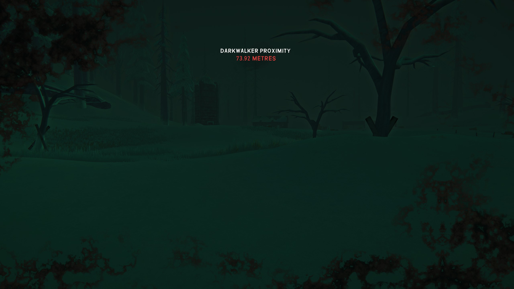

# Anxiety

**Contents**

- [Overview](#overview)
- [Darkwalker Distance:](#darkwalker-distance)
- [Player Quotes](#player-quotes)
- [Trivia](#trivia)

**Anxiety**

| Property | Details |
| --- | --- |
|  |  / *Anxiety\_icon.png* |
| Release | [29 Oct 2020](./The%20Long%20Dark%20%E2%80%94%20Changelog.md#1.86) |
| Update | 1.86 |
| **Properties** |  |
| Category | [Afflictions](./Afflictions.md) |
| Caused By | Being within 200-51m from the Darkwalker |
| Effect | Negative |
| Type | Risk |
| Affliction Duration | Until Treated |
| **Treatment** |  |
| Treatment | Move more than 200m away from the Darkwalker |
| Recovery Time | Instant |

> “**If this is a nightmare, I wanna wake up!**”

**Anxiety** is an [Affliction](./Afflictions.md) found within *[The Long Dark](./The%20Long%20Dark.md)*. It is one of two unique Afflictions found only within the [Escape the Darkwalker](./Escape%20the%20Darkwalker.md) [Challenge](./Challenge.md).

## Overview

If the survivor is within 200m (~656 feet) of the Darkwalker they will be afflicted with Anxiety, accompanied by a unique audio cue and dialogue. A message box will appear in the middle of the screen, detailing the distance between the survivor and the Darkwalker. While afflicted with Anxiety actions which accelerate time (Sleep, Pass Time, Craft, Sharpen, Clean, Harvest, Research, etc.) are impossible. If the survivor was asleep when the Darkwalker approached, it will automatically wake them. The closer the the survivor moves toward the Darkwalker, the more bloody the visual effect will appear.

###### Darkwalker Distance:

- 200m or greater: Anxiety is removed.
- Less than 200m: survivor is afflicted with Anxiety (unable to sleep/pass time/craft/use [Research Books](./Research%20Book.md)).
- 50m (~164 feet): Anxiety is replaced with [Fear](./Fear.md) (rapid Condition drain).
- 5m: the Darkwalker catches the survivor (instant death).

## Player Quotes

- "That's not an animal..."
- "If this is a nightmare, I wanna wake up!"
- "What is that...?"
- "No...No...!"
- "This is like something out of a horror movie"
- "(Panicked) I gotta get outta here!"

## Trivia

- Anxiety is the only Affliction Risk that has a negative effect. Usually the Risk must develop into an Affliction before negative effects ensue.
- Despite anxiety being a psychological state of mind, The Long Dark categorizes it as an injury.
- Anxiety's audio cue is a loud piano cord being struck.

*The screen bloodies as the the Darkwalker draws closer...* **Lua execution error in Module:Navbox function navbox**
